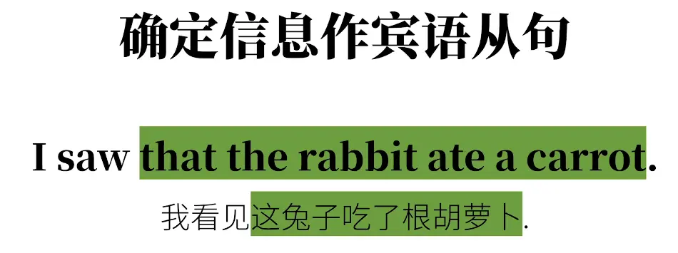
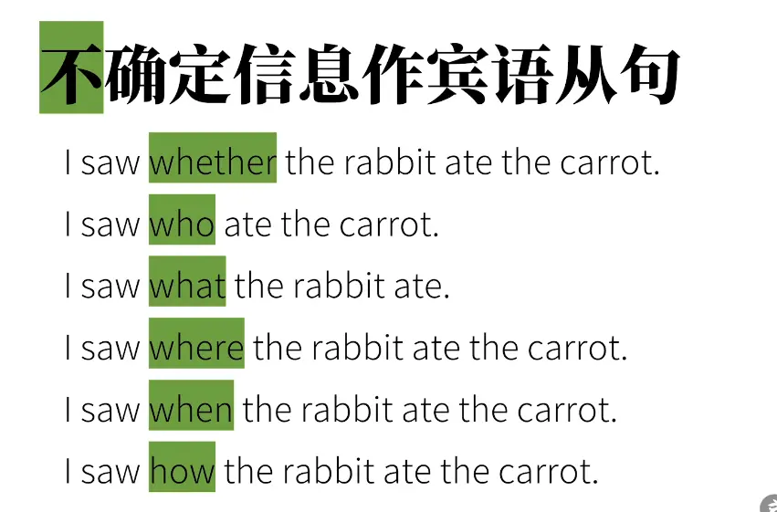
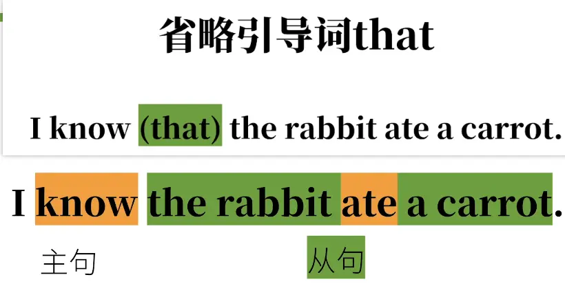
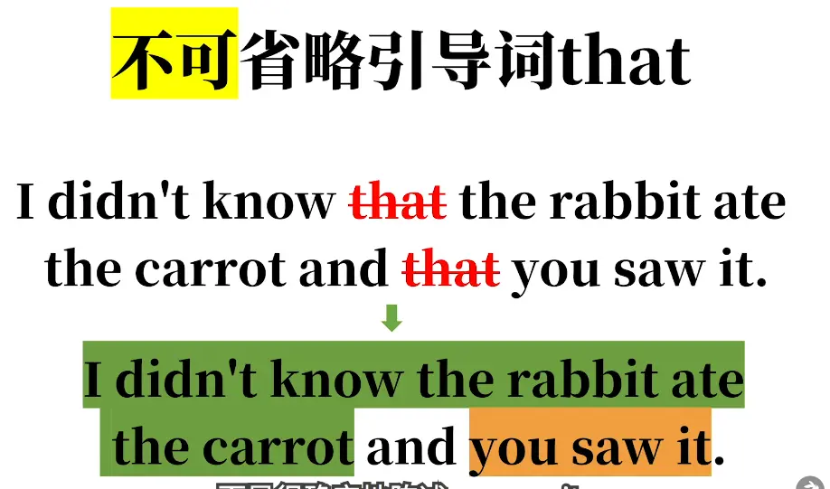

  

  

# 引导词是 that 的省略情况 

  

1. **I didn't know that the rabbit ate the carrot and that you saw it.** 翻译：我不知道兔子吃了胡萝卜，**也不知道**你看见了这件事。 （两件事都是我不知道的）
2. **I didn't know the rabbit ate the carrot and you saw it.** 翻译①（原意）：我不知道兔子吃了胡萝卜，也不知道你看见了这件事。 翻译②（容易产生的歧义理解）：我不知道兔子吃了胡萝卜，**而**你看见了这件事。 （变成两件独立的事：我不知情，你看见了）

> it 指代“兔子吃掉胡萝卜”这件事。