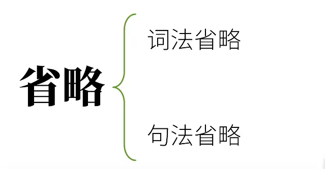  

# 词法省略  

## 唯一职业
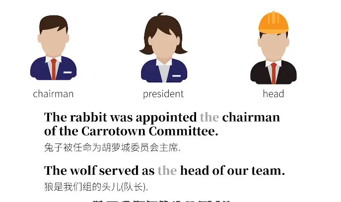  
就一个职业  

## 冠词重复
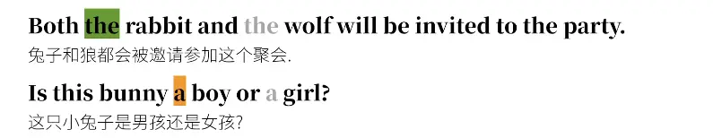  

  
## 独立主格
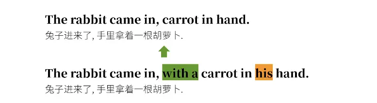  

## 时间介词  

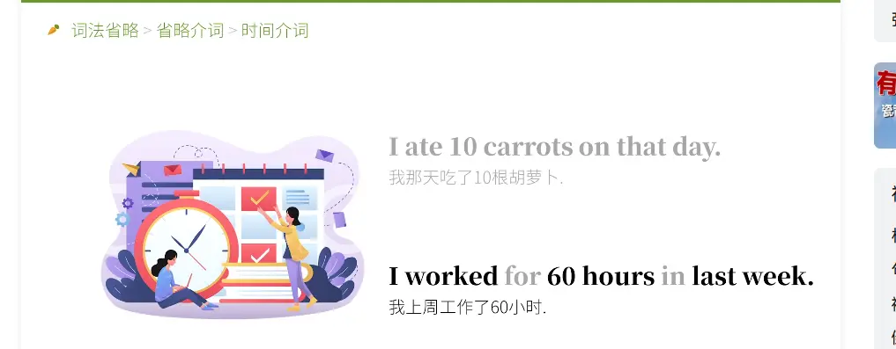  

## 做某事  

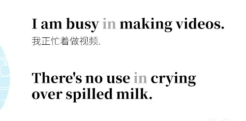  

## 并列关系  

省略 to  

不定时省略  
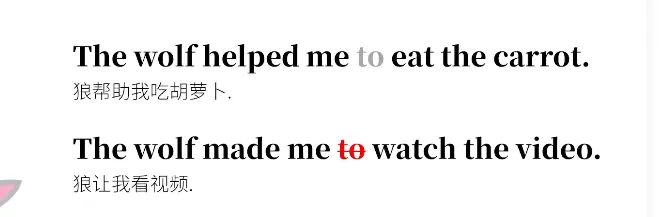

## 定语从句  

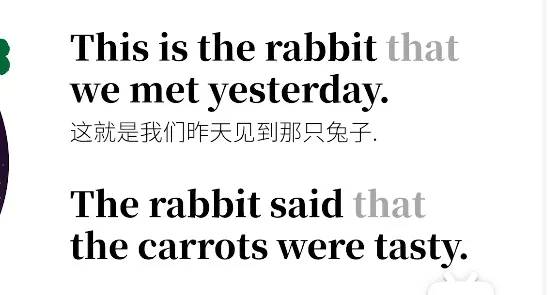

# 词法省略  

## 祈使句  
  

## 感叹句  

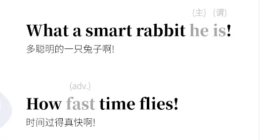  

##   回答

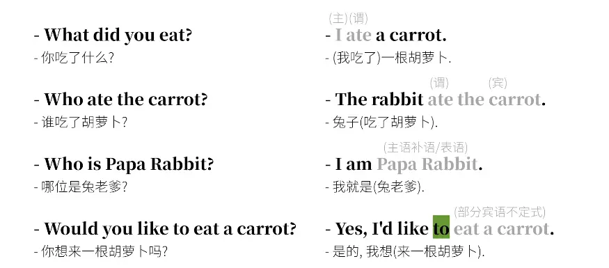  

## 并列省略  

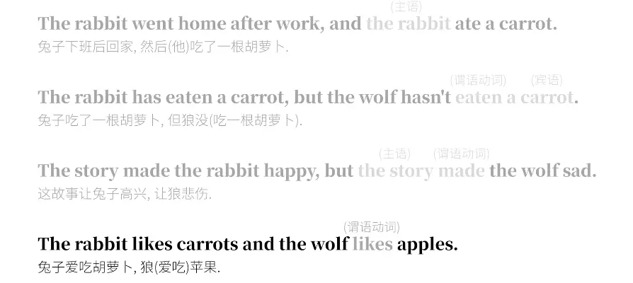  

## 复杂句
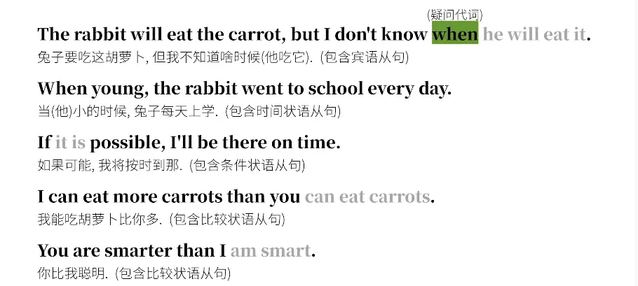  

## 主句为 我  

