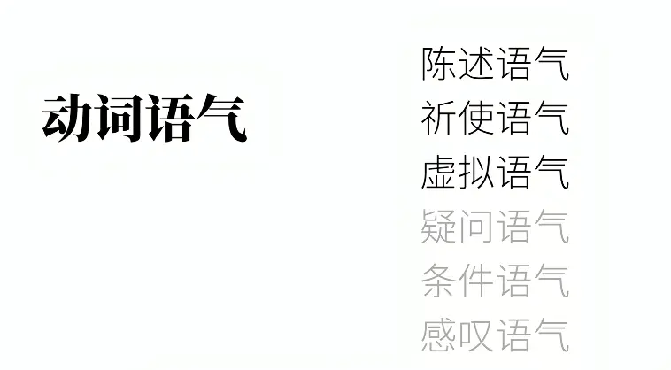  

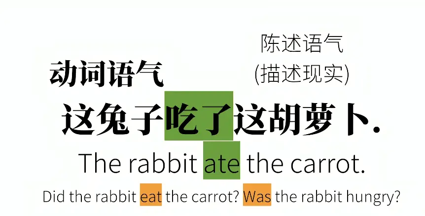  

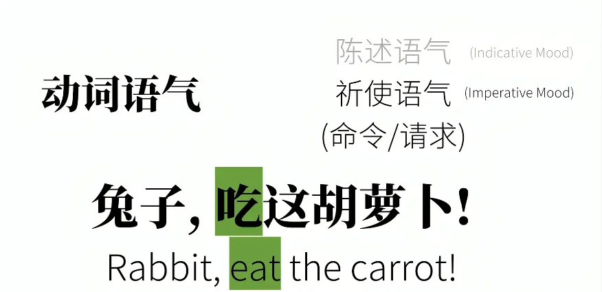  

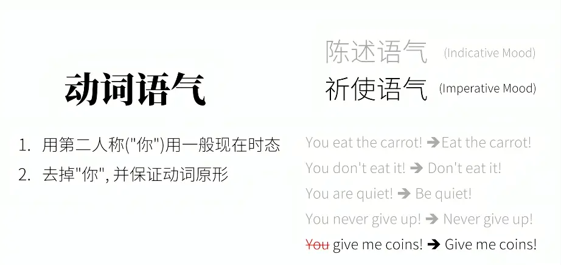  

# 虚拟语气 1 表示不可能（与事实相反的假设）

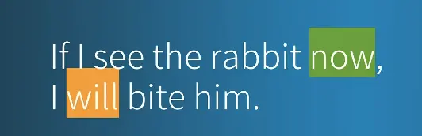  
错误的

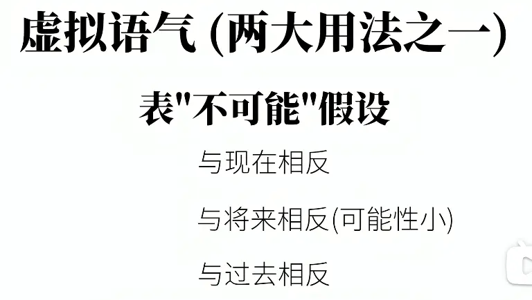

# 虚拟语气（if 引导的非真实条件句）

核心：**描述假设、不可能发生、和事实相反的情况，不是真实发生的事**，分 3 种时间场景。

> 口诀：**if 从句往前推时态，主句用 would/could/might+动词**  

## 1️⃣ 与**现在**事实相反（第一张图例句）

> If I saw the rabbit now, I would bite him. 如果我现在看见这只兔子，我就咬他。 ✅ 真实情况：**我现在并没有看见兔子**

- if 从句：动词用**过去式**（saw，不是过去时间！只是虚拟标记，be 动词统一用 were）
- 主句：**would + 动词原形**

公式：`If + 主语 + 过去式, 主语 + would do`
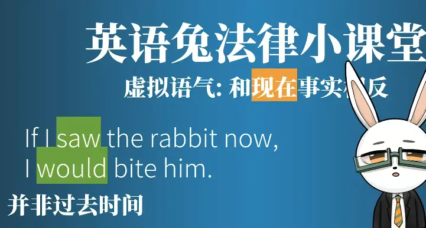  

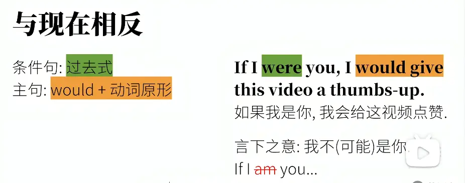

## 2️⃣ 与**将来**事实相反（将来发生可能性极小）

> If I should see the rabbit tomorrow, I would bite him. 如果我明天居然见到这只兔子，我就咬他。 ✅ 真实情况：**明天基本不可能见到兔子**

- if 从句：`should + 动词原形`（还可以用过去式 / were to do）
- 主句：**would + 动词原形**

公式：`If + 主语 + should do, 主语 + would do`
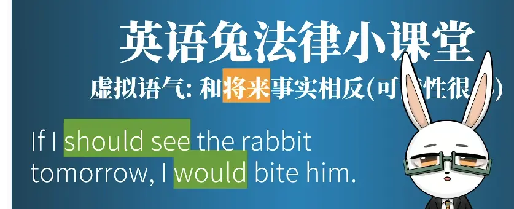  

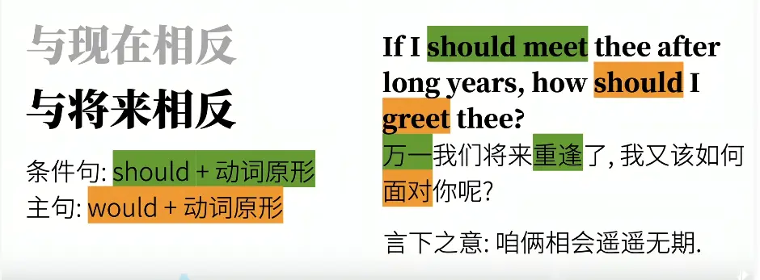
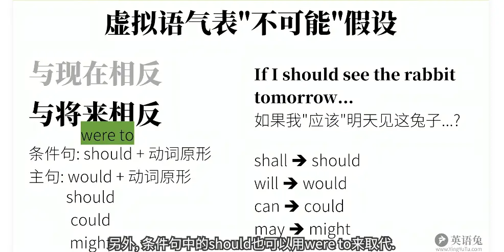
这里不是应该 构成将来时态   用 will 和 shall  
构成

## 3️⃣ 与**过去**事实相反

> If I had seen the rabbit a few days ago, I would have bitten him. 如果几天前我见到了这只兔子，我当时就咬他了。 ✅ 真实情况：**几天前我并没有见到兔子，事情已经过去了，没法重来**

- if 从句：**had + 过去分词（had seen）**
- 主句：**would have + 过去分词（would have bitten）**

公式：`If + 主语 + had done, 主语 + would have done`  
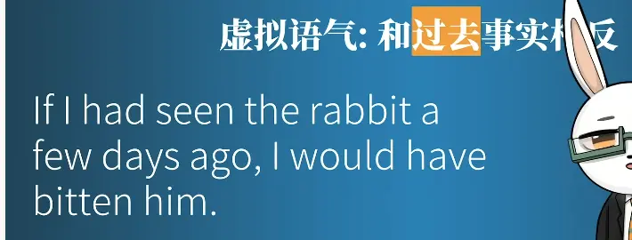  

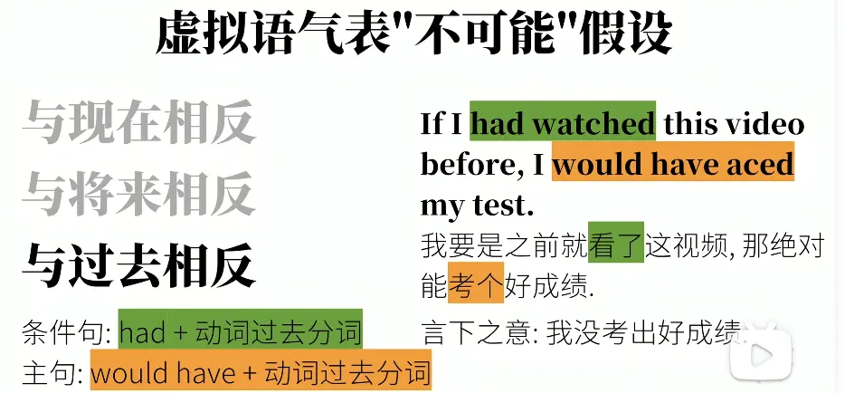
---

# 一张汇总表
不管什么人称都是使用 were

|虚拟类型|if 从句时态|主句时态|
|---|---|---|
|与现在相反|过去式（be→were）|would do|
|与将来相反（可能性很小）|should do / were to do / 过去式|would do|
|与过去相反|had done|would have done|

### 重点易错提醒

1. 虚拟里的**过去式≠过去时间**！ 像第一句 `saw` 不是说“过去看到”，只是标记：**现在这件事是假的**。
2. 主句除了 `would`，还可以用 `could(能够)/might(也许)`，含义略有差别。

# 虚拟语气表希望  愿望 请求 建议 命令
##  对现在的希望
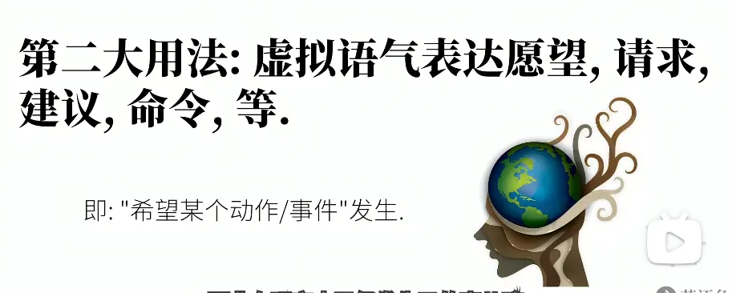  

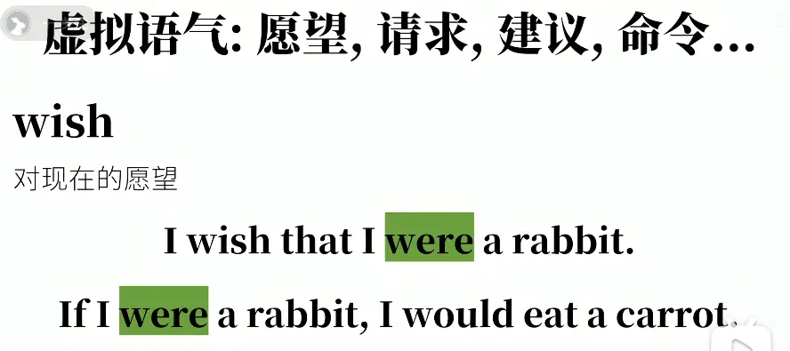  

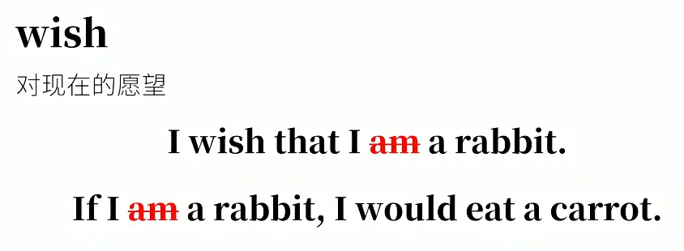  称述语句为什么要希望呢  

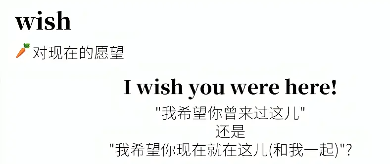  答案：**我希望你现在就在这儿（和我一起）**

`I wish you were here!`

> 这是 **wish 引导的虚拟语气，与【现在事实相反】**

##  对过去的希望  

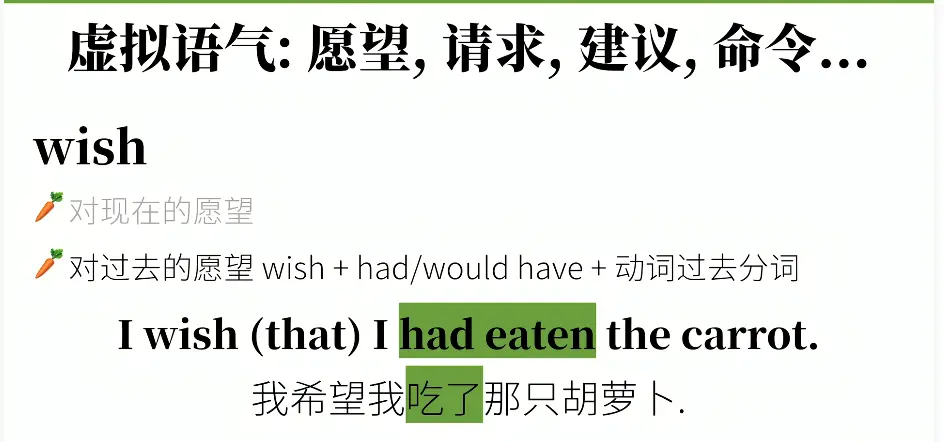

##  对将来的希望  

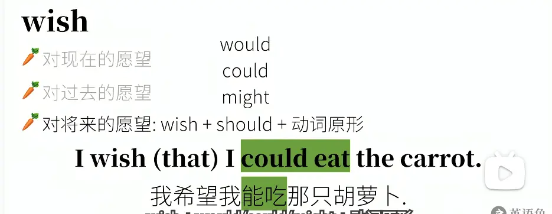

##  不止有 wish  
hope  也可以 还有  

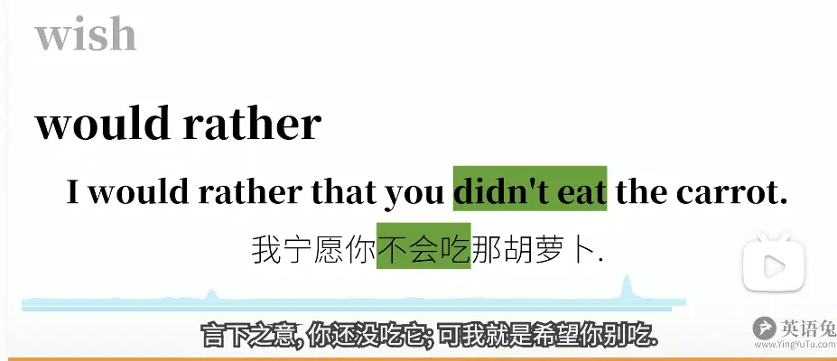

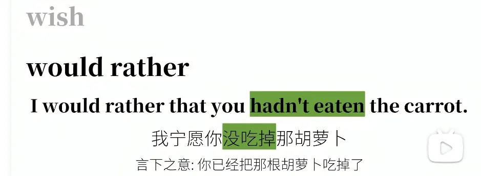

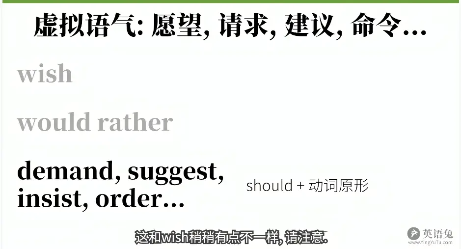

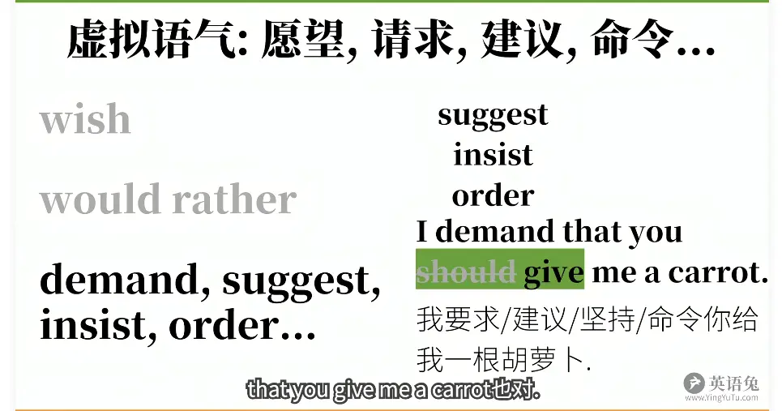

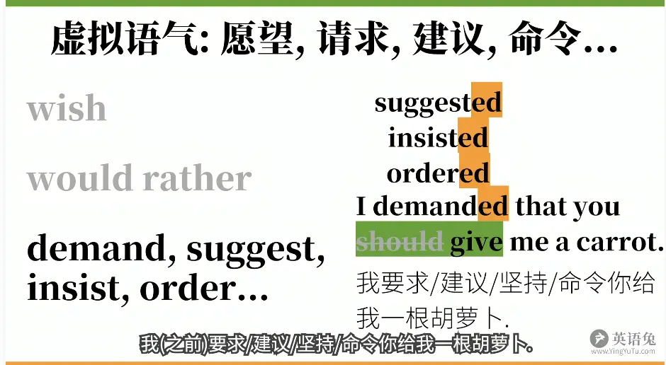

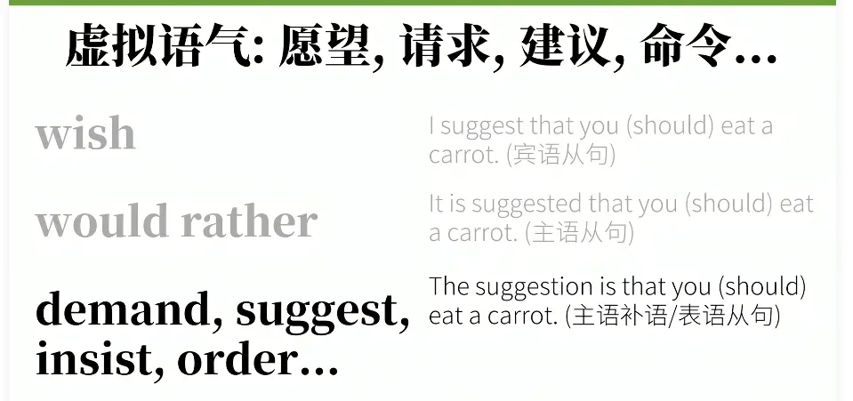

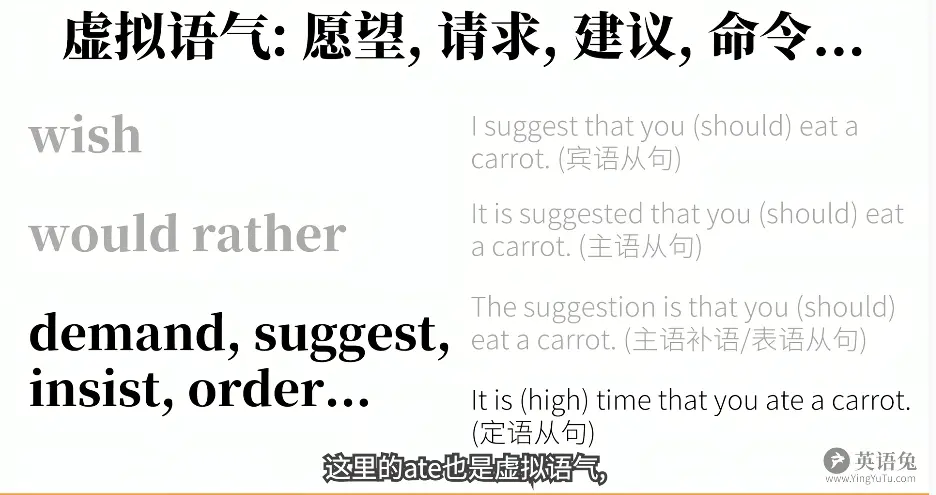

# ✅ 答案：**我希望你现在就在这儿（和我一起）**

`I wish you were here!`

> 这是 **wish 引导的虚拟语气，与【现在事实相反】**

## 语法拆解（和刚才 if 虚拟是一套体系）

wish 后面从句时态规则：

1. **从句用一般过去式（were） → 对【现在】虚拟** 事实：**你现在并不在这里**，我只是愿望。 ✅ I wish you **were** here. 但愿你此刻就在这里。
    
    > 注意：虚拟语气里，不管主语是谁，be 动词统一用 **were**（正式语法；口语偶尔用 was）
    
2. 如果想表达 **“我希望你曾来过这儿（对过去虚拟）”** 从句要用 **had been**： ✅ I wish you **had been** here. 含义：真希望你当时来过这里（但你那时候没来，是过去的遗憾）

## 对比记忆（wish 虚拟 3 种情况）

|句子|时态|含义|真实情况|
|---|---|---|---|
|I wish you **were** here|过去式|但愿你**现在**在这|你现在不在|
|I wish you **had been** here|had done|但愿你**当时/过去**来过|你过去没来|
|I wish you **would come** here|would do|但愿你**将来**能来（表期盼）|你未来大概率不会来|

### 一句话考点

wish 从句里：**过去式 = 现在的假想；had done = 过去的假想**，不要把 were 当成过去发生！ 和前面 `If I saw…` 同一个逻辑：**虚拟里的过去式，不一定代表过去时间，只是表示和现在事实相反**。

### 总结  

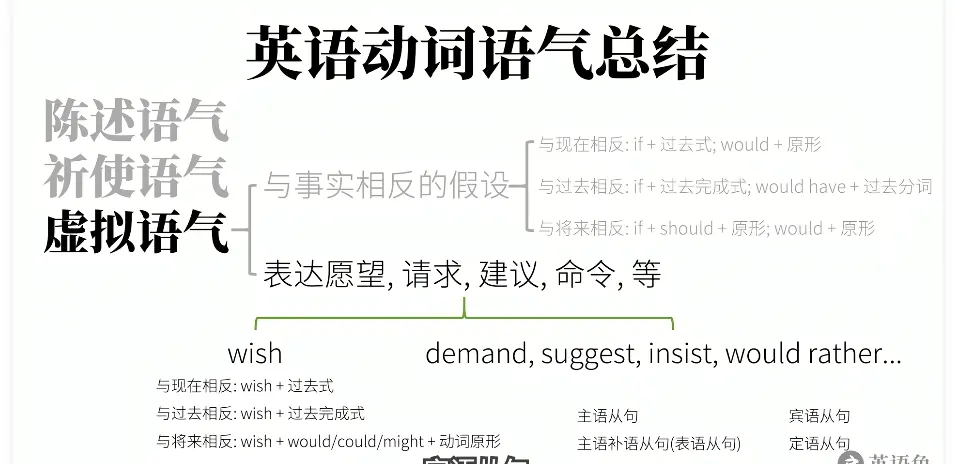