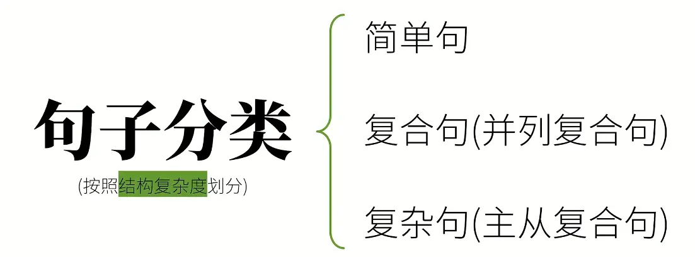
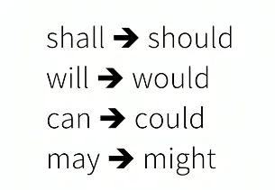

# 英语词性与句子成分 超详细总结（配例句+易混辨析）

词性是单词**本身的固有语法属性**，不随句子位置改变；句子成分是单词/短语在句子中**承担的语法功能**，同一个词在不同语境中可充当不同成分。以下是系统拆解+典型例句+易错点辨析。

## 一、英语词性（10 大类）

按是否能独立充当句子成分，分为**实词（6 类，有实际词汇意义）**和**虚词（4 类，无完整词汇意义，仅起语法辅助作用）**。

### （一）实词 Notional Words

#### 1. 名词 Noun (n.)

**定义**：表示人、事物、地点、抽象概念的词。 **细分分类**：

- 按意义：
    - 专有名词：特定人/物/地点，首字母大写。例：`China`, `Einstein`, `the Great Wall`, `January`
    - 普通名词：一类人/物/抽象概念。例：`student`, `book`, `happiness`
- 按可数性：
    - 可数名词：有单复数形式。例：`apple → apples`, `box → boxes`
    - 不可数名词：无复数，不能直接加 `a/an`。例：`water`, `news`, `progress`, `furniture`
- 补充分类：集体名词（`family`, `team`，可表整体或成员）、物质名词（`wood`, `rice`）、抽象名词（`love`, `courage`）

**句法功能+例句**：

- 主语：`The cat is sleeping.`（猫在睡觉。）
- 宾语：`I bought a dictionary.`（我买了一本词典。）
- 表语：`My father is a doctor.`（我爸爸是医生。）
- 定语：`apple tree` 苹果树（名词作定语修饰名词）
- 同位语：`Our teacher Ms. Li is kind.`（我们的李老师很和蔼。）

---

#### 2. 动词 Verb (v.)

**定义**：表示动作、行为、状态的词，是句子的核心，**只有动词能独立作谓语**。 **细分分类**：

- 按句法功能：
    - 谓语动词：在句中作谓语，有人称、时态、语态变化。
    - 非谓语动词：不作谓语，共 3 种形式：不定式 `to do`、动名词 `doing`、分词（现在分词 `doing` / 过去分词 `done`）
- 按含义&用法：
- ① 实义动词（行为动词）：有实际动作含义
    - 及物动词(vt.)：后面必须加宾语。例：`I love music.`（love 是及物动词，music 是宾语）
    - 不及物动词(vi.)：后面不加宾语，加宾语需搭配介词。例：`He arrived at the station.`（arrive 是不及物动词，加介词 at 再接宾语）
- ② 系动词：本身有一定词义，后面必须接表语，构成“主系表”结构
    - 状态系动词：`be (am/is/are/was/were)`
    - 感官系动词：`look` (看起来), `sound` (听起来), `smell` (闻起来), `taste` (尝起来), `feel` (感觉)
    - 变化系动词：`become`, `get`, `turn`, `grow`, `go`
    - 保持系动词：`keep`, `stay`, `remain` 
- ③ 助动词：无实义，辅助实义动词构成时态、语态、疑问、否定。例：`do/does/did`, `have/has/had`, `will/would` 
- ④ 情态动词：表说话人的语气、情态（能力、许可、推测等），后接动词原形。例：`can`, `may`, `must`, `should` 应该的含义

**句法功能+例句**：

- 谓语（谓语动词）：`She speaks English well.`（她英语说得好。）
- 主语（非谓语-不定式）：`To see is to believe.`（眼见为实。）
- 宾语（非谓语-动名词）：`I enjoy reading.`（我喜欢阅读。）
- 定语（非谓语-分词）：`a sleeping baby` 一个睡着的婴儿；`a broken cup` 一个碎了的杯子
- 状语（非谓语-分词）：`Seeing the teacher, the students stood up.`（看到老师，学生们站了起来。）

---

#### 3. 形容词 Adjective (adj.)

**定义**：修饰名词/代词，描述事物的性质、特征、状态。 **细分分类**：

- 性质形容词：描述属性。例：`tall`, `red`, `happy`, `difficult`
- 等级变化：原级(`tall`)、比较级(`taller`)、最高级(`tallest`)
- 按功能分：定语形容词（仅放名词前）、表语形容词（仅放系动词后，如 `afraid`, `alive`, `asleep`）

**句法功能+例句**：

- 定语（前置）：`a beautiful garden` 一个漂亮的花园
- 表语：`The movie is wonderful.`（这部电影很精彩。）
- 宾语补足语：`We made the room clean.`（我们把房间打扫干净了。）

**补充：多个形容词前置排序口诀**：限（限定词）观（观点）形（形状）龄（年龄）色（颜色）国（国籍）材（材料）用（用途） 例：`a charming small round old brown French wooden writing desk` 一张迷人的、小巧的、圆形的、旧的、棕色的、法国产的木制写字台

---

#### 4. 副词 Adverb (adv.)

**定义**：修饰动词、形容词、其他副词或整个句子，说明时间、地点、方式、程度等。 **细分分类（按意义）**：

- 时间副词：`now`, `then`, `yesterday`, `soon`, `already`
- 频率副词：`always`, `usually`, `often`, `sometimes`, `never`
- 地点副词：`here`, `there`, `upstairs`, `everywhere`
- 方式副词：`quickly`, `carefully`, `happily`, `hard`
- 程度副词：`very`, `quite`, `too`, `enough`, `almost`
- 疑问副词：`when`, `where`, `how`, `why`（引导特殊疑问句）
- 连接副词：`however`, `therefore`, `besides`（连接句子）
- 关系副词：`when`, `where`, `why`（引导定语从句）

**句法功能+例句**：

- 状语（最主要功能）：`He runs fast.`（他跑得很快。→ 方式状语）；`Very luckily, he was saved.`（非常幸运，他得救了。→ 修饰整个句子）
- 表语：`Class is over.`（下课了。）
- 宾语补足语：`Let him in.`（让他进来。）

---

#### 5. 代词 Pronoun (pron.)

**定义**：代替名词、名词短语，避免重复，使行文简洁。 **细分分类**：

- 人称代词：主格(`I, you, he, she, it, we, they`)作主语；宾格(`me, you, him, her, it, us, them`)作宾语
- 物主代词：形容词性(`my, your, his, her`)作定语；名词性(`mine, yours, his, hers`)作主/宾/表
- 反身代词：`myself`, `yourself`, `themselves` 等，表“某人自己”
- 指示代词：`this`, `that`, `these`, `those`
- 疑问代词：`who`, `whom`, `what`, `which`（引导特殊疑问句）
- 不定代词：`some`, `any`, `all`, `both`, `none`, `everyone` 等
- 关系代词：`who`, `which`, `that`（引导定语从句）
- 相互代词：`each other`, `one another`（表相互）

**句法功能+例句**：

- 主语：`She is my classmate.`（她是我同学。）
- 宾语：`I met him yesterday.`（我昨天遇见了他。）
- 表语：`It's me.`（是我。）
- 定语：`His bag is blue.`（他的包是蓝色的。）

---

#### 6. 数词 Numeral (num.)

**定义**：表示数量或顺序的词。 **细分分类**：

- 基数词：表数量。例：`one`, `twenty`, `hundred`
- 序数词：表顺序，前通常加 `the`。例：`first`, `fifth`, `twenty-first`
- 分数/小数/百分数：`two thirds`（三分之二）, `0.5`（zero point five）, `30%`（thirty percent）

**句法功能+例句**：

- 主语：`Three of us are from Beijing.`（我们中有三个人来自北京。）
- 宾语：`I need two.`（我需要两个。）
- 表语：`He is ten.`（他十岁了。）
- 定语：`There are fifty students in our class.`（我们班有 50 个学生。）

---

### （二）虚词 Form Words

虚词不能独立充当句子成分，必须依附实词或句子发挥语法作用。

#### 1. 冠词 Article (art.)

**定义**：用在名词前，限定名词的指称范围，是最典型的限定词。 **细分分类**：

- 不定冠词 `a/an`：表泛指“一个”，`a` 用于辅音音素开头的词前，`an` 用于元音音素开头的词前。 例：`a book`, `an apple`, `an hour`（h 不发音，元音开头）
- 定冠词 `the`：表特指“这个/这些”，可接可数单/复数、不可数名词。 例：`the sun`（独一无二的事物）, `the girl in red`（特指穿红衣服的女孩）
- 零冠词：不用冠词的情况。例：泛指复数 `Books are useful.`；球类/三餐 `play football`, `have lunch`；专有名词 `Beijing`；学科 `math`

**特点**：不能独立作成分，只能和名词连用。

---

#### 2. 介词 Preposition (prep.)

**定义**：用在名词/代词（宾格）前，表明其与句中其他成分的逻辑关系（时间、地点、方式、所属等）。 **细分分类**：

- 简单介词：`in`, `on`, `at`, `by`, `with`, `for`
- 复合介词：`into`, `onto`, `within`, `without`
- 短语介词：`because of`, `in front of`, `instead of`, `according to`

**特点**：不能独立作成分，必须和后面的宾语构成**介词短语**才能充当句子成分。 **介词短语功能+例句**：

- 状语：`We go to school by bike.`（我们骑自行车上学。→ 方式状语）
- 定语：`The book on the desk is mine.`（桌子上的书是我的。→ 后置定语）
- 表语：`He is in the office.`（他在办公室。）
- 宾语补足语：`I found everything in good order.`（我发现一切井然有序。）

---

#### 3. 连词 Conjunction (conj.)

**定义**：连接单词、短语、从句或句子的词，只起连接作用，不充当句子成分。 **细分分类**：

- 并列连词：连接并列的词、短语或分句，前后地位平等。
    - 联合：`and`, `both...and...`, `not only...but also...`
    - 转折：`but`, `yet`, `however`
    - 选择：`or`, `either...or...`, `neither...nor...`
    - 因果：`so`, `for` 例：`Hurry up, or you'll be late.`（快点，否则你要迟到了。）
- 从属连词：引导从句（名词性从句、状语从句），从句处于从属地位。
    - 引导宾语从句：`that`, `if`, `whether`
    - 引导状语从句：`because`（原因）, `if`（条件）, `when`（时间）, `though`（让步） 例：`I was late because I missed the bus.`（我迟到了，因为我错过了公交车。）

---

#### 4. 感叹词 Interjection (int.)

**定义**：表达喜怒哀乐等强烈情感的词，完全独立于句子语法结构之外。 例：`oh`, `wow`, `ah`, `alas`, `ouch`, `hey` **特点**：不作任何句子成分，通常独立成句，或放在句首用逗号隔开。 例：`Wow! What a nice view!`（哇！多美的景色啊！）；`Oh, I forgot my key.`（哦，我忘带钥匙了。）

---

## 二、英语句子成分（9 大成分）

句子成分是单词/短语在句子中的**功能角色**。按功能分为：核心成分（主语、谓语）、修饰成分（宾语、表语、定语、状语）、补充成分（补足语、同位语）、独立成分（插入语）。

### 1. 主语 Subject (S.)

**核心功能**：句子描述的主体，是动作的发出者或被描述的对象，是句子的“话题”。 **可充当结构**：名词、代词、数词、动名词、不定式、主语从句、`it` 作形式主语。 **位置特点**：通常位于句首；疑问句、倒装句中会后置。

**经典例句**：

- 名词作主语：`The moon goes around the earth.`（月亮绕着地球转。）
- 动名词作主语：`Swimming is good for health.`（游泳有益健康。）
- 形式主语 `it`（真正主语后置，避免头重脚轻）：`It is not easy to master a language.`（掌握一门语言不容易。）
- 主语从句：`What he said is true.`（他说的是真的。）

---

### 2. 谓语 Predicate (V.)

**核心功能**：说明主语的动作、状态或特征，是句子的核心，**只能由动词（谓语动词）充当**。 **分类&例句**：

- 简单谓语：由一个动词（或动词短语）构成。 例：`He reads English every morning.`（他每天早上读英语。）
- 复合谓语： ① 情态动词/助动词 + 实义动词原形 例：`We can speak a little French.`（我们会说一点法语。）；`She has finished her homework.`（她已经完成了作业。） ② 系动词 + 表语（主系表结构的谓语整体） 例：`The leaves turn yellow in autumn.`（秋天树叶变黄。）

⚠️ 注意：非谓语动词（`to do`, `doing`, `done`）不能单独作谓语。

---

### 3. 宾语 Object (O.)

**核心功能**：动作的承受者或作用对象，位于及物动词或介词之后。 **分类**：

- 直接宾语：动作的直接作用对象（多为物）
- 间接宾语：动作的指向对象（多为人），通常在直接宾语前
- 介词宾语：介词后面的名词/代词

**可充当结构**：名词、代词、数词、动名词、不定式、宾语从句、`it` 作形式宾语。

**经典例句**：

- 单宾语：`I love nature.`（我热爱自然。）
- 双宾语（间接宾语+直接宾语）：`My mom bought me a new dress.`（我妈妈给我买了一条新裙子。→ me 间接宾语，a new dress 直接宾语）
- 介词宾语：`We are talking about the plan.`（我们正在讨论这个计划。→ the plan 是介词 about 的宾语）
- 形式宾语 `it`：`I find it difficult to learn grammar.`（我发现学语法很难。→ it 是形式宾语，真正宾语是 to learn grammar）

**补充：同源宾语**：少数不及物动词可接和它同根的名词作宾语。例：`dream a sweet dream` 做了个美梦；`live a happy life` 过着幸福的生活

---

### 4. 表语 Predicative (P.)

**核心功能**：位于系动词之后，说明主语的身份、性质、状态、特征，和系动词共同构成谓语。 **可充当结构**：名词、形容词、代词、数词、介词短语、不定式、动名词、分词、表语从句。 **常见系动词**：be 动词、感官动词、变化类、保持类（见词性-动词部分）

**经典例句**：

- 形容词作表语：`The soup tastes delicious.`（这汤尝起来很美味。）
- 介词短语作表语：`All the students are in the classroom.`（所有学生都在教室里。）
- 不定式作表语：`My dream is to be a doctor.`（我的梦想是成为一名医生。）
- 表语从句：`That is why he was absent.`（那就是他缺席的原因。）

⚠️ 补充：表语属于广义的**主语补足语**，补充说明主语的状态。

---

### 5. 定语 Attribute (Attr.)

**核心功能**：修饰、限定名词/代词，说明事物的属性、数量、所属等。 **分类**：前置定语（放在被修饰词前）、后置定语（放在被修饰词后） **可充当结构**：形容词、名词、代词、数词、介词短语、不定式、分词、定语从句。

**经典例句**：

- 前置定语（名词）：`coffee cup` 咖啡杯
- 后置定语（介词短语）：`the people in the hall` 大厅里的人们
- 后置定语（不定式）：`I have a lot of work to do.`（我有很多工作要做。）
- 后置定语（现在分词）：`the girl singing under the tree` 在树下唱歌的女孩
- 后置定语（过去分词）：`the book written by Mo Yan` 莫言写的书
- 定语从句：`This is the movie that I like best.`（这是我最喜欢的电影。）

---

### 6. 状语 Adverbial (Adv.)

**核心功能**：修饰动词、形容词、副词或整个句子，说明动作发生的背景信息。 **按意义细分（最常用 9 类）**： 时间、地点、方式、原因、目的、结果、条件、让步、程度 **可充当结构**：副词、介词短语、不定式、分词、状语从句。 **位置特点**：非常灵活，可位于句首、句中、句末。

**经典例句**：

- 句首时间状语：`In the morning, we do morning exercises.`（早上我们做早操。）
- 句末地点状语：`They went hiking in the mountain.`（他们去山里远足了。）
- 条件状语从句：`If it rains tomorrow, we will stay at home.`（如果明天下雨，我们就待在家里。）

---

### 7. 补足语 Complement (C.)

**核心功能**：补充说明主语或宾语的状态、身份，缺少则句意不完整。 分为**宾语补足语**和**主语补足语**两类。

#### （1）宾语补足语 Object Complement (OC)

- 位置：位于宾语之后，和宾语有**逻辑上的主谓关系**（宾语+宾补 = 逻辑上的主谓结构），合称“复合宾语”。
- 常接宾补的动词：使役动词（`make, let, have`）、感官动词（`see, hear, feel`）、其他（`call, name, elect`）

**经典例句**：

- 名词作宾补：`We made him our monitor.`（我们选他当班长。→ 逻辑上：he is our monitor）
- 形容词作宾补：`The news made her happy.`（这个消息让她很开心。→ 逻辑上：she is happy）
- 不定式作宾补：`My teacher asked me to finish the paper.`（老师让我完成论文。）
- 现在分词作宾补：`I saw him playing basketball.`（我看见他正在打篮球。）

#### （2）主语补足语 Subject Complement (SC)

- 功能：补充说明主语的状态、身份，常见于被动语态（主动句的宾补变被动后，就成了主补）。
- 例句： 主动（宾补）：`We elected him president.` 被动（主补）：`He was elected president.`（他被选为总统。→ president 补充说明主语 he）

✅ **易混辨析：双宾语 VS 复合宾语（宾补）**

- 双宾语：两个宾语都是动词的作用对象，二者没有主谓关系。例：`give me a book`（我和书没有“我是书”的逻辑）
- 复合宾语：宾语和宾补有逻辑主谓关系。例：`call him Tom`（逻辑上“他是汤姆”）

---

### 8. 同位语 Appositive

**核心功能**：放在名词/代词之后，对其进行解释、说明，二者所指内容完全相同。 **可充当结构**：名词、代词、数词、同位语从句。

**经典例句**：

- 名词作同位语：`My deskmate Lucy is from Canada.`（我的同桌露西来自加拿大。→ Lucy 和 my deskmate 是同一个人）
- 同位语从句：`I heard the news that our team won the game.`（我听到了我们队获胜的消息。→ 从句解释 news 的具体内容，that 不充当成分）

✅ **易混辨析：同位语从句 VS 定语从句**

- 同位语从句：解释前面名词的内容，`that` 在从句中**不充当成分**，不能省略。 例：`The fact that he told lies surprised us.`（他撒谎的事实让我们惊讶。）
- 定语从句：修饰限定前面的名词，`that` 在从句中**充当主语/宾语**，作宾语时可省略。 例：`The fact that he told me surprised us.`（他告诉我的事实让我们惊讶。）

---

### 9. 插入语 Parenthesis

**核心功能**：插入句中，表达说话人的态度、补充说明或转换话题，与句子主干无语法关联，属于**独立成分**。 **可充当结构**：副词、介词短语、不定式短语、短句等。

**经典例句**：

- 副词作插入语：`However, I don't think so.`（然而，我不这么认为。）
- 介词短语作插入语：`In fact, he is right.`（事实上，他是对的。）
- 不定式作插入语：`To be honest, I hate this job.`（说实话，我讨厌这份工作。）
- 短句作插入语：`This movie, I think, is the best one this year.`（这部电影，我认为，是今年最好的。）

**特点**：去掉插入语，句子主干仍然完整通顺。

---

## 三、词性与句子成分对应速查表

|词性|常作成分|偶作成分|不能独立作成分|
|---|---|---|---|
|名词|主语、宾语、表语、定语、同位语|宾补|谓语|
|谓语动词|谓语|—|其他所有|
|非谓语动词|主、宾、表、定、状、补|—|谓语|
|形容词|定语、表语、宾补|主补|谓语、主语|
|副词|状语|表语、宾补、主补|主语、宾语|
|代词|主语、宾语、表语|定语、同位语|谓语|
|数词|主语、宾语、表语、定语|同位语|谓语|
|冠词/介词/连词|—（依附实词/起连接作用）|—|所有独立成分|
|感叹词|—（独立成分）|—|所有句子成分|

需要我再补充**五大基本句型**和每种成分的对应关系，或者出一些辨析练习题吗？