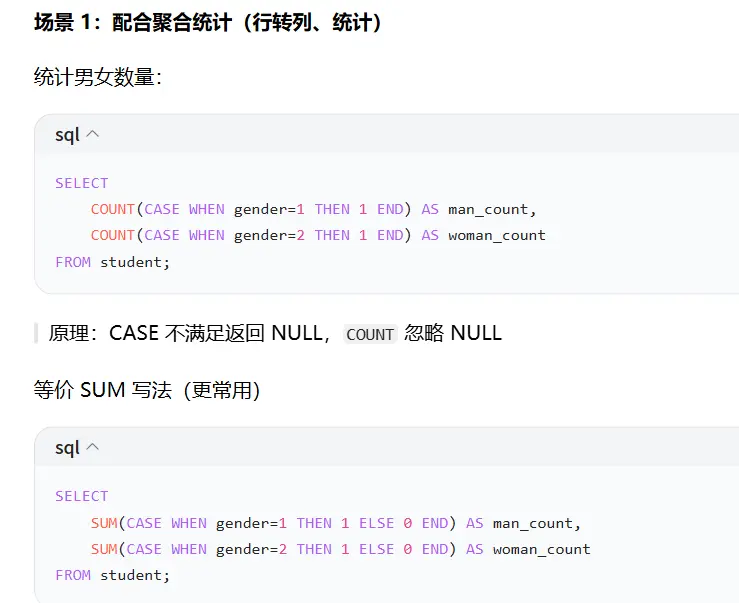

# MySQL：CASE、IF、UNION、UNION ALL、LIMIT 详细用法

> 说明：`IF` 是**函数**；`CASE` 是**表达式**，两者都是做条件判断；`UNION/UNION ALL` 用来合并多条查询结果集；`LIMIT` 用来限制返回行数，常用于分页。

先准备一张测试表方便演示：

```
CREATE TABLE student (
    id INT PRIMARY KEY AUTO_INCREMENT,
    name VARCHAR(20),
    score INT,
    gender TINYINT -- 1男 2女
);
INSERT INTO student(name,score,gender) VALUES
('张三',88,1),('李四',59,1),('王五',95,2),('赵六',72,2);
```

---

## 一、IF 函数

### 语法

```
IF(条件表达式, 满足条件返回值, 不满足返回值)
```

> 只能**二选一**，适合简单二元判断。

### 示例

1. 判断成绩是否及格

```
SELECT 
    name,
    score,
    IF(score >= 60, '及格', '不及格') AS result
FROM student;
```

2. 嵌套 IF（多分支，可读性差，多分支优先用 CASE）

```
SELECT 
    name,
    score,
    IF(score>=90,'优秀',IF(score>=60,'及格','不及格')) AS level
FROM student;
```

> ⚠️注意：
> 
> - IF 是**函数**，写在 `SELECT` 字段里、WHERE 条件都可以用
> - 只支持 2 个分支，多层嵌套复杂，不推荐超过 2 层

---

## 二、CASE 表达式

两种写法：**简单 CASE** 和 **搜索 CASE**

> CASE 可以多分支，可读性远好于嵌套 IF，推荐优先使用。

### 写法 1：简单 CASE（等值匹配，只能=）

```
CASE 字段
    WHEN 值1 THEN 结果1
    WHEN 值2 THEN 结果2
    ELSE 默认结果
END
```

示例：性别转文字

```
SELECT 
    name,gender,
    CASE gender
        WHEN 1 THEN '男'
        WHEN 2 THEN '女'
        ELSE '未知'
    END AS gender_name
FROM student;
```

### 写法 2：搜索 CASE（支持> < >= <=，最常用）

```
CASE
    WHEN 条件1 THEN 结果1
    WHEN 条件2 THEN 结果2
    ELSE 默认结果
END
```

示例：成绩评级

```
SELECT 
    name,score,
    CASE
        WHEN score >=90 THEN '优秀'
        WHEN score >=80 THEN '良好'
        WHEN score >=60 THEN '及格'
        ELSE '不及格'
    END AS level
FROM student;
```

### CASE 其他使用场景

1. 放在 `ORDER BY` 自定义排序 1111111111111111111111111111111

```
SELECT * FROM student
ORDER BY 
    CASE gender WHEN 1 THEN 1 ELSE 2 END; --男生排在前面
```

2. 放在 `WHERE`

```
SELECT * FROM student
WHERE CASE WHEN gender=1 THEN score>80 ELSE score>70 END;
```

> ⚠️ CASE 注意点
> 
> 1. 只要匹配到第一个 WHEN 就停止，后面不再判断
> 2. ELSE 可选；如果没匹配且无 ELSE，返回 NULL
> 3. CASE 是**表达式**，不是存储过程里的 CASE 语句

### IF vs CASE 对比

||IF|CASE|
|---|---|---|
|分支|只能二元，多分支要嵌套|支持多条件分支|
|判断|支持 > < =|支持 > < =|
|可读性|分支多的时候很差|多分支清晰，推荐|

---

## 三、UNION 和 UNION ALL

作用：**把多条 SELECT 查询的结果纵向合并（上下堆叠）**

> 要求：多条查询的**列数量必须一致**，列类型尽量匹配；列名以第一条查询为准。

### UNION

自动**去重**，并且会对结果排序。

```
-- 查询男生和女生，合并，自动剔除完全一样的行
SELECT name,score FROM student WHERE gender=1
UNION
SELECT name,score FROM student WHERE gender=2;
```

> UNION 底层会创建临时表做去重，性能比 UNION ALL 差很多。

### UNION ALL

**不去重，直接拼接，不排序，性能更高，推荐优先使用**

```
SELECT name,score FROM student WHERE gender=1
UNION ALL
SELECT name,score FROM student WHERE gender=2;
```

### UNION 与 UNION ALL 对比

||UNION|UNION ALL|
|---|---|---|
|去重|✅自动去重|❌不去重|
|排序|合并后排序|不排序|
|性能|慢（临时表+去重）|快，无额外开销|
|使用场景|需要剔除重复行|确定无重复，追求性能|

### 重要规则

1. 每个 select 的**列数必须相同**，否则报错
2. 字段名以第一条 SQL 的字段名为准
3. 如果要对合并后的整体排序：`ORDER BY` 写在**最后一条 SELECT 后面**，并且要把整个 union 包裹

```
-- union all 合并后整体排序
(SELECT name,score FROM student WHERE gender=1)
UNION ALL
(SELECT name,score FROM student WHERE gender=2)
ORDER BY score DESC;
```

> ❌错误写法：不要在中间每条 select 后单独写 order by，单独 order by 在 union 里无效（除非搭配 limit）

---

## 四、LIMIT：限制返回行数，分页核心

### 语法

```
LIMIT offset, row_count;
```

- `offset`：偏移量，从 0 开始。跳过多少行
- `row_count`：取多少条数据

简写形式：只写一个参数，代表取多少条，offset 默认=0

```
LIMIT row_count; --等价 LIMIT 0, row_count
```

### 示例

```
-- 取前2条（跳过0条，拿2条）
SELECT * FROM student LIMIT 2;

-- 跳过2条，取2条（第3、4条数据）
SELECT * FROM student LIMIT 2,2;
```

### 分页公式

> page：页码；size：每页条数

```
LIMIT (page-1)*size , size
```

例：第 2 页，每页 2 条

```
SELECT * FROM student LIMIT 2,2;
```

### LIMIT + UNION ALL

LIMIT 可以加在单个子查询，也可以加在合并后的结果集

```
-- 每个查询各取2条，再合并
(SELECT name,score FROM student WHERE gender=1 LIMIT 2)
UNION ALL
(SELECT name,score FROM student WHERE gender=2 LIMIT 2);

-- 合并全部结果之后，整体只取前3条
(SELECT name,score FROM student WHERE gender=1)
UNION ALL
(SELECT name,score FROM student WHERE gender=2)
LIMIT 3;
```

### LIMIT 坑点

1. offset 很大时 `LIMIT 100000,10` 性能很差：MySQL 要扫描前面 10 万行再丢弃；大数据分页推荐**主键 ID 分页**

```
-- 替代大offset分页（推荐）
SELECT * FROM student WHERE id > 100000 LIMIT 10;
```

2. LIMIT 后面只能跟**数字常量**，不能写变量（低版本 MySQL）

---

# 综合示例（把这几个写在一条 SQL 里）

需求：把男生、女生分数合并，给成绩评级，取前 4 条

```
SELECT name,score,
CASE
    WHEN score >=90 THEN '优秀'
    WHEN score >=60 THEN '及格'
    ELSE '不及格'
END AS level,
IF(score >= 80,'高分','普通') AS tag
FROM student WHERE gender=1
UNION ALL
SELECT name,score,
CASE
    WHEN score >=90 THEN '优秀'
    WHEN score >=60 THEN '及格'
    ELSE '不及格'
END AS level,
IF(score >= 80,'高分','普通') AS tag
FROM student WHERE gender=2
LIMIT 4;
```

---

# 高频面试总结

1. IF 适合简单二分支；CASE 适合多条件分支
2. UNION 去重排序，性能差；UNION ALL 不去重，性能高，优先用 UNION ALL
3. UNION 合并时，列数必须一致；ORDER BY 写在整个语句末尾
4. LIMIT offset,size，offset 从 0 开始；深分页不要直接大 offset

要不要我再出几道练习题（带答案），帮你巩固这几个函数的面试常考 SQL？  


# MySQL IF 判断 NULL

> 重点前置：**MySQL 里 NULL 和任何值比较（=、!=）结果都是 NULL，不是 true/false！** `IF(条件, 真, 假)`：**条件结果为 TRUE（1）才走第一个分支；条件为 FALSE（0）或者 NULL，都会走第二个分支。**

## 1. IF 判断字段是否为 NULL

❌ 错误写法（千万不要用 `=` 判断 null）

```
-- 错误！name = NULL 结果永远是 NULL，IF 永远进入 else
SELECT IF(name = NULL, '是空', '非空') FROM student;
```

✅ 正确：用 `IS NULL` / `IS NOT NULL`

```
SELECT 
  name,
  IF(name IS NULL, '姓名为空', '姓名有值') AS name_status
FROM student;

-- 判断不是null
SELECT 
  name,
  IF(name IS NOT NULL, '有值', '空') AS name_status
FROM student;
```

## 2. IF + IFNULL 组合（非常常用）

`IFNULL(expr1,expr2)`：如果 expr 1 是 NULL，返回 expr 2；否则返回 expr 1

```
-- 如果score是null，替换成0，再判断是否及格
SELECT
  name,
  score,
  IF(IFNULL(score,0)>=60,'及格','不及格') AS res
FROM student;
```

等价拆解：

```
IF( score IS NULL ? 0 : score >=60 , '及格','不及格')
```

## 3. 容易踩坑：IF 的条件得到 NULL 时

```
SELECT IF(NULL, 'true分支', 'false分支'); 
-- 结果：false分支
-- 原理：条件为NULL，等同于假，走第三个参数
```

```
SELECT IF(10 > NULL, 'true','false');
-- 10>NULL 返回NULL → 输出 false
```

## 4. CASE 判断 NULL（顺带对比）

CASE 简单模式 `CASE col WHEN val` 也**不能匹配 NULL**！

```
-- ❌ 错误：CASE gender WHEN NULL，永远匹配不到
CASE gender
  WHEN NULL THEN '空'
  WHEN 1 THEN '男'
END
```

✅ 搜索 CASE 写法，用 IS NULL：

```
CASE
  WHEN gender IS NULL THEN '未知'
  WHEN gender =1 THEN '男'
  ELSE '女'
END
```

## 5. 实战案例：学生表，score 允许 null

```
CREATE TABLE student (
    id INT PRIMARY KEY AUTO_INCREMENT,
    name VARCHAR(20),
    score INT
);
INSERT INTO student(name,score) VALUES
('张三',88),('李四',NULL),('王五',55);

SELECT 
  name,
  score,
  IF(score IS NULL, '缺考', IF(score>=60,'及格','不及格')) AS result
FROM student;
```

输出：

|name|score|result|
|---|---|---|
|张三|88|及格|
|李四|NULL|缺考|
|王五|55|不及格|

## 6. 面试高频考点总结

1. 判断空值**必须用 IS NULL / IS NOT NULL**，不能用 `=` NULL
2. IF 中条件返回 NULL，会进入**else 分支**
3. `IFNULL(col,默认值)`：快速把 null 替换成默认值，再做后续判断
4. 简单 CASE `WHEN NULL` 无法匹配空值；空值判断优先用**搜索 CASE**

## 拓展：还有一个函数 NULLIF

`NULLIF(a,b)`：a 等于 b 时返回 NULL，否则返回 a

```
SELECT NULLIF(name,'') FROM student;
-- name等于空字符串''，返回NULL；否则返回name
```

你要不要顺便区分一下：`NULL` 和 空字符串 `''` 的区别？这个面试经常一起问。  


# MySQL 中 NULL 的特殊性（面试高频，重点整理）

> 一句话核心：**NULL 代表「未知、缺失的值」，不是 0，不是空字符串''，也不是 false。任何和 NULL 的运算、比较结果几乎都是 NULL。**

## 一、比较运算的特殊规则（最容易踩坑）

> 记住：** `=`、`!=`、`<`、`>`、`>=`、`<=` 和 NULL 做比较，结果永远是 NULL，不是 true / false**

```
SELECT 10 = NULL;    -- NULL
SELECT 10 != NULL;   -- NULL
SELECT NULL = NULL;  -- NULL ！！两个null用等号也不相等！
SELECT NULL > 5;     -- NULL
```

✅ 判断 NULL 只能用：`IS NULL` / `IS NOT NULL`

```
SELECT NULL IS NULL; -- 1 (true)
SELECT 10 IS NOT NULL; -- 1
```

> 重点：`NULL = NULL → NULL`，所以 `WHERE col = NULL` 查询不到任何数据！很多新手踩这个坑。 如果想判断两个字段是否同时为 NULL，可以用 `<=>` 安全等于运算符

```
SELECT NULL <=> NULL; -- 1
SELECT 5 <=> NULL;    -- 0
```

`<=>`：相等返回 1；两边都是 NULL 也返回 1；一边 NULL 返回 0。

## 二、逻辑运算 AND / OR / NOT 对 NULL 的规则

三值逻辑：MySQL 逻辑有三种结果：`1(true)`、`0(false)`、`NULL`

|表达式|结果|
|---|---|
|NULL AND 1|NULL|
|NULL AND 0|0|
|NULL OR 1|1|
|NULL OR 0|NULL|
|NOT NULL|NULL|

> WHERE 子句：**只有结果 = 1(true) 的行才会被筛选出来；0 和 NULL 都会被过滤掉！**

```
-- 查不出任何数据，因为条件返回NULL
SELECT * FROM student WHERE score = NULL;
```

## 三、算术运算：任何值 +-*/ NULL，结果都是 NULL

```
SELECT 100 + NULL; -- NULL
SELECT NULL * 2;   -- NULL
SELECT NULL - 5;   -- NULL
```

> 业务场景：分数为 NULL，直接计算总分会变成 NULL，一般用 `IFNULL(col,0)` 转成 0 再计算

```
SELECT IFNULL(score,0)+10 FROM student;
```

## 四、函数对 NULL 的行为

1. **IFNULL(expr 1,expr 2)** expr 1 为 NULL 返回 expr 2，否则返回 expr 1

```
SELECT IFNULL(NULL, 0); --0
```

2. **NULLIF(a,b)** a=b 返回 NULL，否则返回 a

```
SELECT NULLIF('abc','abc'); -- NULL
```

3. **聚合函数**（重点！面试常问）

- `COUNT(*)`：统计**所有行数，包含 NULL 行**
- `COUNT(字段)`：统计该字段**不为 NULL**的行数，字段为 NULL 会跳过！

```
-- 表：id(1,2,3), score(80,null,90)
SELECT COUNT(*), COUNT(score) FROM student;
-- COUNT(*) =3 ，COUNT(score)=2
```

- SUM、AVG、MAX、MIN：**忽略字段为 NULL 的行**，不会把 NULL 当成 0

```
SUM(score) 只会累加80和90，null直接跳过
```

## 五、GROUP BY / DISTINCT 对 NULL 的处理

`GROUP BY` 和 `DISTINCT` 中：**多个 NULL 会被当成相等，分到同一组**

> 和 `NULL=NULL` 不一样！分组场景下所有 NULL 视为同一组。

```
SELECT score,COUNT(*) FROM student GROUP BY score;
-- score为NULL的所有行会合并成一组
```

## 六、索引和 NULL

1. InnoDB 索引**可以存储 NULL**，字段允许 NULL 时，索引可以命中；
2. 但是：**允许 NULL 的列，索引效率略低于 NOT NULL**；
3. 优化建议：**建表尽量设置字段 NOT NULL，并给默认值**（比如 0、''），减少 NULL 带来的三值逻辑问题。
    
    > 很多公司规范：字段尽量 NOT NULL。
    

## 七、CASE 表达式和 NULL

1. **简单 CASE（CASE col WHEN xxx）**：`WHEN NULL` 永远匹配不到

```
CASE score
    WHEN NULL THEN '缺考' -- ❌永远不会命中
    ELSE '有成绩'
END
```

✅ 要用搜索 CASE + IS NULL

```
CASE
    WHEN score IS NULL THEN '缺考'
    ELSE '有成绩'
END
```

## 八、ORDER BY 排序 NULL

排序的时候，**NULL 视为最小值**

- `ORDER BY col ASC`：NULL 排在最前面
- `ORDER BY col DESC`：NULL 排在最后面

可以手动调整 NULL 位置：

```
ORDER BY CASE WHEN score IS NULL THEN 1 ELSE 0 END ASC, score;
```

## 九、NULL 和 空字符串 '' 的区别（必背）

||NULL|'' 空字符串|
|---|---|---|
|含义|值未知，不存在|值存在，是空文本|
|占用存储|InnoDB NULL 只占标记位|需要占用 1 字节|
|COUNT(col)|不计入|计入|
|比较|NULL=NULL 结果 NULL|''='' →1|
|IF 判断|IF(NULL,a,b) →b|IF('',a,b) →b（空字符串是假）|

```
SELECT '' IS NULL; --0
SELECT NULL IS NULL; --1
```

# ✅ 面试一句话总结

MySQL 是**三值逻辑**：true / false / NULL。 NULL 代表未知，**不能用 = 判断；任何运算碰到 NULL 大多返回 NULL；聚合函数 COUNT(列)忽略 NULL；GROUP BY 中多个 NULL 视为相同；建表推荐尽量 NOT NULL**。

# 思考题（自测）

有表 student：id(1,2,3), score(80,null,90)

```
SELECT COUNT(*), COUNT(score), SUM(score) FROM student;
```

结果是多少？你可以先算，我帮你核对。  


# MySQL DISTINCT 使用详解

> DISTINCT：**去重，返回不重复的行**，作用在**整行**，不是单独某一列！（面试高频坑点）

## 一、基础语法

```
SELECT DISTINCT 列1,列2,... FROM 表名 [WHERE ...];
```

### 1. 单列去重

```
-- 查询所有不重复的性别
SELECT DISTINCT gender FROM student;
```

原理：扫描 gender 字段，剔除重复值，只保留唯一值。

### 2. 多列 DISTINCT（重点！）

> DISTINCT 是对**后面所有列组合**去重！不是单独对第一列去重！

```
-- 只有 name 和 gender 两个字段全部相同，才判定为重复，才会被去掉
SELECT DISTINCT name, gender FROM student;
```

举例子：

|name|gender|
|---|---|
|张三|1|
|张三|2|

> 这两行**不会去重**，因为 gender 不一样，组合起来是不同行。

❌ 很多人误解：`DISTINCT name,gender` 只对 name 去重，保留第一条 gender，**这是错的！**

## 二、DISTINCT + 聚合函数（最常考）

`COUNT(DISTINCT col)`：统计**该字段不重复的非 NULL 数量**

> ⚠️ NULL 会被 DISTINCT 直接丢弃！

```
-- 统计不重复的gender数量，NULL不计入
SELECT COUNT(DISTINCT gender) FROM student;
```

示例数据：gender 取值 `1,1,2,NULL`

- `COUNT(DISTINCT gender)` → 结果是 2（只有 1 和 2）
- `COUNT(gender)` →3（忽略 NULL）
- `COUNT(*)` →4（全部行数）

> 其他聚合函数：`SUM(DISTINCT)`、`AVG(DISTINCT)`，把重复值只算一次

```
-- 对分数去重后求和
SELECT SUM(DISTINCT score) FROM student;
```

## 三、DISTINCT 和 NULL

DISTINCT 会**把多个 NULL 当成相同的值，只保留一行 NULL**

```
-- score存在多条NULL，DISTINCT后只会出现一条NULL
SELECT DISTINCT score FROM student;
```

> 刚好和前面 GROUP BY 的行为一致：GROUP BY、DISTINCT 都认为多个 NULL 相等。

## 四、DISTINCT + ORDER BY

DISTINCT 拿到去重结果后，再排序；ORDER BY 的列最好在 select 里面。

```
SELECT DISTINCT score FROM student ORDER BY score DESC;
```

## 五、DISTINCT + LIMIT

先去重，再截取行数

```
-- 获取去重后的前3个分数
SELECT DISTINCT score FROM student LIMIT 3;
```

## 六、DISTINCT 和 UNION 的对比（面试对比题）

- `UNION`：自带 DISTINCT，合并结果集自动去重
- `UNION ALL`：不去重
- `DISTINCT`：单条查询内部去重

```
-- 下面两句效果等价
SELECT DISTINCT name FROM student;

SELECT name FROM student UNION SELECT name FROM student;
```

## 七、性能坑点（面试必问）

1. DISTINCT 底层：MySQL 需要创建临时表，对结果集做排序来去重；**大数据量非常耗性能**
2. 如果字段上有索引，优化器有可能利用索引避免临时表，速度会快很多
3. 优化思路：
    - 能在业务层避免重复就不要用 DISTINCT
    - 尽量对索引字段 DISTINCT
    - 想获取去重数据，某些场景可以替换为 `GROUP BY`

```
-- 这两条SQL结果一样
SELECT DISTINCT gender FROM student;
SELECT gender FROM student GROUP BY gender;
```

> MySQL 8.0 优化后两者性能接近；老版本有差异。但语义不一样： DISTINCT：目的是去重；GROUP BY：目的是分组，只是刚好返回唯一值。**不要滥用 GROUP BY 代替 DISTINCT**

## 八、常见错误写法

❌ DISTINCT 不能写在字段后面！只能写在 SELECT 之后

```
SELECT name DISTINCT FROM student; --语法错误
```

✅ 正确：`SELECT DISTINCT name FROM student;`

❌ DISTINCT 不能只对部分列生效

```
-- 错误理解：只对name去重，gender随便拿，做不到！
SELECT DISTINCT name, gender FROM student;
```

# 面试题自测

student 表：

|id|name|score|
|---|---|---|
|1|张三|80|
|2|张三|80|
|3|李四|90|
|4|王五|NULL|
|5|赵六|NULL|

```
SELECT COUNT(DISTINCT score), COUNT(DISTINCT name) FROM student;
```

请问结果是多少？你可以算一下。

要不要我把 `CASE IF UNION UNION ALL LIMIT DISTINCT` 全部合并，写一条综合 SQL 练手？