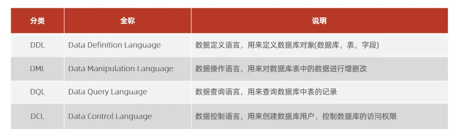

> 
CREATE TABLE IF NOT EXISTS `subject` (
 `id` INT AUTO_INCREMENT PRIMARY KEY  COMMENT '课程表主键',
 `subject_no` INT NOT NULL COMMENT '课程编号',
 `subject_name` VARCHAR(50) COMMENT '课程名称',
 `class_hour` INT(4) ZEROFILL COMMENT '学时',
 `grade_id` INT(4) ZEROFILL COMMENT '年级编号',
 CONSTRAINT fk_subject_grade_id FOREIGN KEY(grade_id) REFERENCES grade(id)
) ENGINE=MyISAM COMMENT='课程表';

ZEROFILL  变为无符号前面用 0 补充  
INT（M）显示 M 为 小于 M 为前面补充 0 到 M 位，大于 M 位保持原样  
ENGINE=MyISAM  引擎不支持外键 MyISAM 会**解析语法，但直接忽略外键约束**
默认引擎 innoDB  一般直接写 INT 就可以了  
char 定长 varchar 不定长  

- VARCHAR/CHAR：只用 `''`，**不使用 NULL**
- 日期、数字：用 NULL 表示无值
- `NULL`：用户没填，未知
- `''`：用户主动清空，明确为空

DESC 用来快速查看字段列表，只能看到字段基础信息，无法看到联合索引完整定义、存储引擎、字符集；SHOW CREATE TABLE 输出完整可执行的建表 SQL，包含字段、全部索引、引擎、字符集、表注释等所有表定义信息，适合表迁移和完整结构核对。  


### 内连接和外连接处理 null

先准备两张表 **user 用户表（左表）**

|uid|username|dept_id|
|---|---|---|
|1|张三|10|
|2|李四|20|
|3|王五|30|

**dept 部门表（右表）**

|dept_id|dept_name|
|---|---|
|10|研发部|
|20|产品部|

> 部门表没有 dept_id=30 的记录

#### 1. INNER JOIN 内连接

> INNER JOIN：两边表**同时有匹配的数据，才展示；任意一边缺失，这条记录直接丢掉**

```
SELECT u.username, d.dept_name
FROM user u
INNER JOIN dept d ON u.dept_id = d.dept_id;
```

结果：

|username|dept_name|
|---|---|
|张三|研发部|
|李四|产品部|

✅ 张三、李四两边都匹配到，保留 ❌ 王五：user 里有王五，但 dept 没有 30 号部门 → 一边缺失，**直接不出现**

## 2. LEFT JOIN 左外连接

> LEFT JOIN：**左边表全部数据都读出来；右边表找不到匹配，右边字段填 NULL**

```
SELECT u.username, d.dept_name
FROM user u
LEFT JOIN dept d ON u.dept_id = d.dept_id;
```

结果：

|username|dept_name|
|---|---|
|张三|研发部|
|李四|产品部|
|王五|NULL|

✅ user（左表）全部保留：张三、李四、王五 王五在 dept 没有对应部门，**dept_name 填 NULL，记录不会删掉**

## 3. RIGHT JOIN 右外连接

> RIGHT JOIN：**右边表全部数据读出来；左边表找不到匹配，左边字段填 NULL**

新增一条部门记录：`dept_id=40，dept_name=测试部`，user 表没有人属于 40 部门

```
SELECT u.username, d.dept_name
FROM user u
RIGHT JOIN dept d ON u.dept_id = d.dept_id;
```

结果：

|username|dept_name|
|---|---|
|张三|研发部|
|李四|产品部|
|NULL|测试部|

✅ dept（右表）所有部门全部保留 测试部没有对应的用户，**user 字段全部填充 NULL**

# 一句话总结

1. **INNER JOIN**：两边匹配上才保留，只要任意一方缺少对应数据，这条记录不显示。
2. **LEFT JOIN**：**左表所有行一定保留**，右表匹配不到，右表字段为 NULL。
3. **RIGHT JOIN**：**右表所有行一定保留**，左表匹配不到，左表字段为 NULL。

# 面试精简背诵版

INNER JOIN 只返回两边能匹配上的数据，任意一边缺少对应数据就丢弃该行；LEFT JOIN 以左表为基准，左表全部数据保留，右表没有匹配记录则右表字段填充 NULL；RIGHT JOIN 以右表为基准，右表全部保留，左表无匹配则左表字段填充 NULL。

## 小坑提醒

LEFT JOIN 想筛选「右表没有匹配的数据」，写法：`WHERE d.dept_id IS NULL`（找王五这种没有部门的人）。 注意：**不要把右表过滤条件写在 WHERE 里，容易把 NULL 行过滤掉**，条件放在 ON 和 WHERE 效果不一样。

要不要我用这两张表演示：ON 放条件 和 WHERE 放条件 的区别？
### java 命名规范
mysql->user_name    java->userName  

| 类型              | 命名风格    | 示例                    |
| --------------- | ------- | --------------------- |
| package         | 全小写     | `com.project.service` |
| 类/接口            | 大驼峰     | `UserMapper`          |
| 方法              | 小驼峰     | `getUserById()`       |
| 变量              | 小驼峰     | `userAge`             |
| static final 常量 | 全大写+下划线 | `DEFAULT_TIMEOUT`     |
| 泛型              | 单个大写字母  | `T`                   |

