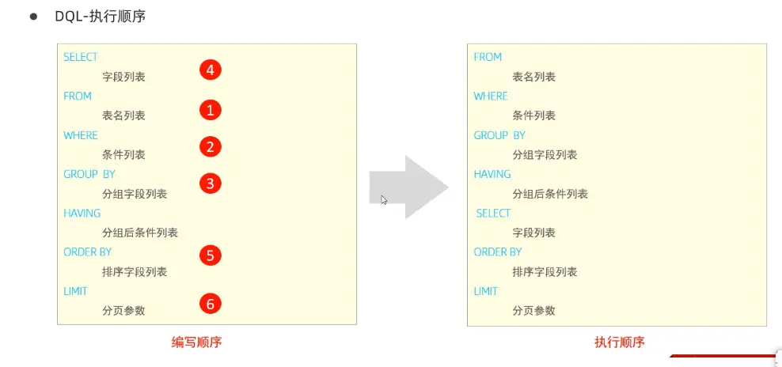
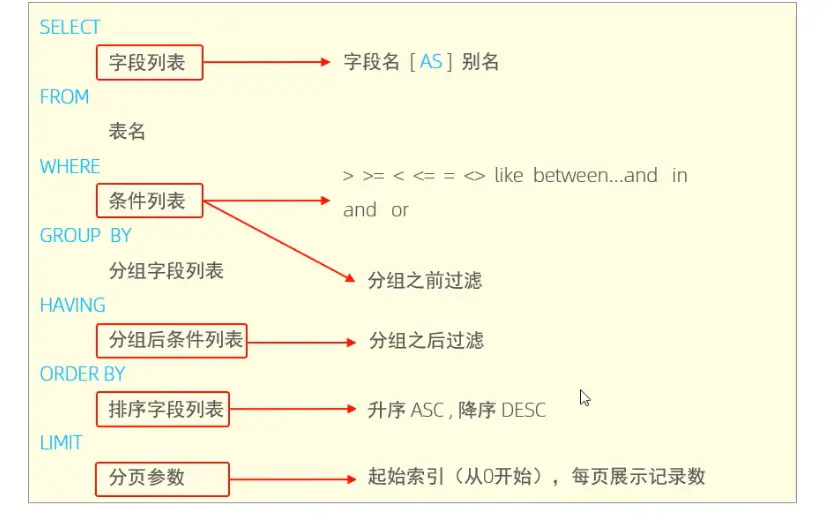

  

### 一、完整 SQL 书写顺序（语法层面）

在原有多表关联的基础上，加入 `DISTINCT` 去重和常用函数后，标准语法书写顺序如下：

```
SELECT [DISTINCT] 字段/表达式/函数列表
FROM 表1
[INNER / LEFT / RIGHT / FULL JOIN 表2 ON 关联条件]
[WHERE 行级过滤条件（可使用单行函数）]
[GROUP BY 分组字段]
[HAVING 分组后过滤条件（可使用聚合函数）]
[ORDER BY 排序字段/表达式 [ASC/DESC]]
[LIMIT 分页参数]
```

#### 关键位置说明

1. **DISTINCT 的位置** 紧跟在 `SELECT` 之后、字段列表之前，作用是对最终查询结果的整行数据去重；只能写在 SELECT 子句的最开头，不能嵌套在字段中间。
2. **常用函数的书写位置** SQL 函数主要分为**单行函数**和**聚合函数**两大类，书写位置有明确区别：

- **单行函数**（如字符串函数 `CONCAT/SUBSTRING`、数值函数 `ROUND/ABS`、日期函数 `DATE_ADD/DATEDIFF`、流程函数 `IF/CASE WHEN`）：可以写在 `SELECT` 字段列表、`WHERE` 条件、`ORDER BY` 排序、`GROUP BY` 分组中，对每行数据单独计算。
- **聚合函数**（`COUNT() / SUM() / AVG() / MAX() / MIN()` 等）：只能写在 `SELECT` 字段列表、`HAVING` 过滤条件、`ORDER BY` 排序中；**禁止写在 WHERE 中**（原因和执行顺序直接相关）。

---

### 二、MySQL 内部执行顺序（逻辑执行层面）

从数据库底层执行逻辑来看，表连接、过滤、分组、函数计算、去重、排序是严格按先后顺序执行的，完整执行链路如下：

1. **FROM + JOIN：数据源组装** 先读取所有关联的表，按 `JOIN` 类型和 `ON` 关联条件做表连接，生成一张临时的“全量数据表”，确定本次查询的完整数据源。
    - 此阶段只做表的拼接，不涉及函数计算和去重。
2. **WHERE：行级过滤** 对上一步生成的临时表，按 `WHERE` 后的条件逐行过滤，只保留符合条件的行。
    - ✅ 可以使用**单行函数**对字段做运算后再判断条件（比如 `WHERE YEAR(create_time) = 2024`）；
    - ❌ 不能使用**聚合函数**，因为此时还未分组，聚合计算还未执行。
3. **GROUP BY：数据分组** 按指定字段对过滤后的数据进行分组，把相同字段值的行归为一组。
    - 分组字段中可以使用单行函数（比如 `GROUP BY DATE(create_time)` 按日期分组）。
4. **聚合函数计算** 针对每个分组，执行 `SELECT` 和 `HAVING` 中用到的聚合函数（`COUNT/SUM/AVG` 等），计算出每个分组的聚合结果。
    - 这是聚合函数唯一的执行阶段，因此所有聚合逻辑都晚于 WHERE 过滤。
5. **HAVING：分组后过滤** 对分组并计算完聚合结果的数据，按条件做二次过滤。
    - ✅ 可以直接使用聚合函数作为过滤条件（比如 `HAVING COUNT(id) > 10`）；
    - 这里也可以使用单行函数，但通常以聚合条件为主。
6. **SELECT：字段投影与表达式计算** 筛选最终要返回的字段，计算字段别名、执行所有**单行函数**的最终运算，生成结果集的列结构。
    - 注意：字段别名是在这一步生成的，因此 WHERE/GROUP BY 中不能使用 SELECT 里定义的别名。
7. **DISTINCT：结果去重** 对 SELECT 生成的结果集，按整行所有字段的值做去重，只保留不重复的行。
    - 因为在 SELECT 之后执行，所以 DISTINCT 是对最终输出的列去重，而非对原始表数据去重。
8. **ORDER BY：结果排序** 按指定字段对去重后的结果集做升序/降序排序。
    - 可以使用字段、别名、表达式、单行函数、聚合函数排序。
9. **LIMIT：分页截取** 从排序后的最终结果中，截取指定行数的数据返回。

---

### 三、核心总结

1. 书写顺序上：`DISTINCT` 属于 SELECT 子句的开头修饰符，函数按类型分别写在对应子句中；`JOIN` 始终紧跟 FROM 之后，共同构成数据源部分，位于 WHERE 之前。
2. 执行顺序上：表连接 → 行过滤 → 分组 → 聚合计算 → 分组过滤 → 字段计算 → 去重 → 排序 → 分页。
3. 关键规则：聚合函数晚于 WHERE 执行，所以 WHERE 不能用聚合函数；DISTINCT 晚于 SELECT 执行，是对最终输出结果去重。