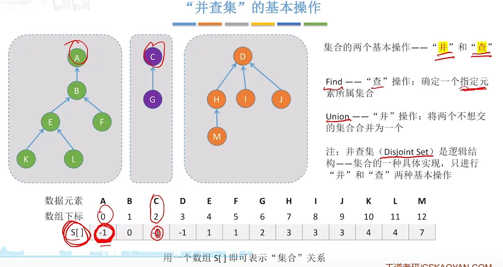
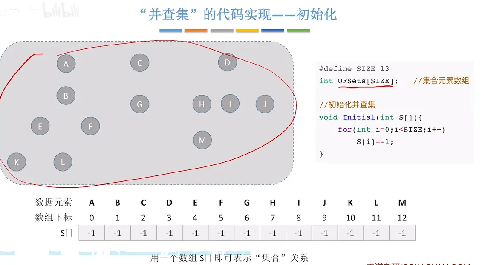
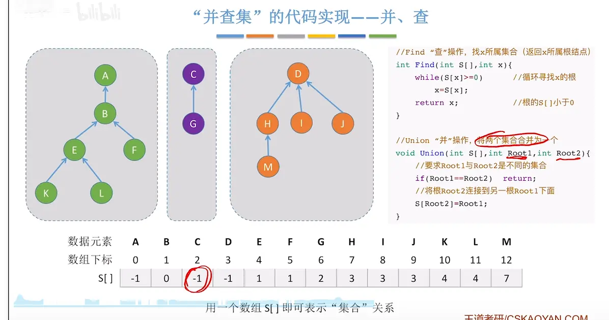
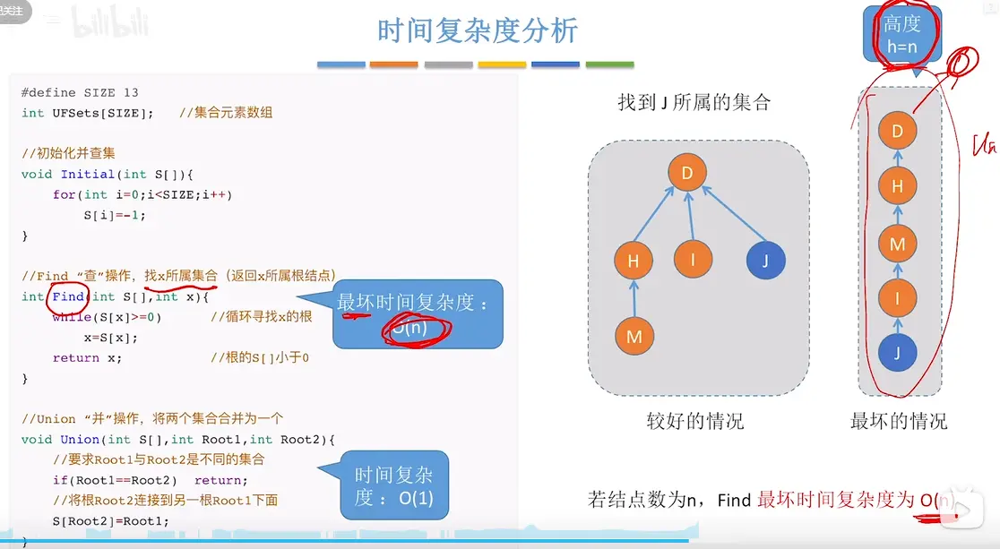
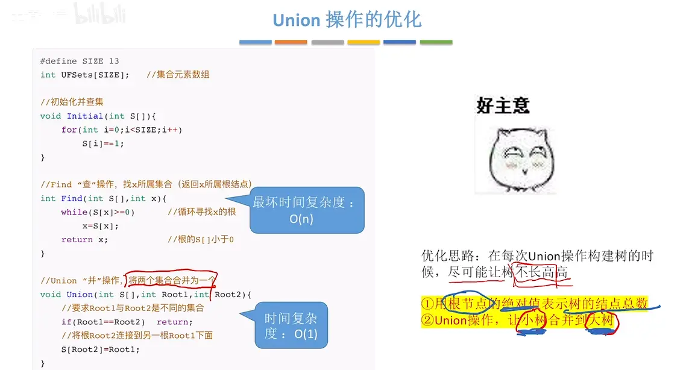
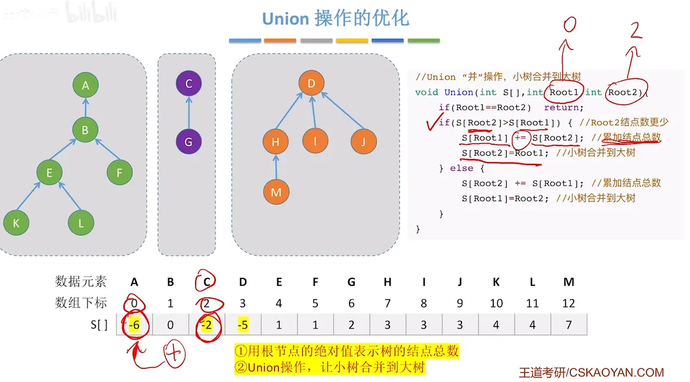
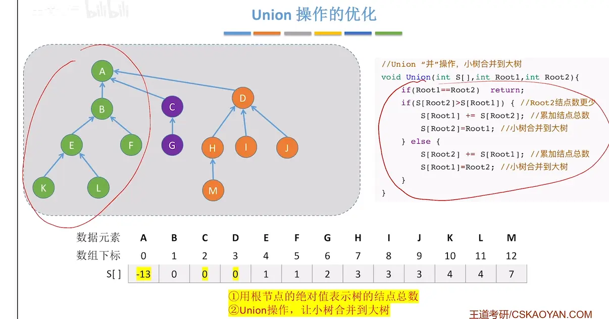
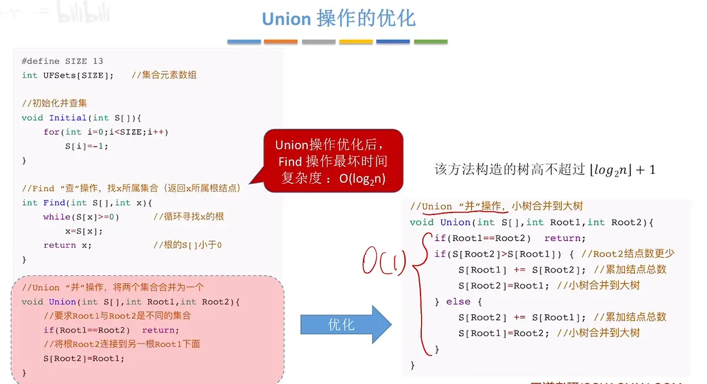
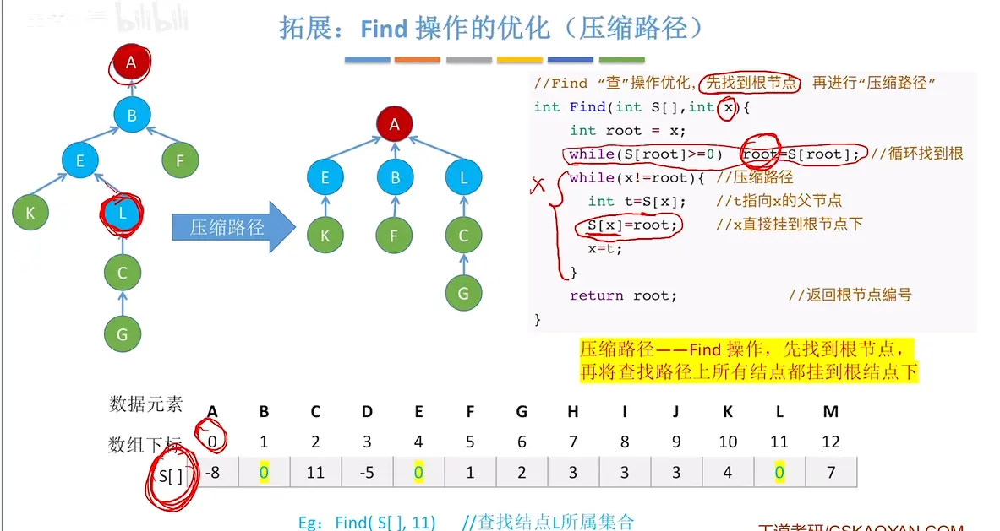
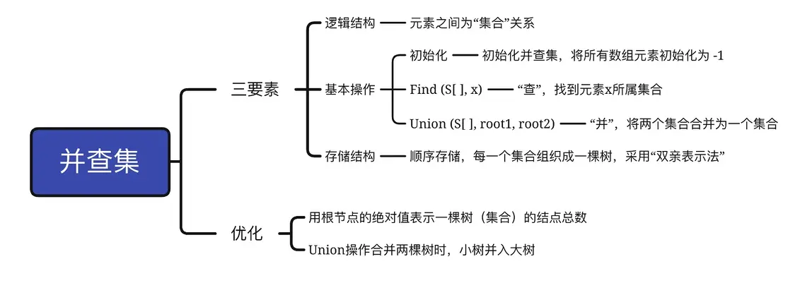

# 并查集的概念

  

# 使用双亲表示法

  

# 并查集初始化  

  

# 并查集代码  
## 初始化并查集  
  

## 并和查  
  
如果两个  节点不是根节点先 find 到根节点  在进行合并  

## 时间复杂度分析  

  

## 优化代码  （优化并操作小并大）
  
  
  

  

## 进一步优化（压缩路径）  

# 总结  
  
优化策略  
