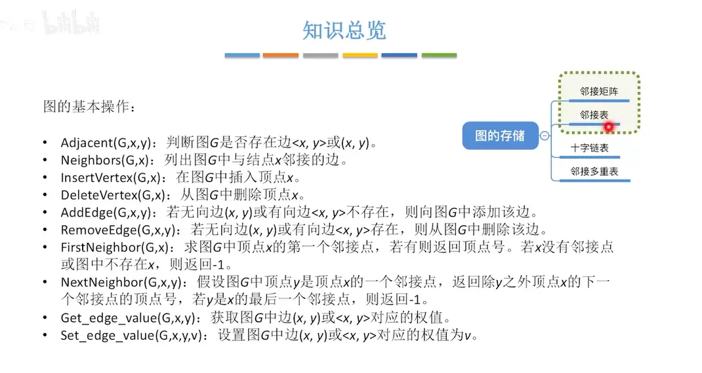  

# 判断边的存在
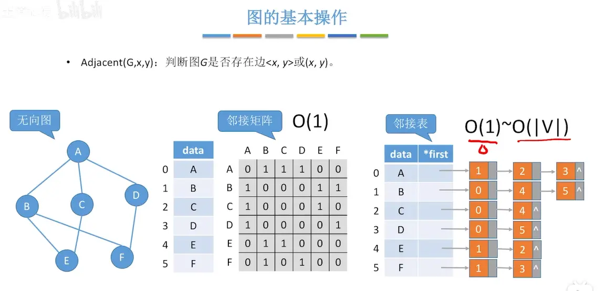  

# 列出邻接的边 （无向）
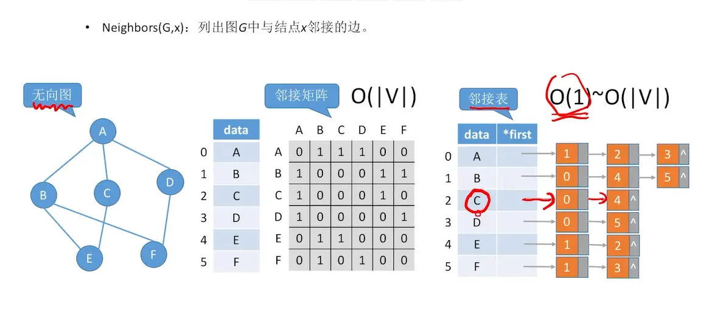  

# 列出邻接的边 （有向）
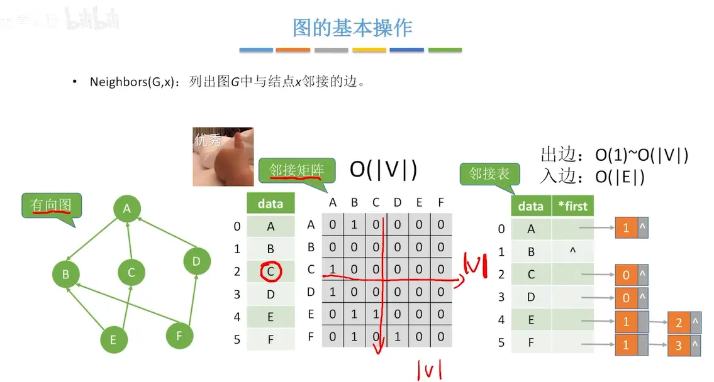

# 插入顶点
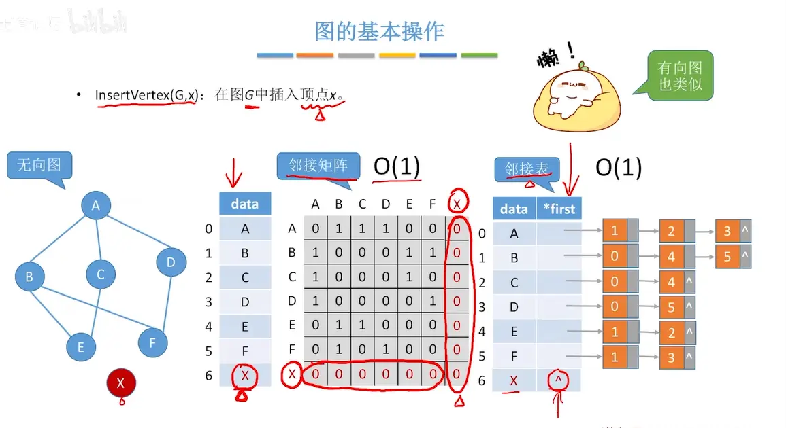  

# 删除顶点(无向图)
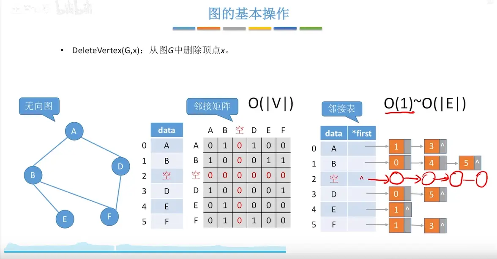  
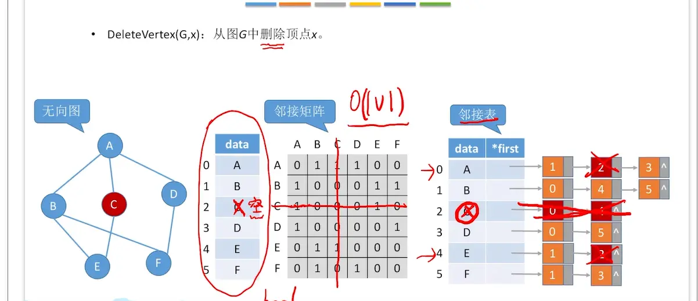  

# 删除顶点（有向图）
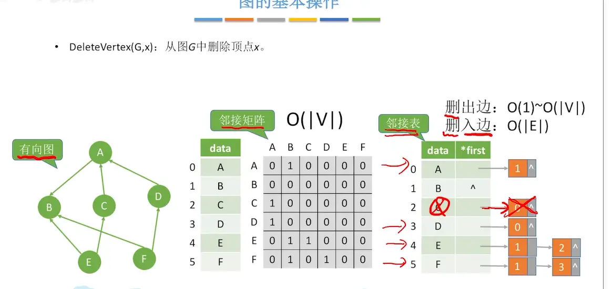  
如果是稀疏图   第二种也不高  

# 添加边  
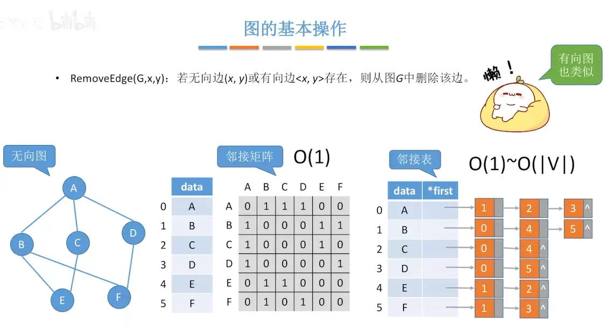  
头插 o 1   尾插 ov  

# 求顶点的第一个邻接点  （无向）  
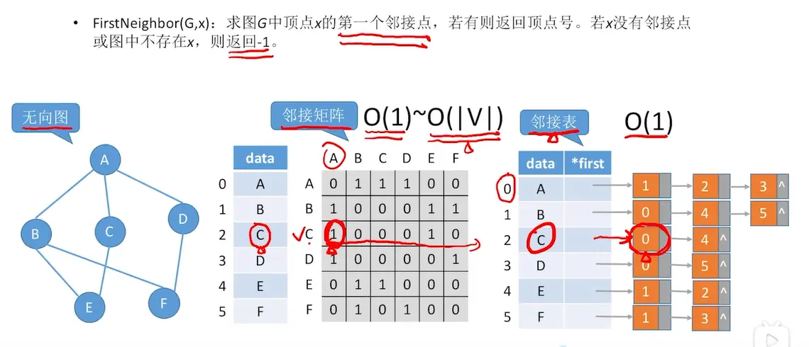

# 求顶点的第一个邻接点  （有向）   
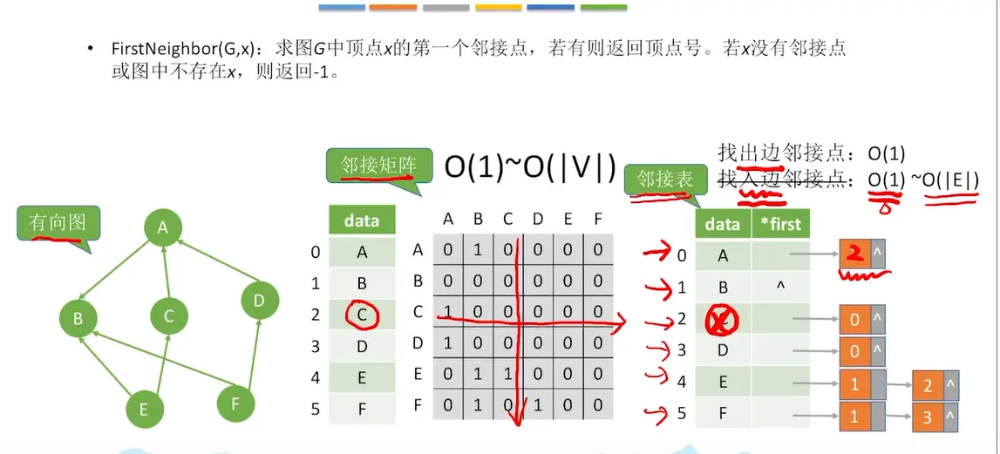  

# 求一个点的第二个点  

