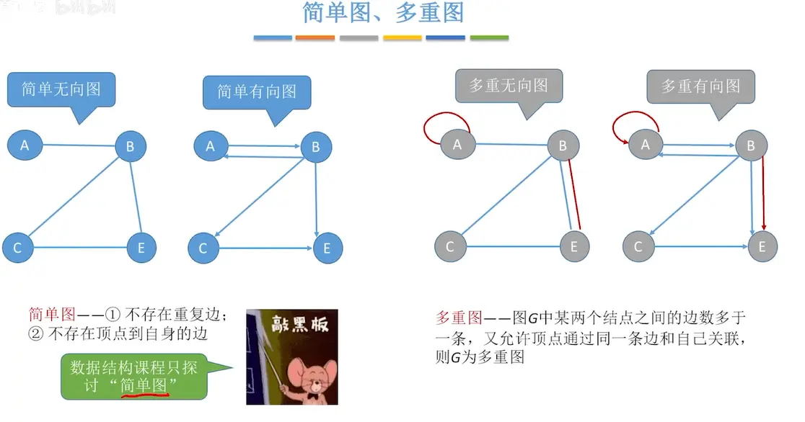
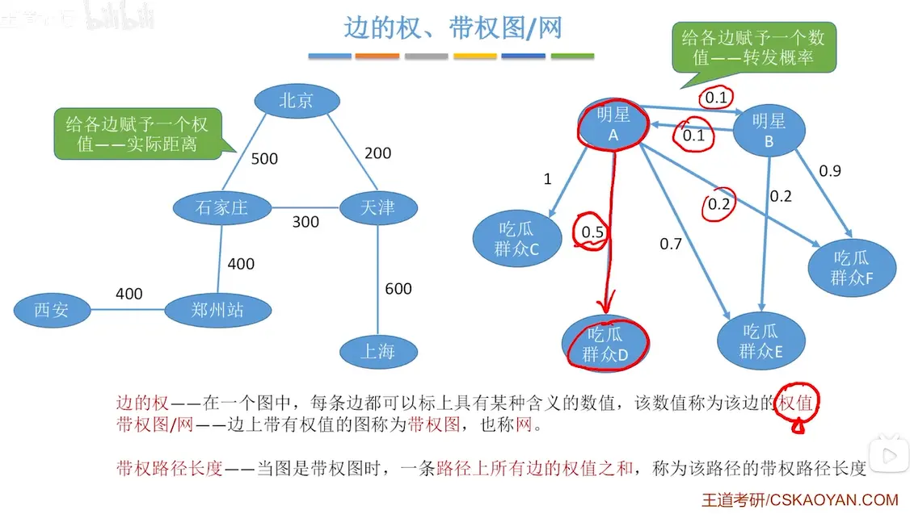
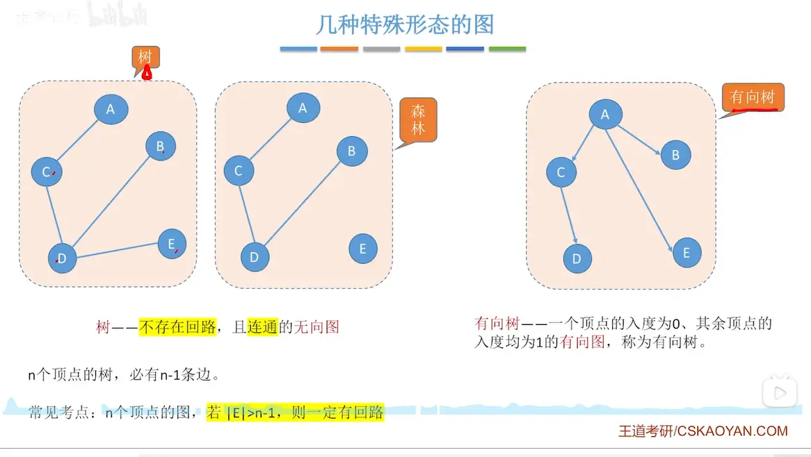

# 图的定义  
    

# 有向图 无向图  
  
有箭头的一边是弧尾    

# 简单图 多重图  

  

# 顶点的度 入度 出度  

  

# 顶点和顶点关系描述  
  

# 连通图 强连通图  
  

# 子图  
  
有向图也同理  

# 连通分量  （无向图）
  

# 强连通分量  （有向图）  
  

# 生成树  （连通图）

  

# 生成森林（非连通分量）  
  

# 边的权、带权图、网  
  

# 几种特殊的图  
  

# 稀疏图/稠密图  
  
预制不绝对  

# 树  
  
有向树是连通的但不是强连通图  

# 总结  

