# aov 网  
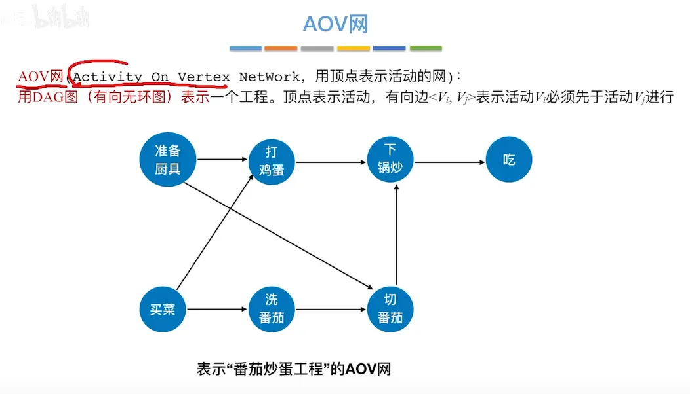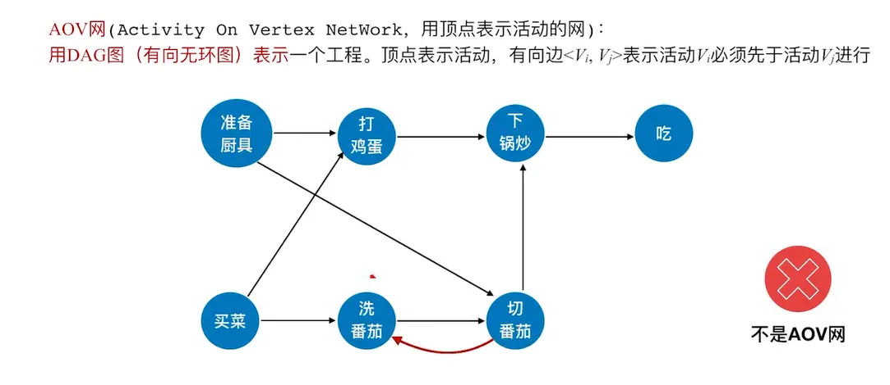  

# 拓补排序  
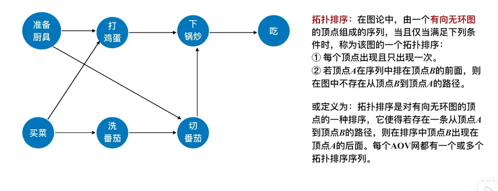  
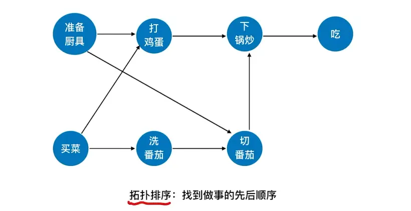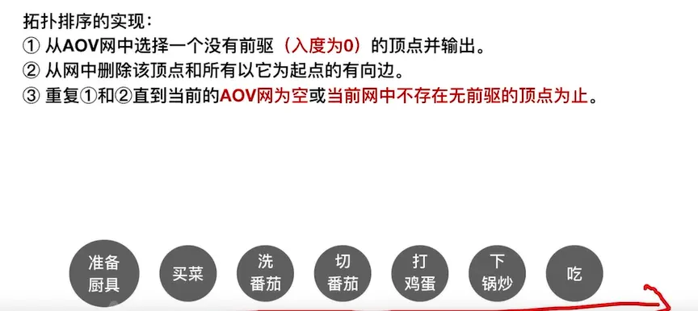  每个 aov 网都有一个/多个拓补排序序列  可以先买菜/准备厨具  
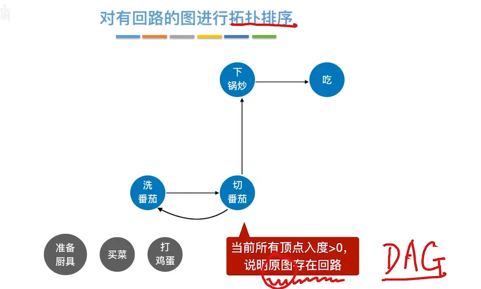  

# 实现代码  

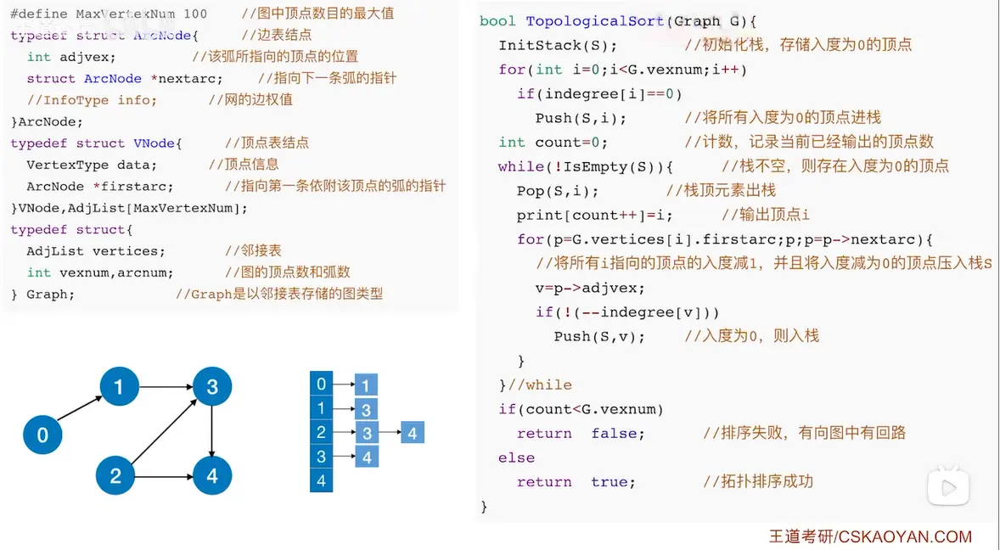

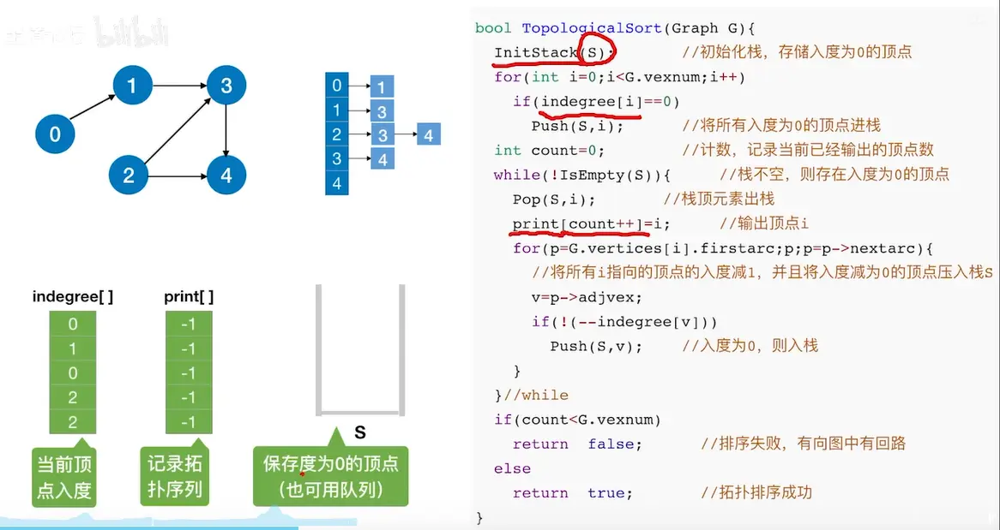
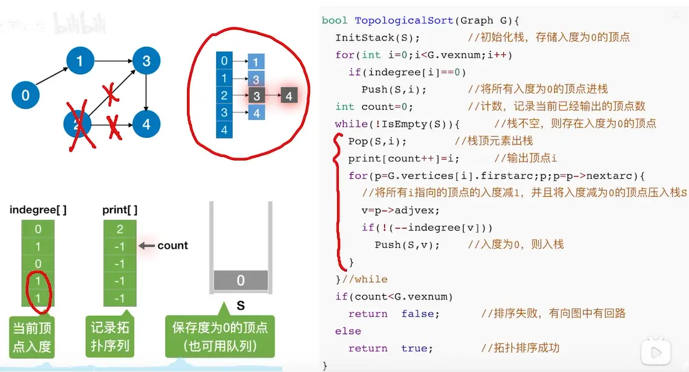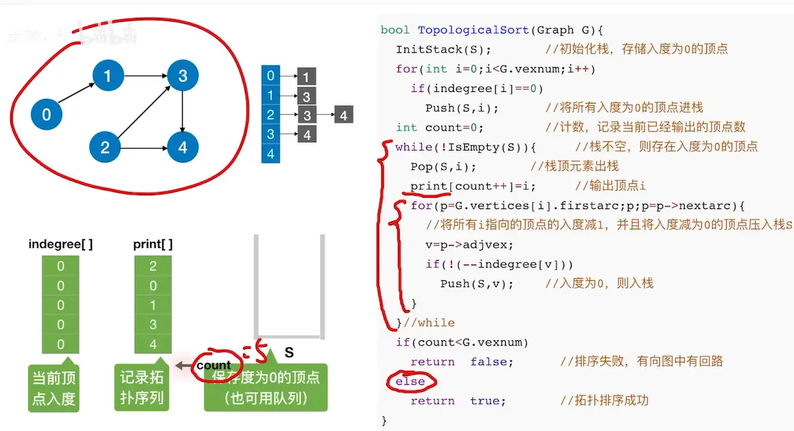  
# 时间复杂度分析  
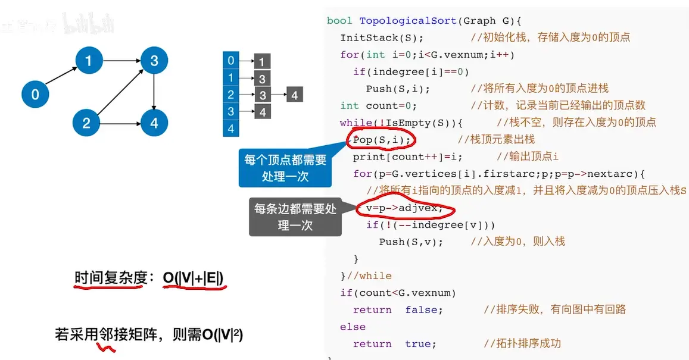  

# 逆拓补排序  
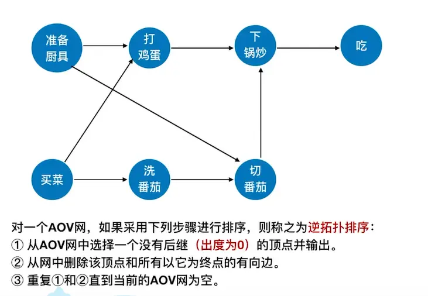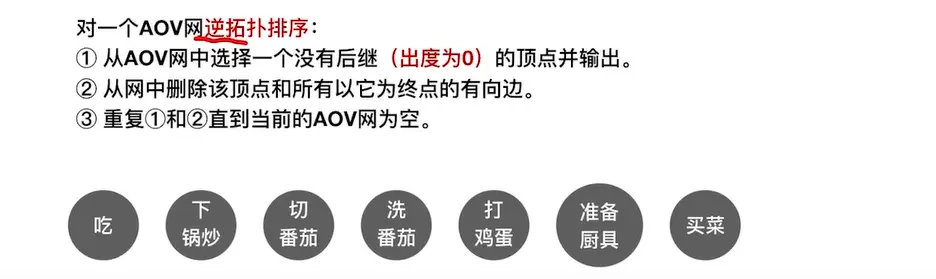  
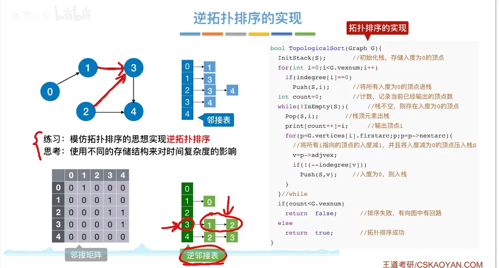  

# 使用 DFS 来实现逆拓补排序  
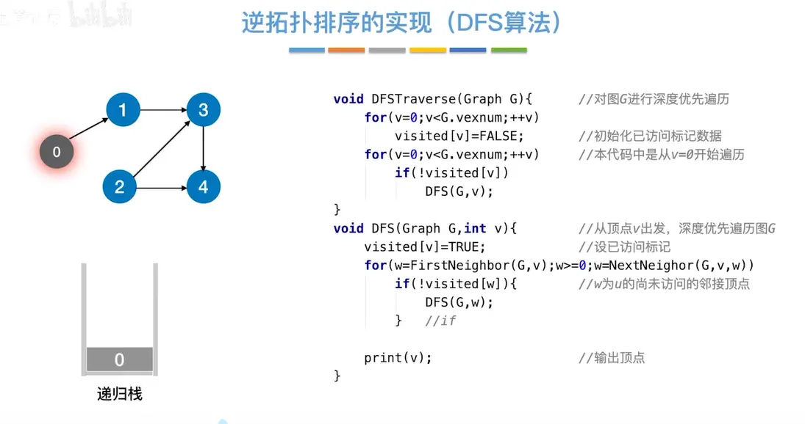  
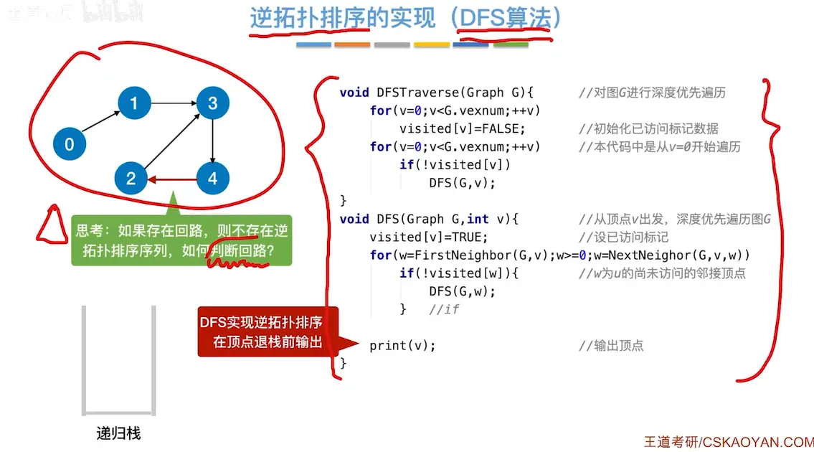  
判断回路的两种方法：  
最简单的办法，传入一个 sign 值，每递归一次 sign+1，超出总个数就有回路了  

拓扑排序，已经做过的事情就不要重复去做了，只要在 DFS 的入口判断一下这件事有没有被做过就可以了，一句 if（！visited[v]）就可以了，没被访问的顶点继续访问，访问过的略过  

