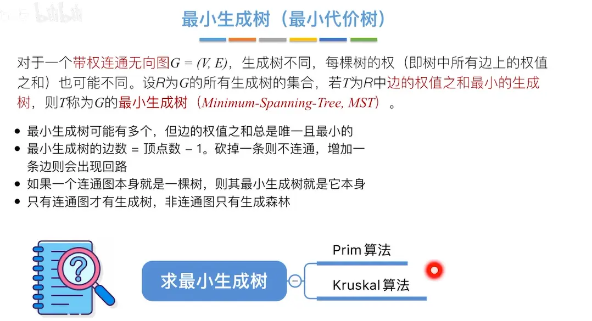
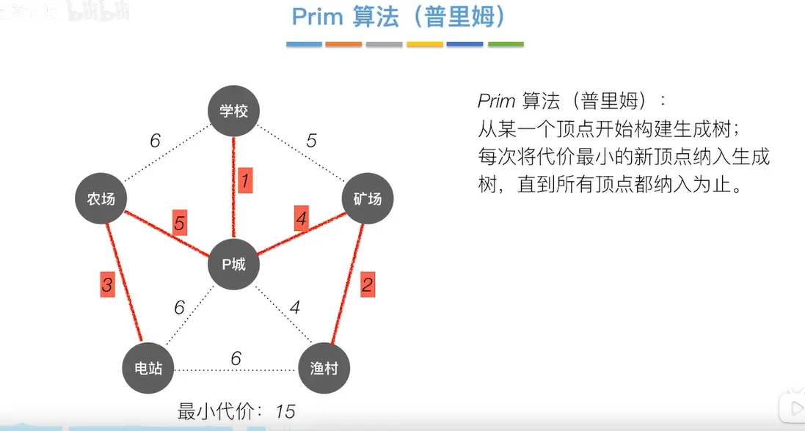
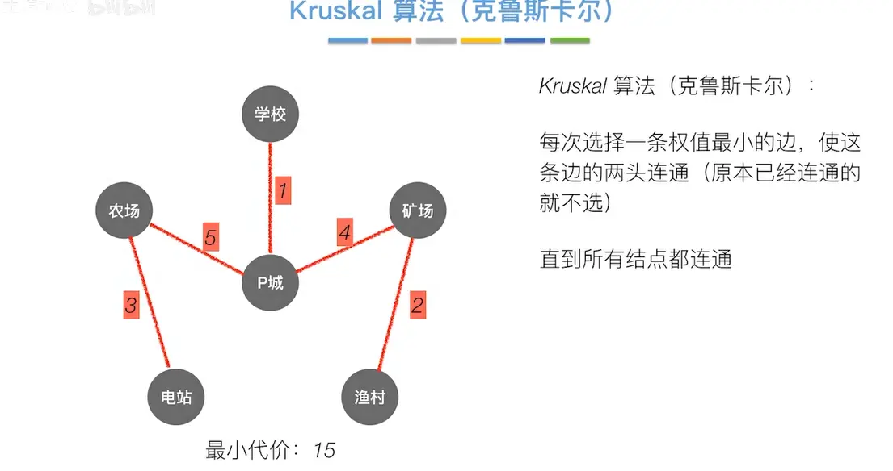
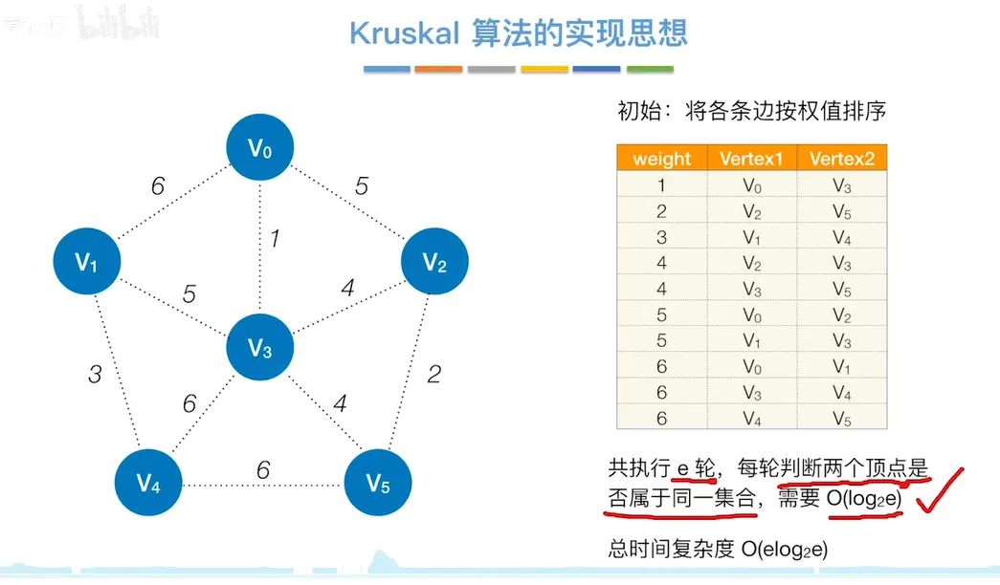
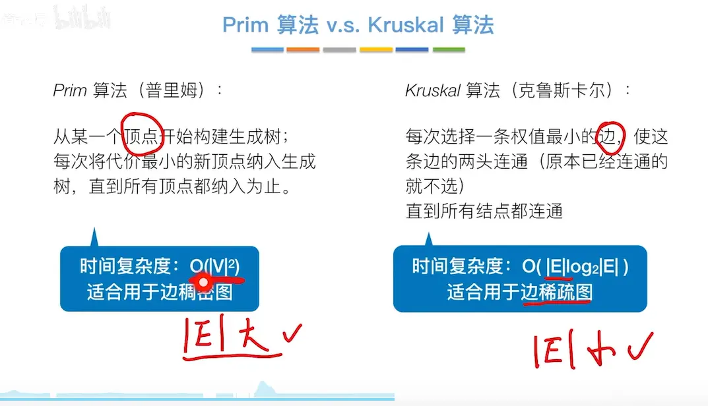

# 生成树  
有广度生成树和深度生成树
  

# 最小生成树  
  
# prim 算法  
  
每次从当前的树向外发散  

```c++
#include<cstring>

#include<iostream>

#include<algorithm>

  

using namespace std;

  

const int N=510;

  

int n,m;

int g[N][N];

int dist[N];

bool st[N];

  
  
  
  

int prim(){
    memset(dist,0x3f,sizeof(dist));
    int res=0;
    dist[1]=0;

    for(int i=0;i<n;i++){
        int t=-1;
        for(int j=1;j<=n;j++)
            if(!st[j]&&(t==-1||dist[t]>dist[j]))
                t=j;
        if(dist[t]==0x3f3f3f3f) return 0x3f3f3f3f;
        res+=dist[t];
        st[t]=true;

        for(int j=0;j<=n;j++){

            if(!st[j])  dist[j]=min(dist[j],g[t][j]);
        }
    }
    return res;
}

  
  

int main(){
    cin>>n>>m;
    memset(g,0x3f,sizeof g);
    while(m--){

        int a,b,c;

        cin>>a>>b>>c;

        g[a][b]=g[b][a]=min(g[a][b],c);

    }

    int t=prim();

    if(t==0x3f3f3f3f) cout<<"impossible";

    else cout<<t<<endl;

    return 0;

}
```

# Kruskal 算法  需要使用到并查集
  
  
[并查集（双亲表示法）](../6树/5树和二叉树的应用/并查集（双亲表示法）.md)
# 算法时间复杂度分析
  

# 总结  
