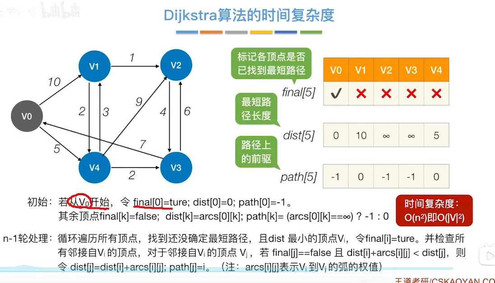

# 算法执行过程
  
# 算法分析  


  


# 代码实现  

```

#include <cstring>

#include <iostream>

#include <algorithm>

  

using namespace std;

  

const int N = 510;//朴素的算法,这个没有经过堆优化     这个算法不能有负权边    

  

int n, m;

int g[N][N];//这里放的是权值

int dist[N];

bool st[N];//每个点的访问状态

  

int dijkstra()

{

    memset(dist, 0x3f, sizeof dist);

    dist[1] = 0;

  

    for (int i = 0; i < n - 1; i ++ )//一次可以确定一个点到原点的最短路径,,这里原点定好是0了所以这里用n-1次

    {

        int t = -1;

        for (int j = 1; j <= n; j ++ )

            if (!st[j] && (t == -1 || dist[t] > dist[j])) t = j;//是用堆优化就是不需要这样排序 哈哈哈哈

  

        st[t] = true;

        for (int j = 1; j <= n; j ++)

            if(!st[j]){//每个都看一下有没有连接  有的就取最小的数

            dist[j] = min(dist[j], dist[t] + g[t][j]);

            }

    }

  

    if (dist[n] == 0x3f3f3f3f) return -1;

    return dist[n];

}

  

int main()

{

    scanf("%d%d", &n, &m);

  

    memset(g, 0x3f, sizeof g);

    while (m -- )

    {

        int a, b, c;

        scanf("%d%d%d", &a, &b, &c);

  

        g[a][b] = min(g[a][b], c);

    }

  

    printf("%d\n", dijkstra());

  

    return 0;

}
```