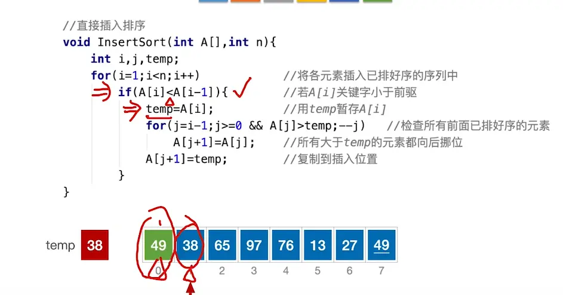
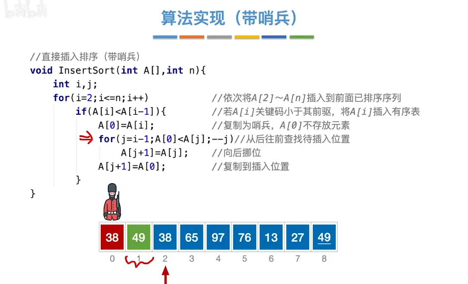
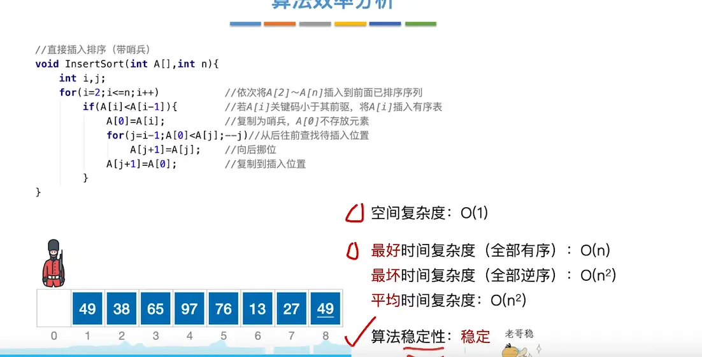
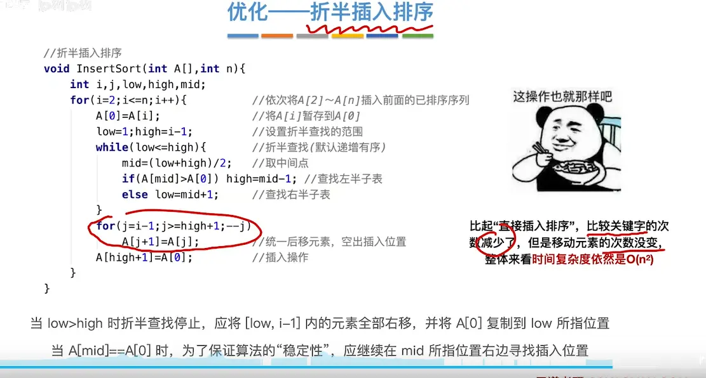
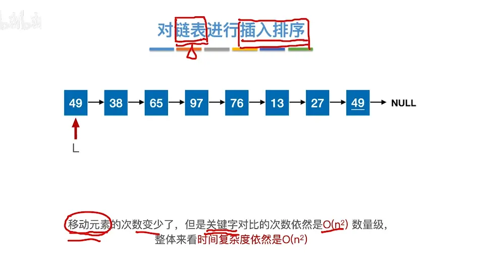
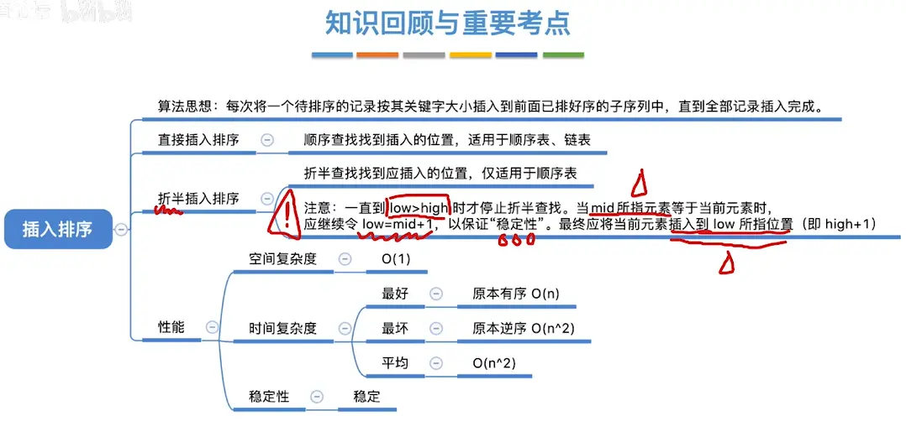

# 不带哨兵和带哨兵的
带哨兵的不过就是把暂存变量放到了 a【0】中而不是在 temp 中
  
  
这是一个非常经典且切中要害的问题！引入“哨兵”机制的核心目的，正是为了**去掉这个 `j >= 0` 的边界判断**。

我们来拆解一下这两种情况在极端条件下的表现：

### 1. 没带哨兵的情况（第一张图）

在这个版本中，数组的数据是从下标 `0` 开始存的（`A[0]` 到 `A[n-1]`）。

假设我们要插入的元素 `temp` 非常小（比前面所有排好序的元素都要小），内层循环会不断把前面的元素往后挪，`j` 会不断自减（`--j`）。

- 当 `j = 0` 时，比对完 `A[0] > temp`，`A[0]` 往后移，接着 `j` 变成了 `-1`。
    
- 如果循环条件里没有 `j >= 0` 这道防线，下一轮循环就会试图去执行 `A[-1] > temp`。
    
- **致命后果：** 程序访问了数组之外的内存区域（**数组越界**），这会导致程序崩溃或读到垃圾数据。因此，`j >= 0` 是必不可少的“安全刹车”。
    

### 2. 带哨兵的情况（第二张图）

在这个版本中，数组的数据是从下标 `1` 开始存的（`A[1]` 到 `A[n]`），特意腾出了 `A[0]` 这个位置作为“哨兵”。

在每次进入内层循环前，先把当前要插入的值复制到了 `A[0]` 里（`A[0] = A[i]`）。

同样假设遇到了一个极小的值，`j` 不断自减：

- 当 `j` 减到 `0` 的时候，循环的判断条件变成了 `A[0] < A[0]`。
    
- 因为一个数字不可能严格小于它自己，所以这个条件必然为 **假 (false)**。
    
- **巧妙结果：** 循环自然而然就终止了！它自带了停止机制，永远不会减到负数去访问未知内存，也就不需要额外写代码去判断 `j` 是不是大于等于 0 了。
    

### 总结：哨兵到底优化了什么？

在没有哨兵的情况下，内层循环每次都要做**两次**判断：

1. 索引越界了吗？(`j >= 0`)
    
2. 找到位置了吗？(`A[j] > temp`)
    

有了哨兵之后，`A[0]` 既充当了暂存变量（替代了 `temp`），又充当了一堵“防撞墙”。内层循环每次只需要做**一次**判断：

1. 找到位置了吗？(`A[0] < A[j]`)
    

在数据量巨大的时候，内层循环会被执行成千上万次，省去一半的判断操作能带来可见的执行效率提升。这就是考研数据结构中非常爱考的**常数级优化**小技巧。  

#   复杂度分析

#  折半查找 (对前面的进行二分查找)  
  

# 对于链表的插入排序  

  

# 总结  
