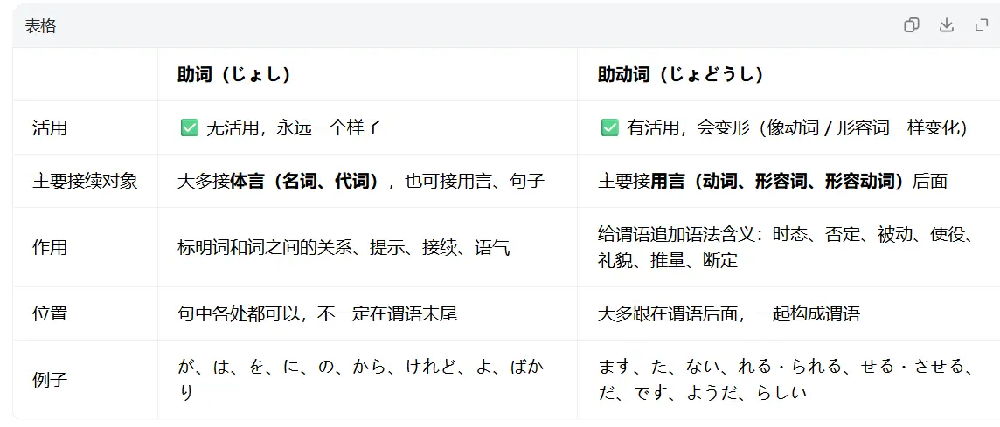

## 助词和助动词  

**助词：无活用（词形不变）；助动词：有活用（词形可以变化）**，二者都属于**附属词**，不能单独当句子主干。

## 1. 对比表

## 2. 举例看懂

### 助词（不变形）

私**は**本**を**読む。 「は」「を」永远是这个写法，不会变。

### 助动词（可以变形）

- ます：ます・ました・ません・ましょう
- た（过去）：読んだ → 読んでいた
- ない：ない・なかった
- だ：だ・です・だった・ではない

> 例：読み**ます**（现在）、読み**ました**（过去），**ます**发生变化，所以是助动词

## 3. 容易踩坑的点

1. **です / だ 是助动词（断定）**，不是助词，可以变形：だった、ではない
2. **て、で 是助词（接续助词）**，没有活用，不是助动词
3. 有些接续助词接在动词后面（如 ば、ても、ので），虽然接在用言后，但**不能变形，依然是助词**
4. 补助动词（ている、てくる这类）≠助动词，是独立动词

## 4. 快速判断口诀

看能不能变形： **能变 → 助动词；不能变 → 助词**