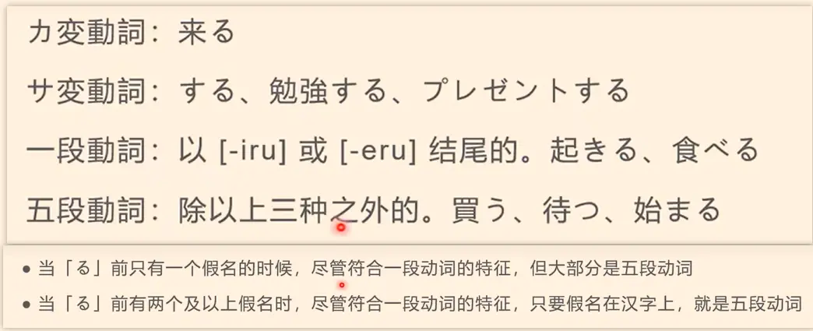
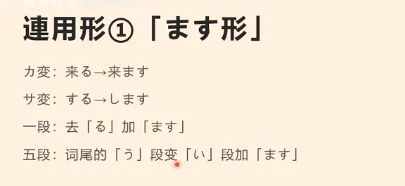
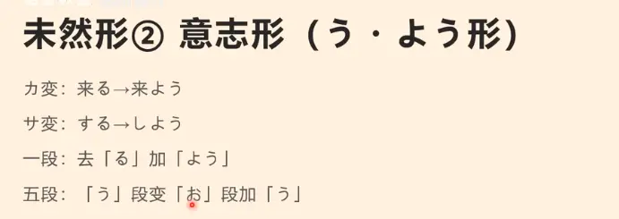
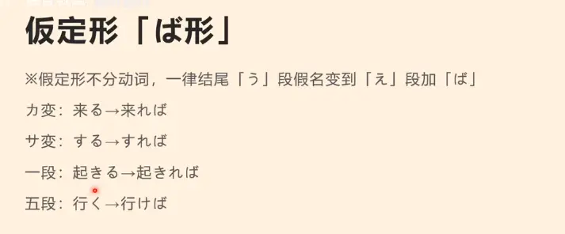
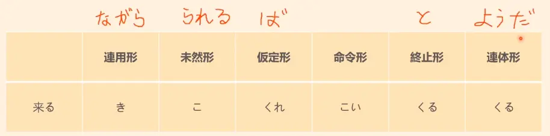

# 日语动词分类 
 
 后面两个是特殊规则   遇到这两个特殊的  需要死记硬背   相应的一段动词  

# 日语动词变形  （变形可能导致音的变化）  
动词的@形是指它除开变为@之前那个部分

## 连用形
  

た形和て形一样  变化规则一样  可以对应起来  

## 未然形  

这里五段的变形  中以う段结尾  是 w 行的那个  

  五段变形变为长音  

## 假定形  

  

## 命令形  

  
 せよ・よ这两个书面语用  用的少 口语场景几乎不用  不用记  

## 动词终止形 连体形  （原型）  

为什么要区分呢   只有动词的终止形和连体形是一样的  

# 动词活用表  （日语语法中要根据助词和助动词的不同需要选择不同的形）  
