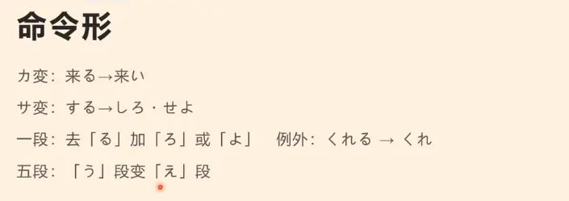

# 日语动词分类 
 
 后面两个是特殊规则   遇到这两个特殊的  需要死记硬背   相应的一段动词  

# 日语动词变形  （变形可能导致音的变化）

## 通用形
  

た形和て形一样  变化规则一样  可以对应起来  

## 未然形  

  
这里五段的变形  中以う段结尾  是 w 行的那个  

  五段变形变为长音  

## 假定形  

  

## 命令形  

  
 せよ・よ这两个书面语用  用的少 口语