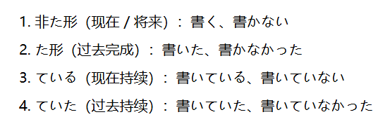

# 日语动词四种时态（时 × 体）

> 一句话：这四种不是平行的四个"时态"，而是 **时（现在·将来 / 过去）× 体（完成·单纯 / 持续·进行）** 交叉出来的四个格子。

## 0. 先建坐标系

|  | 完成 · 单纯陈述 | 持续 · 进行 / 状态 |
| --- | --- | --- |
| **现在 · 将来** | 非た形：書く・書かない | ている：書いている・書いていない |
| **过去** | た形：書いた・書かなかった | ていた：書いていた・書いていなかった |

放到时间轴上理解：

- **非た形** → 从"此刻"一直延伸到将来的一整片
- **た形** → 过去的一个完成点
- **ている** → 一段一直延续到"此刻"的持续
- **ていた** → 过去某段区间内的一段持续

---

## 1. 非た形（書く / 書かない）—— 现在 · 将来

**核心：表示现在·将来的完成体，不表示"正在"。**

| 使用场景 | 例句 | 说明 |
| --- | --- | --- |
| 习惯、反复 | 毎朝六時に起きる。 | 一贯如此，不是此刻这个动作 |
| 真理、恒常、属性 | 地球は太陽の周りを回る。 | 客观事实、能力：彼は英語が話せる |
| 意志、打算、约定 | 明日は図書館へ行く。 | 将来的动作；否定＝我不去「行かない」 |
| 现场即时动作 / 实况解说 | じゃ、食べるね。／ボールを蹴る！ | 说话当下即将发生 |
| 条件、从句中的将来 | 雨が降るなら、行かない。 | 从句里也用它表示"将来" |

最容易错：非た形虽然叫"现在时"，但绝不表示"正在"。要表达"正在"必须用 ている。

---

## 2. た形（書いた / 書かなかった）—— 过去完成

**核心：过去已经完结的动作/状态，但实际用法远超"过去时"。**

| 使用场景 | 例句 | 说明 |
| --- | --- | --- |
| 过去一次性事实 | 昨日、映画を見た。 | 最基础用法 |
| 完了、实现 | やっと宿題が終わった。 | 用过去形表示"已经做完"这一结果 |
| 发现、想起、确认 | あ、ここにあった！／そうだ、今日は日曜日だった。 | 有"原来…""对了…"的恍然语气 |
| 反事实、后悔 | もっと早く来ればよかった。／言わなければよかった。 | ～ばよかった＝要是…就好了 |
| 命令、催促（口语） | どいた、どいた！／静かにした！ | 语气强硬，多用于口语 |
| 过去的状态、性质 | 子供のころ、体が弱かった。 | 形容词过去式同此逻辑 |
| 修饰名词（从句） | 昨日買った本 | た形可直接做定语 |

---

## 3. ている（書いている / 書いていない）—— 现在持续

**核心：不只是"正在进行"，还包括"结果状态的持续"。**

| 使用场景 | 例句 | 说明 |
| --- | --- | --- |
| 动作正在进行 | 今、手紙を書いている。 | 最典型用法 |
| **结果状态的持续** | 結婚している／知っている／眼鏡をかけている／東京に住んでいる／窓が開いている | 瞬间动词 + ている = 状态，这是重点 |
| 反复、习惯 | 毎日ジョギングしている。 | 习惯的持续 |
| 经历、记录 | その映画はもう見ている。 | 表示"已经看过" |
| 未来的进行 | 明日の今ごろは試験を受けている。 | ている 也能指向将来 |

状态动词一般不加 ている：ある・いる・できる・要る・似合う。

---

## 4. ていた（書いていた / 書いていなかった）—— 过去持续

**核心：把 ている 整体平移到过去。**

| 使用场景 | 例句 | 说明 |
| --- | --- | --- |
| 过去某时的进行（背景） | 電話が鳴ったとき、私は風呂に入っていた。 | 常做叙述背景 |
| 过去状态的持续 | そのころ、彼は東京に住んでいた。 | |
| 过去的习惯 | 学生のころ、毎晩遅くまで本を読んでいた。 | |
| 过去的发现 | 窓を開けると、雪が降っていた。 | 开门"一看"，雪正下着 |
| 与 た形 的对比 | 宿題を書いた（写完了）／宿題を書いていた（当时正在写） | 完成 vs 进行 |

---

## 5. 易错对比

1. **書かなかった vs 書いていない**
   - 書かなかった＝（当时）没写 → 过去的事实
   - 書いていない＝还没写 / 没在写 → 现在的状态
2. **知った vs 知っている**
   - 知った＝得知的那一瞬间
   - 知っている＝"知道"这个状态（不能用 知る）
3. **从句时态：行ったとき / 行くとき**
   - 日本へ**行った**とき、写真を撮った → 到了之后拍
   - 日本へ**行く**とき、写真を撮った → 出发之前拍
4. **行っていた 的歧义**
   - "（当时）在那儿"（结果的持续）
   - "过去常去"（过去的习惯）
   - 靠上下文判断
5. **否定形式的对应**

| 形式 | 否定 | 含义 |
| --- | --- | --- |
| 非た形 | 書かない | 不做 / 不会做（现在·将来） |
| た形 | 書かなかった | 没做（过去） |
| ている | 書いていない | 没在做 / 还没做 |
| ていた | 書いていなかった | 当时没在做 / 那时还没做 |

---

## 6. 口诀

**此刻正在做、或状态还在 → ている；此刻做、将来做、一贯如此 → 非た形；过去做完一次 → た形；过去某时正在 → ていた。**

判断顺序（做题时按这个走）：

1. 动作发生在**过去**还是**现在/将来**？
2. 是**一次完成**还是**持续/进行**？
3. 动词是**瞬间动词**还是**持续动词**？（瞬间动词 + ている 多半是"状态"）

---

## 7. 相关笔记

- [[日语动词变化规则]]（た形、て形的变形规则）
- [[日语动词不同变化接后缀的用法]]
- [[日语名词形容词动词过去式用法]]
- [[助词和助动词]]（ている 的构成：て形 + 补助动词いる）
