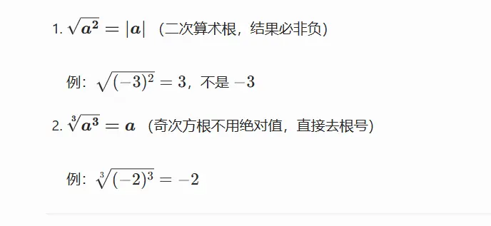

# 开根号
$x^2=a$   ->  $x=\pm \sqrt{ a }$

>   
> 求极限的时候 全是无穷加减  默认分母为 1  往分式上面靠   这样更好求
 对于偶次方根   分式形式的时候  现提出因子  在上下同除  
  对几次方根    上下可以同除  

# 等价无穷小的错误使用  
1 的无穷形式使用基本极限的方法做
  
  
在高等数学的极限计算中，底数部分包含无穷小时能否进行等价代换，**完全取决于指数是“常数”还是“变量”**。
无论底数还是指数含有无穷小，遇到 $u(x)^{v(x)}$ 形式的极限，第一步永远是利用对数恒等式将其改写：

$$u(x)^{v(x)} = e^{v(x) \ln u(x)}$$

因为指数函数 $e^x$ 是连续函数，极限符号可以跨过底数 $e$ 移到指数上：

$$\lim u(x)^{v(x)} = e^{\lim [v(x) \ln u(x)]}$$

此时，指数部分变成了 $v(x) \cdot \ln u(x)$ 的**乘积形式**。只要是在乘除法因子中，你就可以放心地使用等价无穷小替换了。

## 第一类：指数是“常数” —— 放心直接换

如果你的式子是 $(\text{无穷小})^C$ （其中 $C$ 是常数），这种情况本质上是乘法的延伸。

- **规则**：只要底数是一个独立的乘法因子，**可以直接对底数进行等价无穷小代换**。
    
- **原理**：比如 $(\sin x)^3$，本质上是 $\sin x \cdot \sin x \cdot \sin x$。既然乘法因子可以换，那么整体代换也是合法的。
    
- **示例**：
    
    $$ \lim_{x \to 0} \frac{(\arcsin x)^2}{x^2} = \lim_{x \to 0} \frac{(x)^2}{x^2} = 1 $$
    

## 第二类：指数是“变量” —— 绝对不能直接换！

当你的式子是 $u(x)^{v(x)}$ （即幂指函数），且指数 $v(x)$ 也是包含自变量的函数时，**严禁直接对底数 $u(x)$ 内部的无穷小进行等价代换**。

- **致命原因**：等价无穷小 $\alpha \sim \beta$ 只能保证 $\frac{\alpha}{\beta} \to 1$，**不能保证** $\alpha - \beta \to 0$。如果把带着微小误差的底数直接代换，经过变量指数的放大，极容易产生完全错误的极限。
    
- **唯一安全路径（$e$ 抬升法）**：
    
    遇到 $u(x)^{v(x)}$，不要犹豫，第一步强制变形为：
    
    $$ u(x)^{v(x)} = e^{v(x) \ln u(x)} $$
    
    把原问题转化为求指数部分 $v(x) \ln u(x)$ 的极限。到了指数上变成了乘法，你才可以重新开始考虑代换。
    

## 第三类：考场最高频 —— $1^\infty$ 型极限的“合法快捷操作”

在 $1^\infty$ 型极限 $\lim (1 + \alpha(x))^{v(x)}$ 中，底数里的 $\alpha(x)$ 是无穷小。很多人误以为在这里可以“直接换底数里的无穷小”，但实际上这是一种错觉。

- **表面操作**：比如 $\lim_{x \to 0} (1 + \sin x)^{\frac{1}{x}}$，很多人把它看成 $(1+x)^{\frac{1}{x}}$ 然后得出等于 $e$。虽然结果对了，但**逻辑是错的**（不是在底数里换的）。
    
- **真正的底层逻辑（公式法）**：
    
    对于 $\lim (1 + \alpha(x))^{v(x)}$，标准结论是它等于：
    
    $$ e^{\lim \alpha(x) \cdot v(x)} $$
    
    **关键点来了**：在这个转化公式中，原本在底数里的 $\alpha(x)$ 被“摘”了出来，放到了指数上与 $v(x)$ 相乘。**因为此时 $\alpha(x)$ 变成了乘法因子，所以你才可以对它进行等价无穷小代换！**
    
- **正确操作示范**：
    
    求 $\lim_{x \to 0} (1 + 1 - \cos x)^{\frac{1}{x^2}}$
    
    1. 识别为 $1^\infty$ 型，套用转化公式，极限转化为求 $e^{\lim (1 - \cos x) \cdot \frac{1}{x^2}}$。
        
    2. 在指数部分，$(1 - \cos x)$ 是**乘法因子**，直接替换为 $\frac{1}{2}x^2$。
        
    3. 指数极限为 $\lim \frac{1}{2}x^2 \cdot \frac{1}{x^2} = \frac{1}{2}$。
        
    4. 最终结果为 $e^{\frac{1}{2}}$。
        

> **总结口诀：**
> 
> **指数常数底随便换，指数变量底千万别碰。**
> 
> 遇到变量指数直接 $e^{\ln(\dots)}$ 抬上去，遇到 $1^\infty$ 记住 $e^{\alpha \cdot v}$ 在乘法里换。

# 定积分的运算(基本公式)  
完全可以。这两个拆分性质不仅是定积分最核心的基础属性，更是处理复杂积分时必须掌握的降维手段。

在高等数学中，它们分别被称为定积分的**线性性质**和**区间可加性**。我们来详细梳理一下它们的具体用法和考场上的“避坑指南”。

## 一、 有理运算拆分（线性性质）

定积分对于**加法、减法**以及**常数乘法**是完全开放的，你可以自由地拆解和组合。

**核心公式：**

$$ \int_a^b [\alpha f(x) \pm \beta g(x)] dx = \alpha \int_a^b f(x) dx \pm \beta \int_a^b g(x) dx $$

_(其中 $\alpha, \beta$ 为常数)_

**实战用法与避坑：**

1. **分治法**：当被积函数是一长串多项式或几个不同类型函数的加减组合时，立刻将其拆分成几个简单的积分分别计算。
    
2. **常数提取**：千万不要把常数留在积分号里面增加运算负担，第一步就把它提出来。
    
3. **⚠️ 致命红线（乘除法不可拆）**：
    
    这是初学者最容易犯的错。定积分的拆分**绝对不包含函数之间的乘法和除法**！
    
    - **错误**：$\int_a^b [f(x) \cdot g(x)] dx \neq \int_a^b f(x) dx \cdot \int_a^b g(x) dx$
        
    - **错误**：$\int_a^b \frac{f(x)}{g(x)} dx \neq \frac{\int_a^b f(x) dx}{\int_a^b g(x) dx}$
        
        遇到乘除法，你必须考虑换元法、分部积分法，或者像上一题那样进行三角恒等变换，而不能直接拆开。
        

## 二、 区间拆分（区间可加性）

只要函数在整个大区间上是可积的，你可以把积分区间在任意一点“切断”，拆成两段或多段相加。

**核心公式：**

$$ \int_a^b f(x) dx = \int_a^c f(x) dx + \int_c^b f(x) dx $$

**实战用法与避坑：**

1. ** $c$ 点的位置**：
    
    理论上，点 $c$ **不一定**非要在 $a$ 和 $b$ 之间。即使 $c$ 在区间 $[a, b]$ 之外，只要函数在包含 $a, b, c$ 的最大区间上可积，这个等式依然成立（利用积分上下限颠倒变号的性质即可证明）。但在实际做题中，我们通常选取区间内部的点进行拆分。
    
2. **何时“必须”使用区间拆分？**
    
    在面对研究生入学考试或高难度积分题时，以下三种情况属于**强制触发**区间拆分：
    
    - **分段函数**：函数在不同区间有不同的表达式。显然，必须在分段点 $c$ 处将积分拆开，各自代入对应的解析式。
        
    - **绝对值函数**：例如 $\int_0^3 |x-1| dx$。绝对值本质上就是分段函数，必须先找零点（$x=1$），然后拆分为 $\int_0^1 (1-x) dx + \int_1^3 (x-1) dx$ 来脱去绝对值符号。
        
    - ** $\max(f(x), g(x))$ 或 $\min(f(x), g(x))$ 型函数**：通过令 $f(x) = g(x)$ 找到交点，然后在不同区间分别取大者或小者，再进行区间拆分计算。
        

> **总结**：加减和常数随便拆（线性），区间分段随时切（可加），但一旦遇到函数相乘除，立刻停止“有理拆分”的念想，转向分部或换元。

在定积分的运算中，“换上下限”通常有两层含义：一是**直接颠倒上下限的位置**（上限变下限，下限变上限），二是**把原本的上下限数值替换成新的数值**。

这两者都有明确的触发条件和规则，我们分情况来看：

## 三、 随时可以换：颠倒上下限的位置

在定积分中，你**随时**可以把上限和下限的位置互换，唯一的代价是**在积分号前加一个负号**。

**核心公式：**

$$ \int_a^b f(x) dx = - \int_b^a f(x) dx $$

**什么时候需要这么做？**

1. **符合阅读习惯**：通常我们习惯下限小于上限（即从小积到大）。如果题目给的积分是 $\int_5^2 f(x) dx$，为了顺眼或方便利用某些公式，我们通常会将其写成 $-\int_2^5 f(x) dx$。
    
2. **吸收负号（极度高频）**：在做换元积分时，微分 $dx$ 经常会带出一个负号（比如令 $x = -t$，则 $dx = -dt$）。此时，我们通常**不把负号写在外面，而是直接用这个负号去把颠倒的上下限“翻转”回来**，这样可以极大减少计算中的符号错误。
    

## 圆的表达式  
![[assets/小的注意事项/小的注意事项-1779253959538.webp]]
# 导数极限形式也要分左极限和右极限
[导数定义存在问题](../好的例题/导数定义存在问题.md)  

# 左加右减  (定义域上的)
[函数基本知识](../3记忆内容/1-1函数/函数基本知识.md)  

# 3 次方展开
$(ax+b)^3$ 的展开式是：

$$a^3x^3 + 3a^2bx^2 + 3ab^2x + b^3$$

### 推导过程

这个结果是基于**完全立方和公式** $(A+B)^3 = A^3 + 3A^2B + 3AB^2 + B^3$ 直接推导出来的。

你可以把式子中的 $ax$ 看作 $A$，$b$ 看作 $B$，然后代入公式：

1. **第一项 ($A^3$)：** $(ax)^3 = a^3x^3$
    
2. **第二项 ($3A^2B$)：** $3 \cdot (ax)^2 \cdot b = 3a^2bx^2$
    
3. **第三项 ($3AB^2$)：** $3 \cdot (ax) \cdot b^2 = 3ab^2x$
    
4. **第四项 ($B^3$)：** $b^3$
    

将这四项相加，按 $x$ 的降幂排列，即可得到最终的标准展开式。