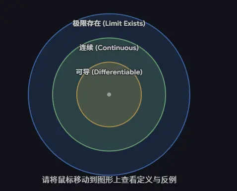

### 二、 导数 $f'(x_0)$ 不存在的情况  

| **情况分类**       | **几何表现 / 特征**                      | **数学表现形式**                                                                 | **典型反例 (在 x=0 处)**                                                                               |
| -------------- | ---------------------------------- | -------------------------------------------------------------------------- | ------------------------------------------------------------------------------------------------ |
| **函数在该点不连续**   | 图像在该点断开（包含跳跃、无穷、可去或震荡间断点）。         | $\lim_{x \to x_0} f(x) \neq f(x_0)$ 或极限不存在。      **（不连续必不可导）** | $f(x) = \begin{cases} 1, & x \geq 0 \\ 0, & x < 0 \end{cases}$      在 $x=0$ 处断开，无切线。 |
| **连续，但左右导数不等** | 图像连续，但在该点出现**尖点**或**折点**，不够平滑。     | $f'_-(x_0) \neq f'_+(x_0)$      （左右导数均存在但不等）                   | $f(x) = \vert x \vert$      左导数为 $-1$，右导数为 $1$，无唯一切线。                                |
| **导数趋于无穷大**    | 图像在该点连续且平滑，但**切线垂直于 x 轴**（斜率为无穷大）。 | $\lim_{\Delta x \to 0} \frac{f(x_0+\Delta x)-f(x_0)}{\Delta x} = \infty$   | $f(x) = x^{\frac{1}{3}}$      在 $x=0$ 处有一条垂直切线 $x=0$。                                |
|                |                                    |                                                                            |                                                                                                  |
|                |                                    |                                                                            |                                                                                                  |

  
> 这里的连续 和极限存在都是针对原函数来进行说明的 不是导函数  
> 所以某一点的二阶可导   不代表这一点的二阶导数 连续  和极限存在  

