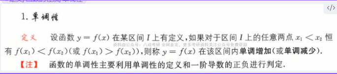
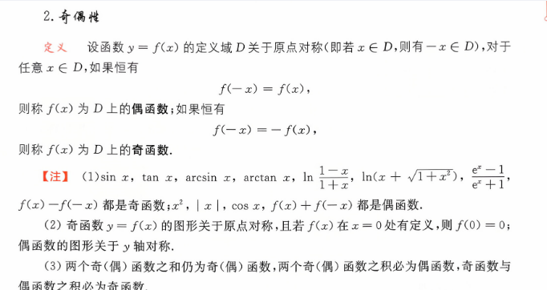
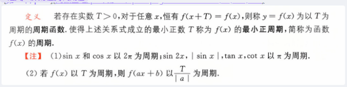
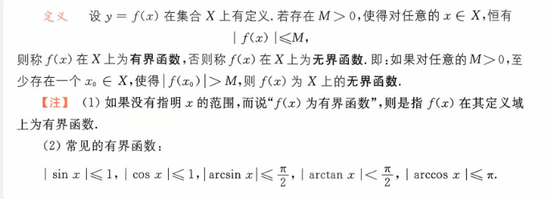
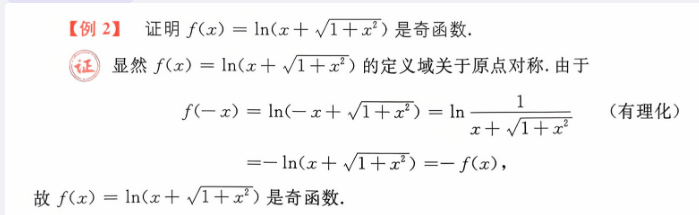
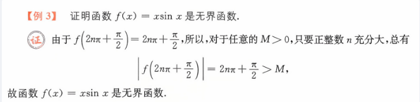

# 定义  
# 单调性  
#定义/函数的性质/单调性  

> 一阶导为正单调增反之单调减
# 奇偶性  

# 周期性    
#定义/函数的性质/周期性

> 对于三角函数是 $\frac{2\pi}{a}$ 这里的 a 是 x 前的系数
# 有界性  
#定义/函数的性质/有界性  

> f(x)总是可以大于你给定一个 M,比你的 M 更大
# 例题  
#例题/函数的性质  ^388a6e  
> 使用分子有理化 把分母视为 1   

#例题/函数的性质 

> 这里的 $2n\pi+\frac{\pi}{2}$ 这里的 $sinx$ 永远是 1 ,周期函数,所以只要看x就行了,这个举例也要有经验  

