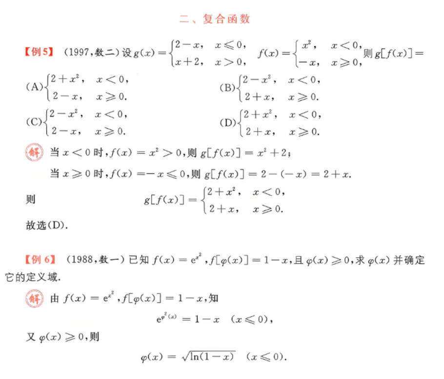

# 例题  
#例题/函数的性质   

 
#严选题/函数的性质

 [自变量和因变量绝对值的不同](特别函数.md#^e74bfe)  
[有界函数乘以一个无穷大的分类讨论](../有界函数乘以一个无穷大的分类讨论.md)
> 这里 x 乘 sinx 有界函数 是    无界但不是无穷大,y 正半轴  再乘一个有界函数  

#例题/复合函数  

> 注意子函数的值域 对应复函数的定义域  
> 例 6 从第二行就要开始注意定义域了  越早注意越好  

