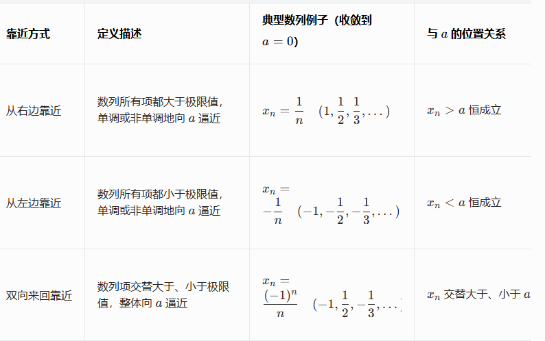

# 数列的极限  
#定义/数列极限

表格  
> - 第四点表示总体有极限可以推出部分列有极限  (这里是以奇数列和偶数列为例)  
> - 部分列必须相等才能推整体有极限  
> - 数列有极限称为收敛 否则发散  
> - $\lim_{ n \to \infty }(-1)^n$ 这个奇数列有极限,偶数列有极限,但它整体是发散,震荡的  
> - 数列有界是数列收敛的必要条件  
> 扩展:  
> - 函数极限存在,某去心领域局部有界  
> - 函数单调有界必有极限

# 函数的极限  
#定义/函数极限  
[第一章, p.15](../../pdf/第一章.pdf#page=15)  

# 左极限于右极限

# 数列极限与函数极限的关系  
[海涅定理(归结原则)](../../补充理解/海涅定理(归结原则).md)

