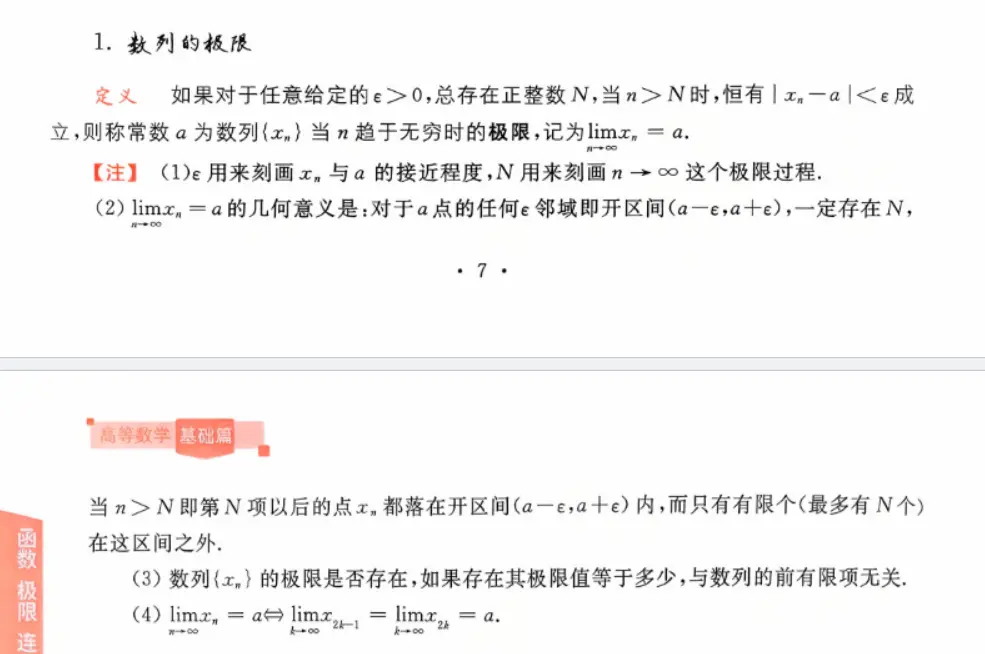
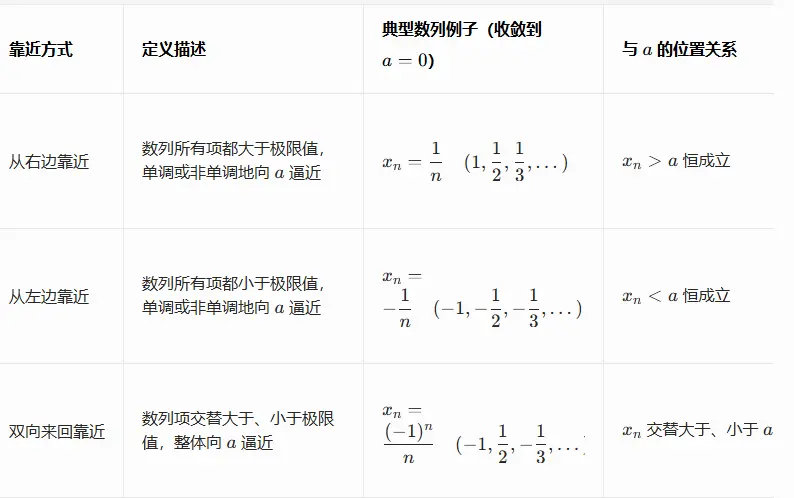
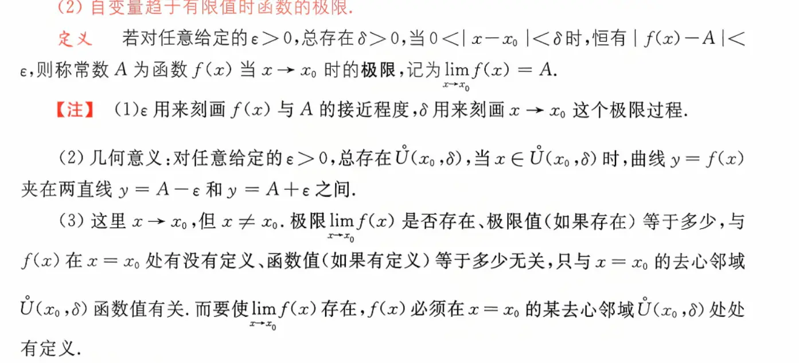
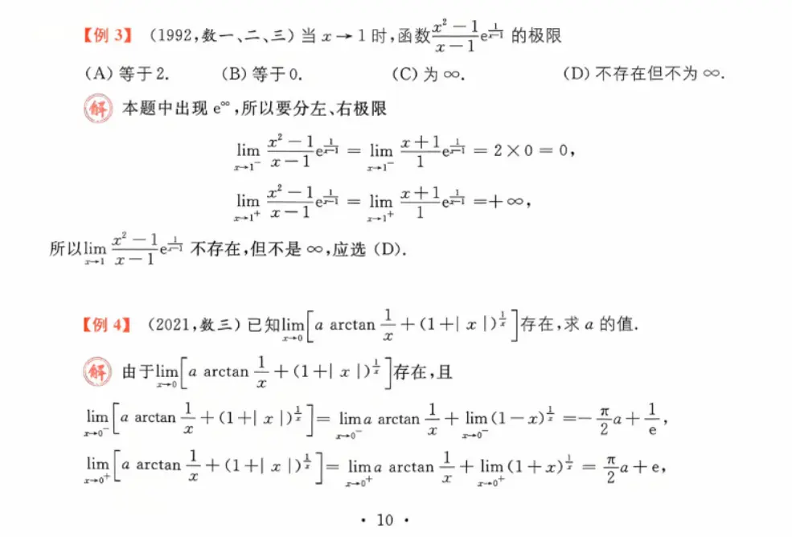

# 数列的极限  
#定义/数列极限

# 函数的极限  
#定义/函数极限  
[第一章, p.15](../../pdf/27考研数学武忠祥《高数基础篇》/第一章.pdf#page=15)

[极限不存在与不可导的情况和关系](../../补充理解/极限不存在与不可导的情况和关系.md)
# 左极限与右极限  
[第一章, p.16](../../pdf/27考研数学武忠祥《高数基础篇》/第一章.pdf#page=16)
[间断点](../../记忆内容/间断点.md)
# 数列极限与函数极限的关系  
[海涅定理(归结原则)](../../补充理解/海涅定理(归结原则).md)

# 例题  
#例题/左右极限  
  
这里基本函数的使用  固定是正 x 的  
