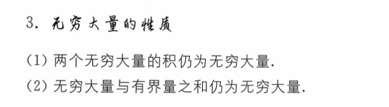
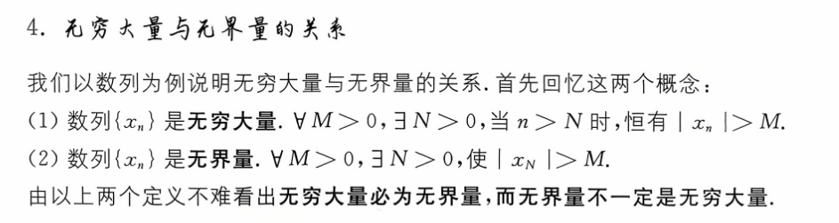
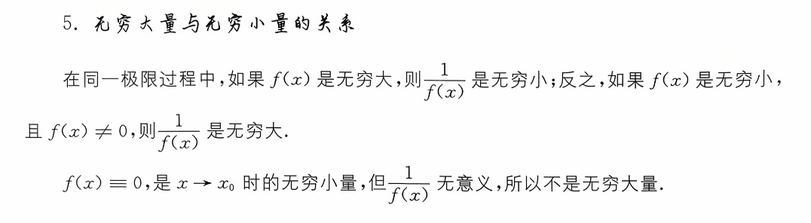

# 概念  

  

# 无穷大的比较  
  
常见变式  

> 可以这样看  
> 将 x 作为分母 变为 1/x  
> 而分子变为-ln 1/x    
> 结果还是  正无穷/正无穷   分子比不赢的   所以是 0  

# 无穷大的性质  
  
同号无穷相加还是无穷  
异号无穷相减是未定式  
[有界函数乘以一个无穷大的分类讨论](../补充理解/有界函数乘以一个无穷大的分类讨论.md)
# 无穷大与无界量的关系  

[无穷大与无界的区别](../补充理解/无穷大与无界的区别.md)  

  

#