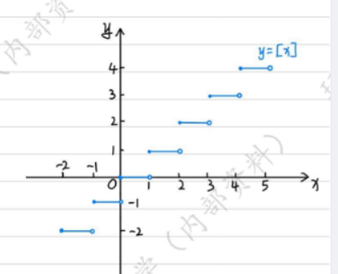
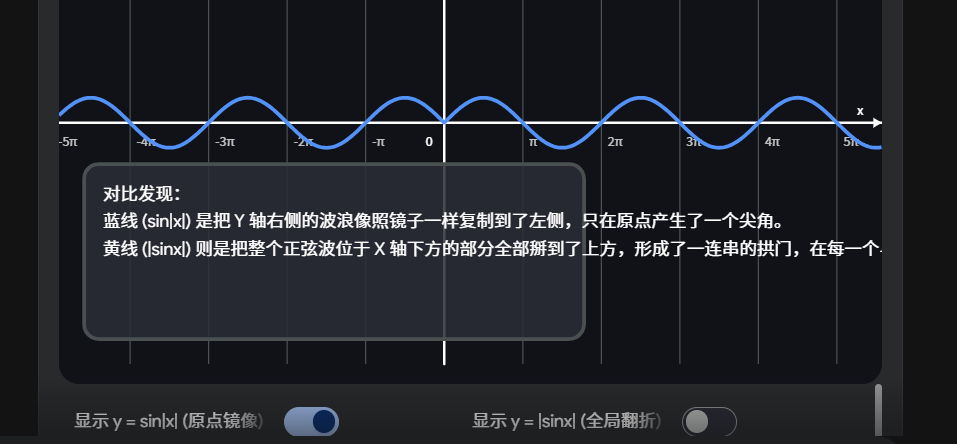
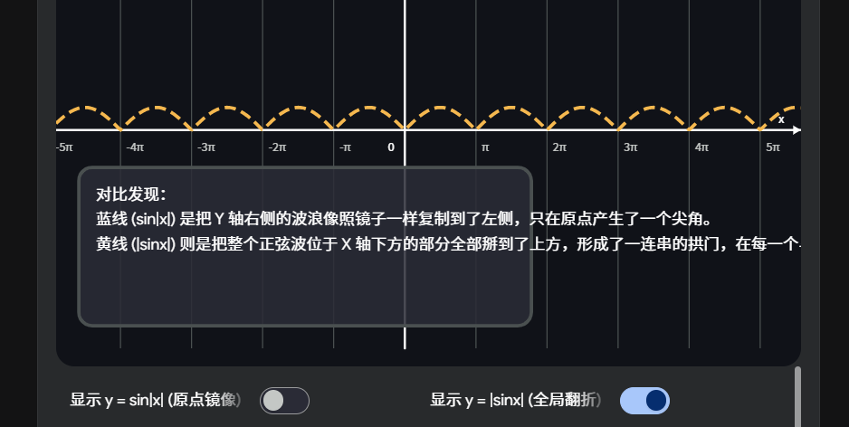

## 绝对值函数 取整函数 狄利克雷函数  
[《零基础学微积分（上）》, p.20](../pdf/《零基础学微积分（上）》.pdf#page=20)  

> 这个图总是忘记  单独提出来  

# 自变量绝对值和因变量绝对值举例  

^e74bfe

  
> 自变量绝对值就是要求<0 的 x 要按照>0 的 x 进行处理,因为取正数了  
> 因变量绝对值就是全部翻到 y 轴的正上方,会对结果取正  

# $sinx*x$  无界但不无穷大

^750153

## 例子：f(x)=xsinx, x→∞

1. 取 x=2 kπ：

f(2 kπ)=2 kπ⋅sin 2 kπ=0

函数可以**等于 0**

2. 取 x=2 kπ+2π​：
    
    f(2 kπ+2π​)=(2 kπ+2π​)⋅1→∞

👉 结论：

- 它**无界**（能冲到无限大）
- 但**不是无穷大**（因为不断回到 0，不是一直变大）
