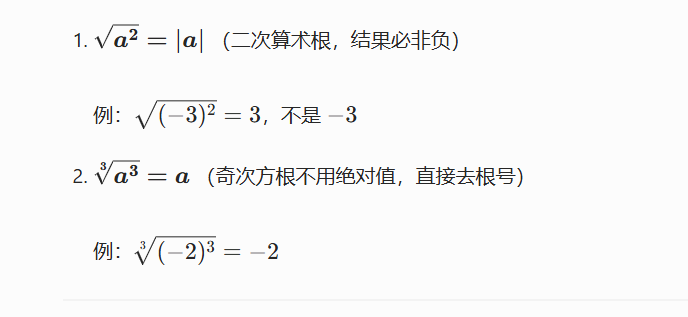
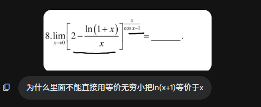
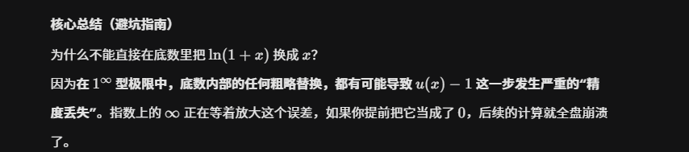

# 开根号
$x^2=a$   ->  $x=\pm \sqrt{ a }$

>   
> 求极限的时候 全是无穷加减  默认分母为 1  往分式上面靠   这样更好求
 对于偶次方根   分式形式的时候  现提出因子  在上下同除  
  对几次方根    上下可以同除  

# 等价无穷小的错误使用  
1 的无穷形式使用基本极限的方法做
  
  
0 的 0 次方可以直接等价无穷小

# 导数极限形式也要分左极限和右极限  

# 左加右减  

