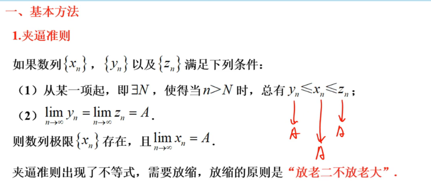
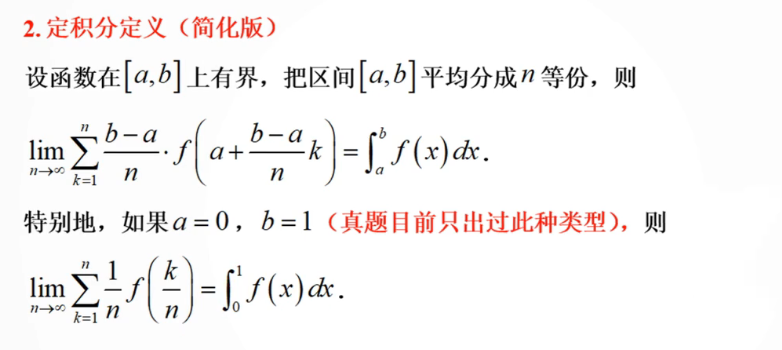
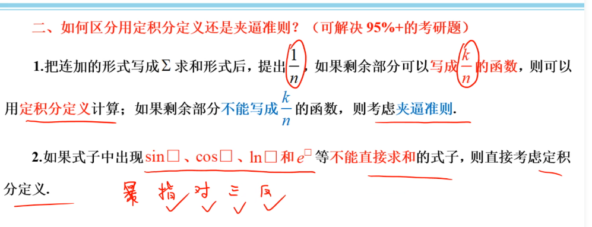

# 夹逼定理

# 定积分  

  
这里将区间分成 n 等分  然后取每个区间右端点(这里表示 k)的值  叠加求极限  

# 区分的快速方法  

> 这两种方法都是求 n 项和式的典型方法  
> 用夹逼定理的和式是因为求和对主部没有影响  
> 用定积分是因为求和之后对主部有影响了  
> 不变的为主部  判断的是变的部分如果求和之后对主部造成影响了 定积分,反之就是夹逼定理(从本质上来说)  

# 题目  
#题目/n和式的
