- [ ] 心一学长 #todo

# 真分式假分式  

## 拆分方法

  
假分式可以转换为一个有理函数加上一个真分式的形式
  

  
  
## 拆分之后的系数怎么求  
  
### 留数法  后求 x 到无穷的极限

  
  
求谁  乘谁   带入 0 点
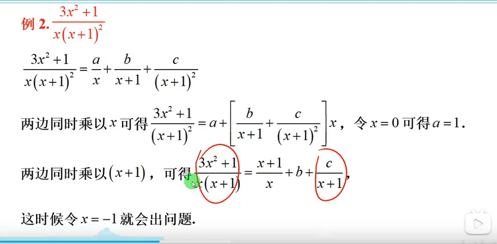  
求 b 的时候  不能完全消除  会有两个正无穷  
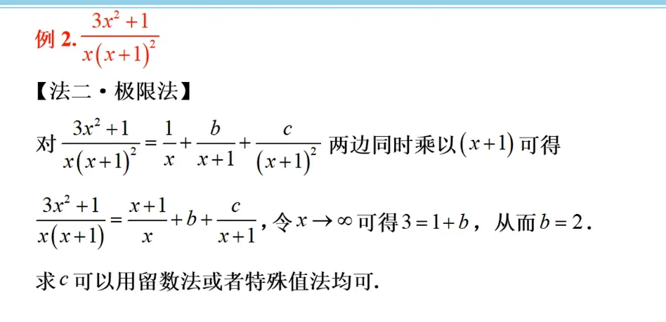  
先用留数法求出要求的系数,然后再进行无穷求中间的系数  

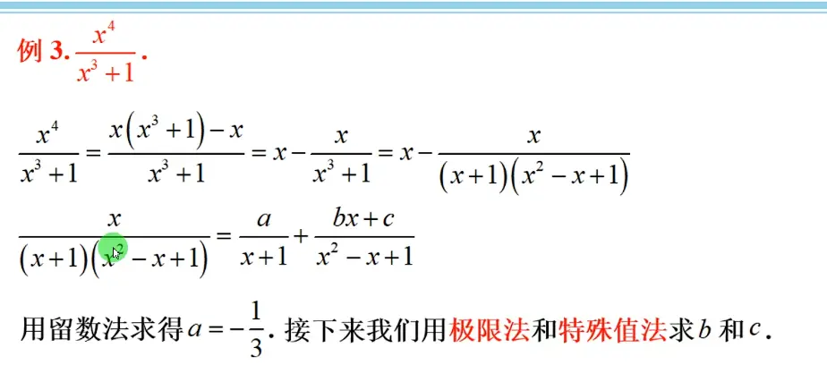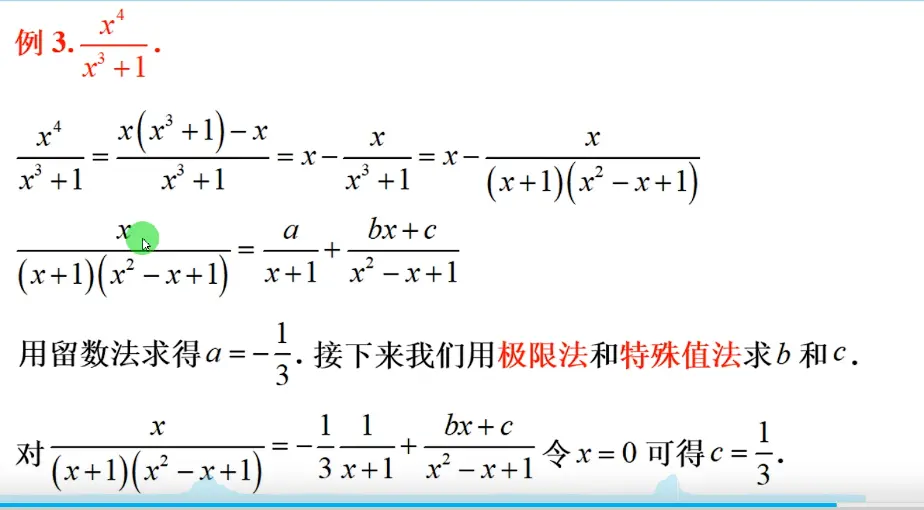  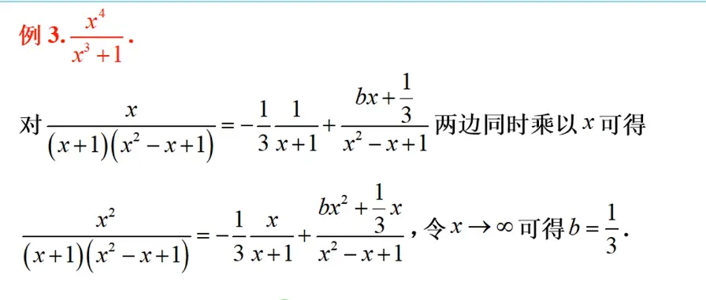
 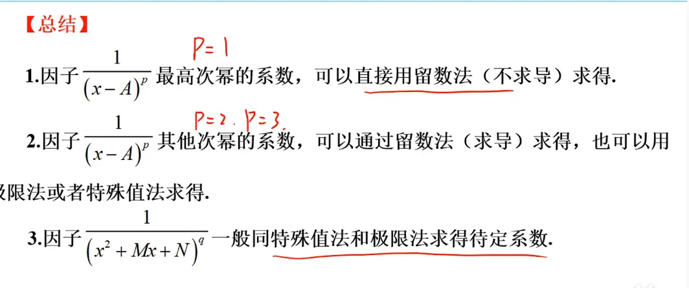  

## 例题  
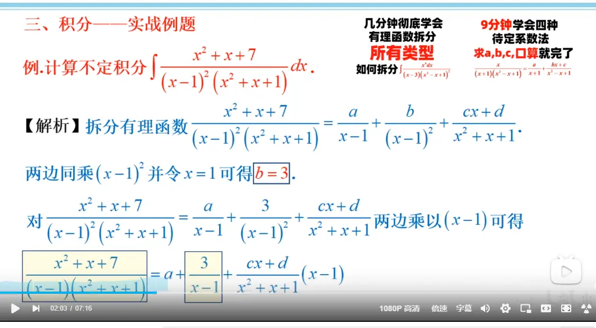  
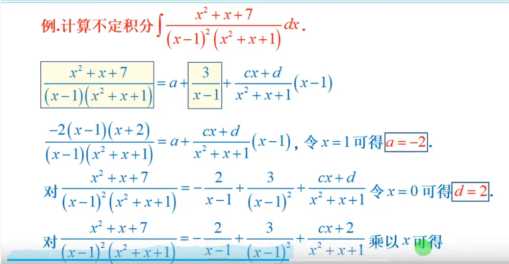  
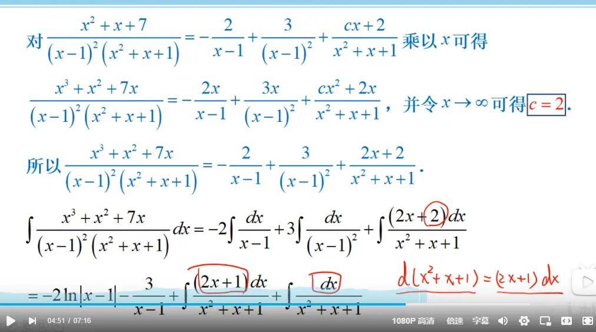  
分开之后好凑微分   
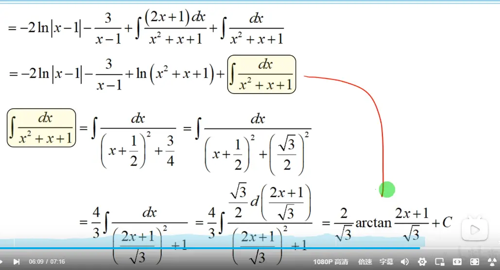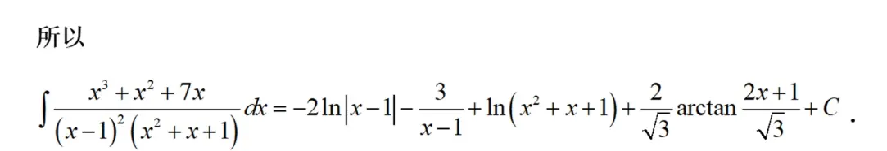  

# 可换为有理式替换的(三角万能替换) 
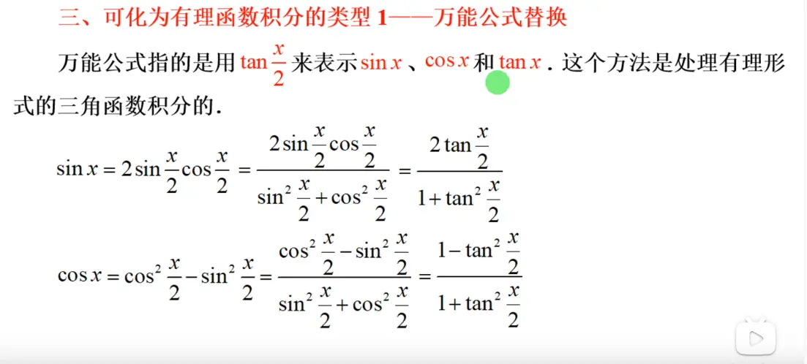  
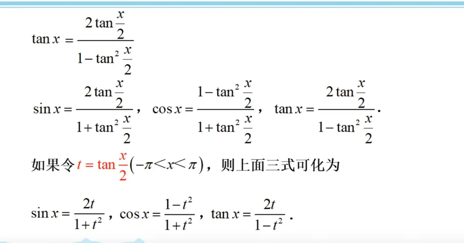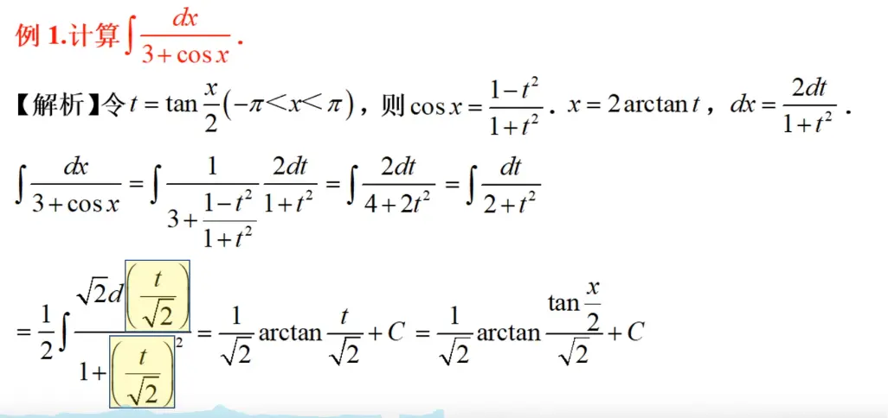  
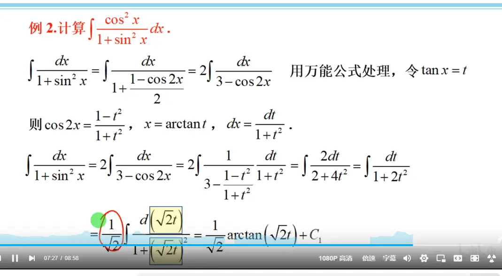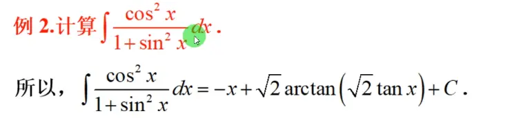