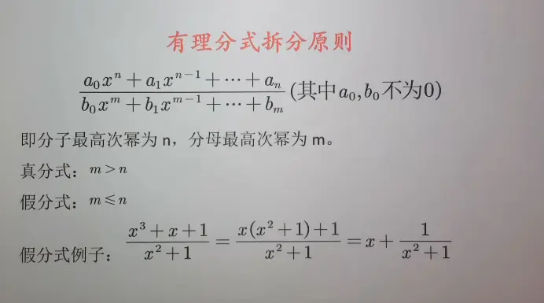
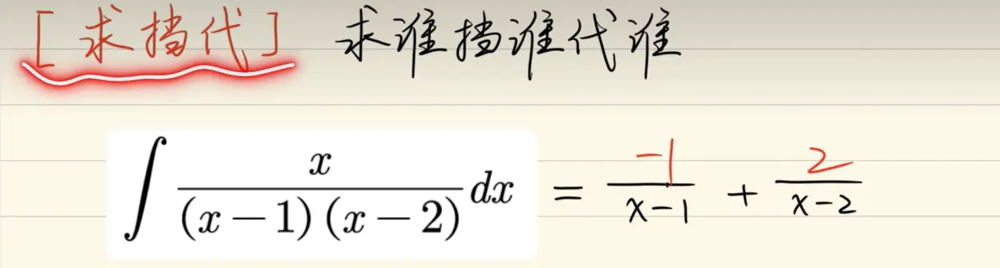

https://www.bilibili.com/video/BV1TBRqBsEf5/?spm_id_from=333.337.search-card.all.click&vd_source=00e9babc4deca9e64ec25dd54e7bfe0c    拆分法的讲解链接  
 

  

求谁的分子 就挡住原式中的因子,并将因子 0 点 x 的值带入,可以得到其拆开后的分子
  

$$\frac{1}{(x-1)^2(x-2)} = \frac{A}{x-1} + \frac{B}{(x-1)^2} + \frac{C}{x-2}$$

**核心法则：掩盖法只能用来求“不重复因式”和“重复因式的最高次幂”的系数。** （这里的低次幂 $A$ 不能直接掩盖，因为会除以 $0$）。

**1. 掩盖法求 $C$ 和 $B$：**

- **求 $C$：** 令 $x-2 = 0 \Rightarrow x=2$。在原式左边捂住 $(x-2)$，把 $x=2$ 代入剩下的 $\frac{1}{(x-1)^2}$ 中：
    
    $$C = \frac{1}{(2-1)^2} = 1$$
    
- **求 $B$：** 令 $x-1 = 0 \Rightarrow x=1$。在原式左边捂住 $(x-1)^2$，把 $x=1$ 代入剩下的 $\frac{1}{x-2}$ 中：
    
    $$B = \frac{1}{1-2} = -1$$
    

此时式子变成了：

$$\frac{1}{(x-1)^2(x-2)} = \frac{A}{x-1} - \frac{1}{(x-1)^2} + \frac{1}{x-2}$$

**2. 特殊值法求 $A$：**

随便挑一个好算的数字代入 $x$（注意避开 $1$ 和 $2$），比如令 ** $x=0$ **：

左边 $= \frac{1}{(-1)^2(-2)} = -\frac{1}{2}$

右边 $= \frac{A}{-1} - \frac{1}{(-1)^2} + \frac{1}{-2} = -A - 1 - \frac{1}{2}$

解这个简单方程：

$$-\frac{1}{2} = -A - \frac{3}{2} \Rightarrow A = -1$$

**瞬间拆分完毕：**

$$\frac{-1}{x-1} - \frac{1}{(x-1)^2} + \frac{1}{x-2}$$

有理函数的拆分（也叫部分分式分解）在求不定积分时是一项核心基本功。它的核心目的是“化繁为简”，把高次的分母拆解成一次或二次的多项式之和，从而套用基础的 $\ln$ 或 $\arctan$ 积分公式。

进行拆分前，必须遵循一个**大前提：必须是真分式**。如果分子最高次幂 $\ge$ 分母最高次幂，必须先做多项式长除法，分离出一个多项式和一个真分式。

对于真分式，拆分的形式完全由**分母的因式分解结果**决定。以下是 4 种最常见的拆分模型及高效求系数的方法：

### 一、 四大基本拆分模型

#### 1. 分母为【不重复的线性因式】（最常见、最简单）

当分母可以分解为几个不同的一阶因式相乘时，每一个因式分到一个常数分子。

**模板：**

$$\frac{P(x)}{(x-a)(x-b)(x-c)} = \frac{A}{x-a} + \frac{B}{x-b} + \frac{C}{x-c}$$

_示例：_ $\frac{x+2}{(x-1)(x+3)} = \frac{A}{x-1} + \frac{B}{x+3}$

#### 2. 分母含有【重复的线性因式】

如果某个一次因式出现了 $n$ 次方，必须把它从 $1$ 次方到 $n$ 次方的所有项都列出来，分子全为常数。

**模板：**

$$\frac{P(x)}{(x-a)^3} = \frac{A_1}{x-a} + \frac{A_2}{(x-a)^2} + \frac{A_3}{(x-a)^3}$$

_示例：_ $\frac{1}{x(x-1)^2} = \frac{A}{x} + \frac{B}{x-1} + \frac{C}{(x-1)^2}$

#### 3. 分母含有【不重复的二次不可约因式】

不可约二次因式指的是 $x^2+px+q$ （即 $\Delta = p^2-4q < 0$，无法在实数域继续分解，比如 $x^2+1$）。此时对应的分子必须设为**一次多项式** $Ax+B$。

**模板：**

$$\frac{P(x)}{(x-a)(x^2+px+q)} = \frac{A}{x-a} + \frac{Bx+C}{x^2+px+q}$$

_示例：_ $\frac{1}{x(x^2+1)} = \frac{A}{x} + \frac{Bx+C}{x^2+1}$

#### 4. 分母含有【重复的二次不可约因式】（考研拔高题型）

和第二种情况类似，需要把从 $1$ 次方到 $n$ 次方的项全列出来，且分子全设为一次多项式。

**模板：**

$$\frac{P(x)}{(x^2+1)^2} = \frac{Ax+B}{x^2+1} + \frac{Cx+D}{(x^2+1)^2}$$

### 二、 高效计算系数的方法（不要只会通分！）

很多同学面对拆分感到头疼，是因为只会“通分后对比系数解方程组”，这种**待定系数法**在项数多的时候极易算错。强烈建议掌握以下两种秒杀技巧：

#### 技巧 1：掩盖法 / 赋值法（Heaviside 留数法）

**适用场景：针对分母中【不重复的一次因式】求系数，绝对的神技。**

操作步骤：想求某一项的分子，就令该项的分母为 0 解出 $x$，然后把原分式中**挡住对应的因式**，将 $x$ 代入剩余部分，算出来的结果就是系数！

**实战演示：** 求 $\frac{x+4}{(x-1)(x-2)} = \frac{A}{x-1} + \frac{B}{x-2}$ 中的 $A$ 和 $B$。

- **求 $A$：** 令 $x-1 = 0$ 得 $x=1$。在左边式子里**捂住 $(x-1)$ **，将 $x=1$ 代入剩下的 $\frac{x+4}{x-2}$，得到 $\frac{1+4}{1-2} = -5$。所以 $A = -5$。
    
- **求 $B$：** 令 $x-2 = 0$ 得 $x=2$。在左边式子里**捂住 $(x-2)$ **，将 $x=2$ 代入剩下的 $\frac{x+4}{x-1}$，得到 $\frac{2+4}{2-1} = 6$。所以 $B = 6$。
    
- **秒出答案：** $\frac{-5}{x-1} + \frac{6}{x-2}$
    

#### 技巧 2：取特殊值法

**适用场景：求二次不可约因式或重复因式的分子系数。**

如果在用“掩盖法”求出了一部分系数后，还剩下几个未知数，不要去展开通分，而是直接给 $x$ 赋几个好算的特殊值（如 $x=0, 1, -1$），列几个简单的算术等式即可求出。

### 三、 考场必备：需要直接背诵的“黄金裂项”

下面这几个结构极其常见，建议直接当公式记住，遇到直接写结果，无需现场推导：

1. **平方差裂项（最基础）：**
    
    $$\frac{1}{x^2-a^2} = \frac{1}{2a} \left( \frac{1}{x-a} - \frac{1}{x+a} \right)$$
    
2. **一次乘一次：**
    
    $$\frac{1}{x(x-a)} = \frac{1}{a} \left( \frac{1}{x-a} - \frac{1}{x} \right)$$
    
    $$\frac{1}{(x-a)(x-b)} = \frac{1}{a-b} \left( \frac{1}{x-a} - \frac{1}{x-b} \right)$$
    
3. **一次乘二次（常与 $\arctan$ 联动）：**
    
    $$\frac{1}{x(x^2+a^2)} = \frac{1}{a^2} \left( \frac{1}{x} - \frac{x}{x^2+a^2} \right)$$
    
4. **降维打击结构（就是你之前发的那道题的通式）：**
    
    $$\frac{1}{x(x^n \pm a)} = \frac{1}{a} \left( \frac{1}{x} - \frac{x^{n-1}}{x^n \pm a} \right)$$
    
    _注：这种形式虽然可以直接裂项，但在积分时，像我们之前那样**分子分母同乘 $x^{n-1}$ 凑微分**，思维上会更连贯。_

# 常见的  
明白了！你不需要那些复杂的推导过程和拆分方法，你要的是考场上遇到能**直接当公式秒出结果的“现成式子”**。

这对于备考考研数学极度重要，因为这种“肌肉记忆”能帮你省下大量时间。我为你整理了考研积分中最常遇到、必须**直接背诵**的“算式清单”，分为【代数裂项】和【凑微分】两部分。

### 一、 常见有理式“直接裂项”清单（不用算，直接写）

遇到这些分式，不要去设未知数通分，直接默写右边的结果。

**1. 一次项拆分（基础极高频）：**

- $\frac{1}{x(x+a)} = \frac{1}{a} \left( \frac{1}{x} - \frac{1}{x+a} \right)$
    
- $\frac{1}{x(x-a)} = \frac{1}{a} \left( \frac{1}{x-a} - \frac{1}{x} \right)$
    
- $\frac{1}{x^2-a^2} = \frac{1}{2a} \left( \frac{1}{x-a} - \frac{1}{x+a} \right)$
    

**2. 一次乘二次（常与 $\arctan$ 或 $\ln$ 组合）：**

- $\frac{1}{x(x^2+a^2)} = \frac{1}{a^2} \left( \frac{1}{x} - \frac{x}{x^2+a^2} \right)$
    
- $\frac{1}{x(x^2-a^2)} = \frac{1}{a^2} \left( \frac{x}{x^2-a^2} - \frac{1}{x} \right)$
    

**3. 假分式“强行分离”（分子次数 $\ge$ 分母）：**

- $\frac{x^2}{x^2+a^2} = 1 - \frac{a^2}{x^2+a^2}$
    
- $\frac{x}{x+a} = 1 - \frac{a}{x+a}$
    

**4. 终极降维打击（针对 $x$ 的高次幂）：**

- $\frac{1}{x(x^n \pm a)} = \frac{1}{a} \left( \frac{1}{x} - \frac{x^{n-1}}{x^n \pm a} \right)$
    

### 二、 常见凑微分“视觉捆绑包”（看到左边直接写 $d$）

这些是考场上最容易卡人的地方。只要你在题目里看到左边这一坨，脑子里要立刻等价替换成右边的微分形式。

**1. 根号兄弟（极其常考）：**

- 看到 $\frac{1}{\sqrt{x}} dx$ $\rightarrow$ 直接换成 $2d(\sqrt{x})$
    
- 看到 $\frac{x}{\sqrt{a^2-x^2}} dx$ $\rightarrow$ 直接换成 $-d(\sqrt{a^2-x^2})$
    
- 看到 $\frac{x}{\sqrt{x^2 \pm a^2}} dx$ $\rightarrow$ 直接换成 $d(\sqrt{x^2 \pm a^2})$
    

**2. 倒数与对数关联：**

- 看到 $\frac{1}{x^2} dx$ $\rightarrow$ 直接换成 $-d(\frac{1}{x})$
    
- 看到 $\frac{1}{x^3} dx$ $\rightarrow$ 直接换成 $-\frac{1}{2}d(\frac{1}{x^2})$
    
- 看到 $\frac{1}{x \ln x} dx$ $\rightarrow$ 直接换成 $d(\ln(\ln x))$
    

**3. 反三角函数神仙组合：**

- 看到 $\frac{1}{1+x^2} dx$ $\rightarrow$ 直接换成 $d(\arctan x)$
    
- 看到 $\frac{1}{\sqrt{1-x^2}} dx$ $\rightarrow$ 直接换成 $d(\arcsin x)$
    

**4. 指数连体婴：**

- 看到 $x e^{x^2} dx$ $\rightarrow$ 直接换成 $\frac{1}{2}d(e^{x^2})$
    
- 看到 $\frac{e^{\frac{1}{x}}}{x^2} dx$ $\rightarrow$ 直接换成 $-d(e^{\frac{1}{x}})$
    
- **（大招）** 看到 $e^x [f(x) + f'(x)] dx$ $\rightarrow$ 直接换成 $d(e^x f(x))$
    

把这些当作九九乘法表一样记，做积分题时你的视野会完全不一样，直接跳过繁琐的代数变形，直奔主题。