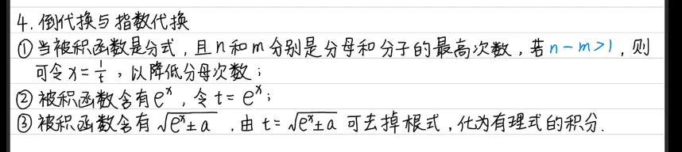

第二类换元算出来之后需要把他复原  

  
结果  
以下是为你补充并重新排版后的完整表格：

|**根式类型**|**三角代换设定**|**微分项 dx 的变化**|**根式化简后的结果**|**核心恒等式依据**|**🎯 整体代换结果 (…​dx)**|
|---|---|---|---|---|---|
|$\sqrt{a^2 - x^2}$|$x = a \sin t$|$dx = a \cos t \, dt$|$\sqrt{a^2 - (a \sin t)^2} = a \cos t$|$1 - \sin^2 t = \cos^2 t$|**$a^2 \cos^2 t \, dt$**|
|$\sqrt{a^2 + x^2}$|$x = a \tan t$|$dx = a \sec^2 t \, dt$|$\sqrt{a^2 + (a \tan t)^2} = a \sec t$|$1 + \tan^2 t = \sec^2 t$|**$a^2 \sec^3 t \, dt$**|
|$\sqrt{x^2 - a^2}$|$x = a \sec t$|$dx = a \sec t \tan t \, dt$|$\sqrt{(a \sec t)^2 - a^2} = a \tan t$|$\sec^2 t - 1 = \tan^2 t$|**$a^2 \sec t \tan^2 t \, dt$**|

_(注：上述化简默认 $a > 0$，且角度 $t$ 取在使开方后结果为正的主值区间内。)_

**实战解题提醒：**

1. **别忘了替换 $dx$：** 很多时候在做题时，只把根号里的 $x$ 换了，却忘记了把后面的 $dx$ 也跟着换成带有 $dt$ 的微分表达式，这是最容易丢分的地方。
    
2. **记得画“直角三角形”代回原变量：** 积分完成后，结果通常是关于 $t$ 的表达式（比如 $\sin t$ 或 $\tan t$）。此时需要根据你最初设定的代换关系画一个直角三角形，利用勾股定理求出其他边，最后把式子重新转换回关于 $x$ 的结果。

 ![[assets/第二类换元/file-20260524164021333.webp]]