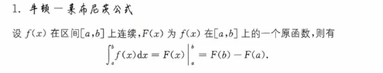
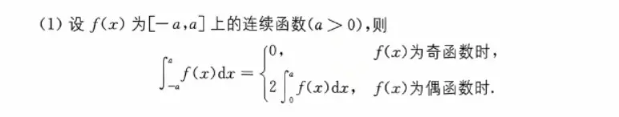
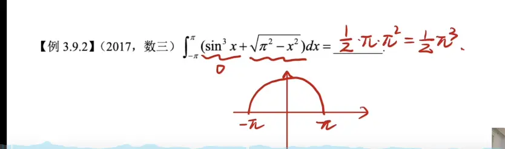
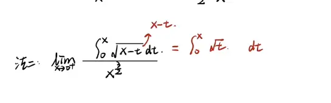
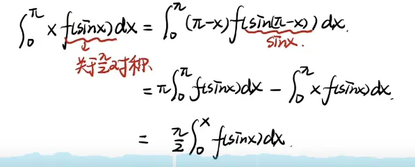
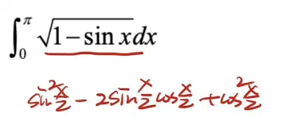
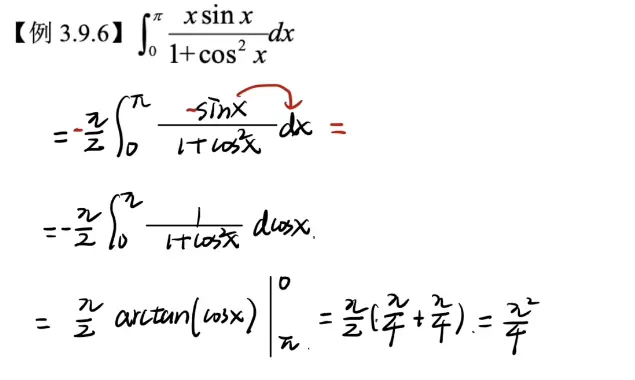
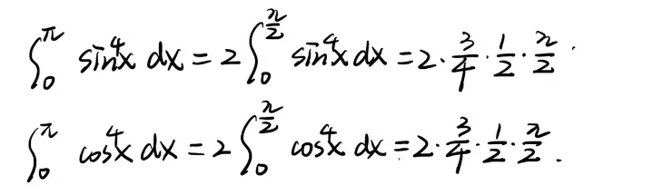
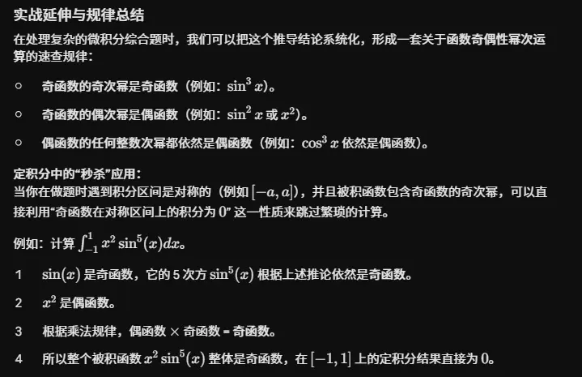
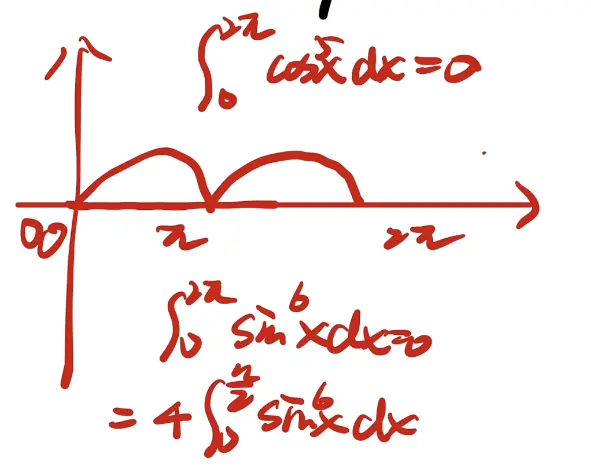

# 拉布尼茨公式  

# 奇偶对称性  
  
  

  
这里直接用圆的面积来做

# 奇常函数  
  
  
关于点(a,b)对称  [轴对称和中心对称](../../扩展记忆/高中知识记忆/轴对称和中心对称.md)
f(x)+f(-x)=2 b  
关于(0,b)对称  
  
  

# 区间再现  

 几何的证明  

## 例题
  
  
这里只要不求极限   
x 可以当做常数处理  

  

# 周期性  
  

# 重要公式(基于前三的推广)  
  
1 区间再现   在这个区间 sinx可以直接和 cosx 直接换
2 广义对称性  
不能换成 cosx 里面的函数 要关于区间中点对称   可以换成|cosx|  重点是关于区间重点对称

3  区间再现  
不能换成 cosx 里面的函数 要关于区间中点对称   可以换成|cosx|  重点是关于区间重点对称

## 1  
  

## 2  
  

  

## 3  
  

# 华里士公式(点火公式)  
必须是 本身上下限不能变  和别的公式一起用 结合用

几次幂 喊到 2 就停  
偶次幂  喊到 1 召唤 pi/2  

##  结合使用  

## 广义对称性和函数特性  

