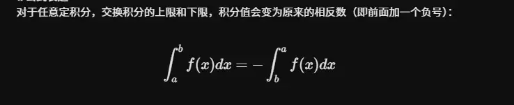

# 拉布尼茨公式  

# 奇偶对称性  
  
  

  
这里直接用圆的面积来做

# 奇常函数  
  
  
关于点(a,b)对称  [轴对称和中心对称](../../扩展记忆/高中知识记忆/轴对称和中心对称.md)
f(x)+f(-x)=2 b  
关于(0,b)对称  
  
  

# 区间再现  

 几何的证明  

## 例题
  
  
这里只要不求极限   
x 可以当做常数处理  

  

# 周期性  
  

# 重要公式(基于前三的推广)  
  
1 区间再现   在这个区间 sinx可以直接和 cosx 直接换
2 广义对称性  
不能换成 cosx 里面的函数 要关于区间中点对称   可以换成|cosx|  重点是关于区间重点对称

3  区间再现  
不能换成 cosx 里面的函数 要关于区间中点对称   可以换成|cosx|  重点是关于区间重点对称

## 1  
  

## 2  
  

  

## 3  
  

# 华里士公式(点火公式)  
必须是 本身上下限不能变  和别的公式一起用 结合用

几次幂 喊到 2 就停  
偶次幂  喊到 1 召唤 pi/2  

##  结合使用  

## 广义对称性和函数特性  

# 利用几何性质  
在微积分和考研数学中，利用定积分的几何意义（圆的面积）是最爽的“秒杀”技巧之一。当你看到特定的带根号的二次式时，千万不要去老老实实做三角代换，直接画图套面积公式才是正解。

以下是我为你整理的**四组最常用、最核心的圆面积快速计算公式**：

### 1. 标准圆（圆心在原点）

这是最基础的形式，特征是被积函数包含 $\sqrt{a^2 - x^2}$，对应圆心在 $(0,0)$，半径为 $a$ 的上半圆。

- **四分之一圆：** 积分下限为 $0$，上限为半径 $a$。
    
    $$\int_{0}^{a} \sqrt{a^2 - x^2} \, dx = \frac{\pi}{4} a^2$$
    
- **半圆：** 积分下限为 $-a$，上限为 $a$。
    
    $$\int_{-a}^{a} \sqrt{a^2 - x^2} \, dx = \frac{\pi}{2} a^2$$
    

### 2. 平移圆（圆心在坐标轴上）

这是考试中最爱出的**隐蔽变形**。特征是被积函数包含 $\sqrt{2ax - x^2}$。

如果你配方，会发现 $y^2 = 2ax - x^2 \implies (x-a)^2 + y^2 = a^2$。这是一个**圆心在 $(a, 0)$，半径为 $a$ **，且正好与 $y$ 轴相切的上半圆。

- **平移半圆：** 积分区间覆盖整个圆的宽度。
    
    $$\int_{0}^{2a} \sqrt{2ax - x^2} \, dx = \frac{\pi}{2} a^2$$
    
- **平移四分之一圆：** 积分区间只到圆心。
    
    $$\int_{0}^{a} \sqrt{2ax - x^2} \, dx = \frac{\pi}{4} a^2$$
    
    _(同理，$\int_{a}^{2a} \sqrt{2ax - x^2} \, dx$ 也是 $\frac{\pi}{4} a^2$)_
    

### 3. 奇偶性组合（终极秒杀杀手锏）

当圆的方程前面乘上或加上了其他一次项函数，并且**积分区间对称**时，直接拆分！

- **一次项 + 圆：**
    
    $$\int_{-a}^{a} (kx + b)\sqrt{a^2 - x^2} \, dx$$
    
    **破题心法：** 拆成两部分。
    
    前半部分 $\int_{-a}^{a} kx\sqrt{a^2 - x^2} \, dx$ 是**奇函数**在对称区间上的积分，结果直接为 ** $0$ **。
    
    后半部分 $b \int_{-a}^{a} \sqrt{a^2 - x^2} \, dx$ 就是常数 $b$ 乘以半圆面积。
    
    **公式：**
    
    $$\int_{-a}^{a} (kx + b)\sqrt{a^2 - x^2} \, dx = \frac{1}{2} b \pi a^2$$
    

### 4. 绝对值圆（双弧线）

有时题目会加上绝对值，比如 $\int_{-a}^{a} \sqrt{a^2 - |x|^2} \, dx$ 或者 $\int_{-a}^{a} \sqrt{a^2 - x^2} \, d|x|$。

但请注意，由于 $x^2 = |x|^2$，所以 $\sqrt{a^2 - x^2}$ 本身就不受绝对值影响。

但如果是类似 $\int_{0}^{2a} |\sqrt{a^2 - (x-a)^2}| \, dx$，因为根号出来默认非负，所以绝对值通常是多余的障眼法，依然直接算面积即可。

你可以通过下方的交互组件，直观地感受这几种常见定积分在坐标系中对应的真实几何面积。特别是“奇偶性组合”的情况，你可以看到奇函数部分增加的正负面积是如何完美抵消，最终只剩下纯粹的圆面积的。