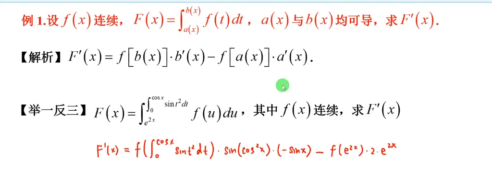
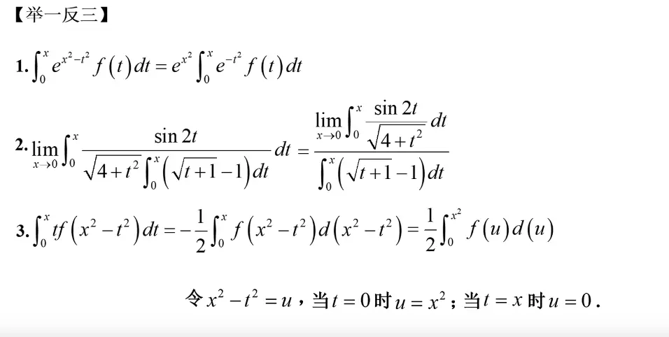
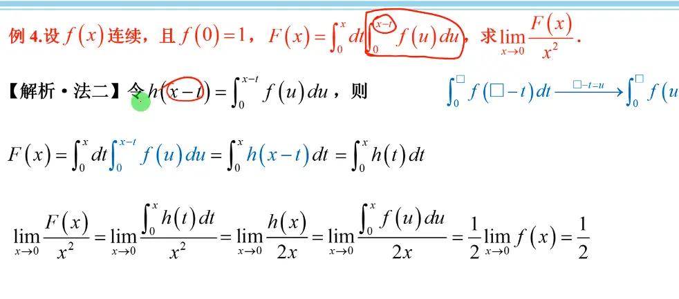

- [ ] 理解积分上限函数的课程 复盘 #todo 
# 概念与性质  

  

# 题目   

## 例一  直接使用公式
  

## 例二 被积函数有上限变量 分离方法  

[区间再现](定积分的计算方法.md#^5e3eaf)

  
在积分的时候 x 看做常数, 求出来之后  整体的导数才看做一起  

其他的分离方法  
  

## 例三 累次积分  的变上限函数

    

## 例四    
     

  

## 例五  (一个证明题)  

  

# 总结  
