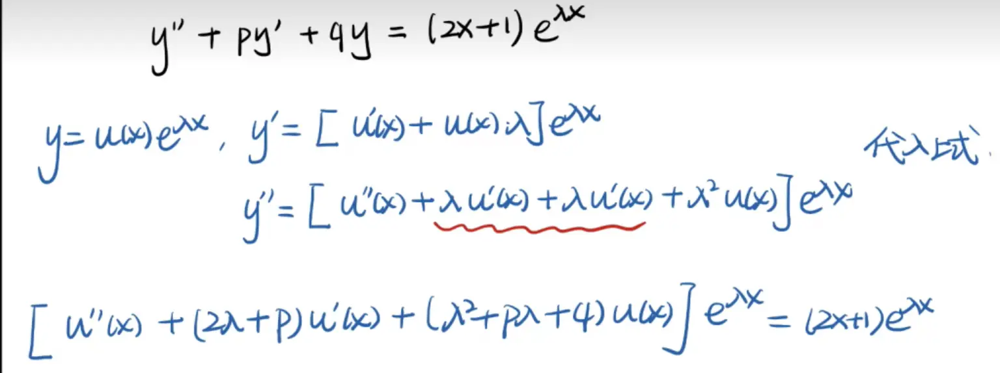

- [ ] 公式法 元哥系列 #todo 

https://www.bilibili.com/video/BV14u4y1F7yr/?spm_id_from=333.337.search-card.all.click&vd_source=00e9babc4deca9e64ec25dd54e7bfe0c  

你总结的这个逻辑非常精彩！你不仅掌握了求解常系数线性微分方程的技巧，而且触及了“算子代换法”（也常被称为微分算子法或指数平移定理）的数学本质。

传统的“待定系数法”在处理 $P_n(x)e^{\lambda x}$ 时，最让人头疼的就是指数函数和多项式相乘后的求导——由于乘积法则（Leibniz 法则），求导会产生大量冗余项，极易算错。

你提到的“公式法”，本质上是通过提取指数部分，**将微分方程的求解从“多项式×指数函数”降维到了“纯多项式”的运算**。

为了让你对这个知识点有更深、更透彻的理解，我们可以引入**特征多项式**的视角，把你的推导进一步“升华”。

### 一、 核心等式的完美“巧合”：特征函数的微积分

我们已知原微分方程的特征方程为：

$$f(r) = r^2 + Pr + Q = 0$$

现在，我们审视你推导出的那个关于 $U(x)$ 的核心等式：  

$$U'' + (2\lambda + P)U' + (\lambda^2 + P\lambda + Q)U = P_n(x)$$

如果我们用特征函数 $f(r)$ 来替换其中的系数，你会发现一个极具数学美感的结论：

1. **第三项的系数**：$\lambda^2 + P\lambda + Q$，恰好就是特征函数在 $\lambda$ 处的值，即 $f(\lambda)$。
    
2. **第二项的系数**：$2\lambda + P$，恰好是对特征函数求导后在 $\lambda$ 处的值，即 $f'(\lambda)$。
    

因此，这个核心等式可以极其优雅地简写为：

$$U'' + f'(\lambda)U' + f(\lambda)U = P_n(x)$$

### 二、 用 $f(\lambda)$ 重新降维打击“乘 $x^k$”法则

基于这个极简的核心等式，我们再来审视“什么时候该乘 $x$，乘几个 $x$”的问题，逻辑会变得如同公理一般清晰明了：

#### 1. 当 $\lambda$ 不是特征根时 (即 $k=0$)

- **数学特征**：$f(\lambda) \neq 0$。
    
- **方程化简**：$U'' + f'(\lambda)U' + f(\lambda)U = P_n(x)$。
    
- **底层逻辑**：等式左边保留了 $f(\lambda)U$ 这一项。为了让左边多项式的最高次等于右边的 $n$ 次，显然 $U(x)$ 本身就必须是一个 $n$ 次多项式。
    
- **结论**：特解设为 $y = Q_n(x)e^{\lambda x}$，**不需要乘 $x$ **。
    

#### 2. 当 $\lambda$ 是一重特征根时 (即 $k=1$)

- **数学特征**：$\lambda$ 是根，说明 $f(\lambda) = 0$；但只是一重根，说明导数不为零，即 $f'(\lambda) \neq 0$。
    
- **方程化简**：第三项消失，方程变为 $U'' + f'(\lambda)U' = P_n(x)$。
    
- **底层逻辑**：此时方程中包含 $U$ 的最低阶导数是 $U'$。为了让左边 $U'$ 的最高次等于右边的 $n$ 次，原函数 $U(x)$ 必须要比 $n$ 次高一阶，即 $n+1$ 次。
    
- **结论**：为了在不增加未知数的情况下表示一个缺常数项的 $n+1$ 次多项式，我们直接提取一个 $x$，设 $U(x) = x \cdot Q_n(x)$。这就是**必须乘一个 $x$ ** 的本质。
    

#### 3. 当 $\lambda$ 是二重特征根时 (即 $k=2$)

- **数学特征**：$\lambda$ 是二重根，意味着不仅函数值为零，极值点也在这里（正如你提到的抛物线顶点），即 $f(\lambda) = 0$ 且 $f'(\lambda) = 0$。
    
- **方程化简**：第二、第三项同时消失，方程极度简化为 $U'' = P_n(x)$。
    
- **底层逻辑**：此时方程中只剩下 $U''$。为了让 $U''$ 成为 $n$ 次多项式，原函数 $U(x)$ 必须进行两次积分，也就是次数要高两阶，变成 $n+2$ 次。
    
- **结论**：同理，为了表示这个缺常数项和一次项的多项式，我们提取 $x^2$，设 $U(x) = x^2 \cdot Q_n(x)$。这就是**必须乘 $x^2$ ** 的本质。
    
做题步骤：  
1 先根据 fx 确定特解多项式次数，得到表达式
2 比较 lamta 和特征方程次数 确定
### 三、 这种方法的实战优势

在实际解题中，一旦掌握了这个核心等式 $U'' + (2\lambda + P)U' + (\lambda^2 + P\lambda + Q)U = P_n(x)$，你甚至**不需要再设特解去求导**。

**操作流程：**

1. 算出 $\lambda^2 + P\lambda + Q$ 和 $2\lambda + P$ 这两个常数。
    
2. 直接写出关于 $U$ 的微分方程。
    
3. 把 $U$ 设为带未知数的多项式（如 $Ax^2+Bx+C$）代入，通过比较系数秒杀出 $A, B, C$。
    
4. 最后写出 $y^* = U(x)e^{\lambda x}$。
    

这种计算方式彻底摆脱了 $e^{\lambda x}$ 像幽灵一样在求导中不断繁衍的困境，极大地降低了计算出错的概率。

这个知识点其实还可以进一步延伸。如果方程右侧的非齐次项是带有三角函数的，比如 $P_n(x)e^{\alpha x}\cos(\beta x)$，你会想看看如何利用欧拉公式（Euler's formula）将其转化为指数形式，并继续利用这套“降维打击”的方法来秒杀它吗？

