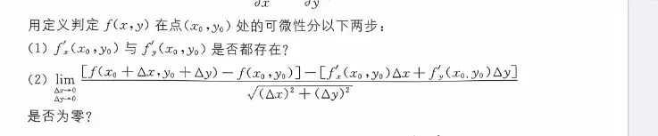
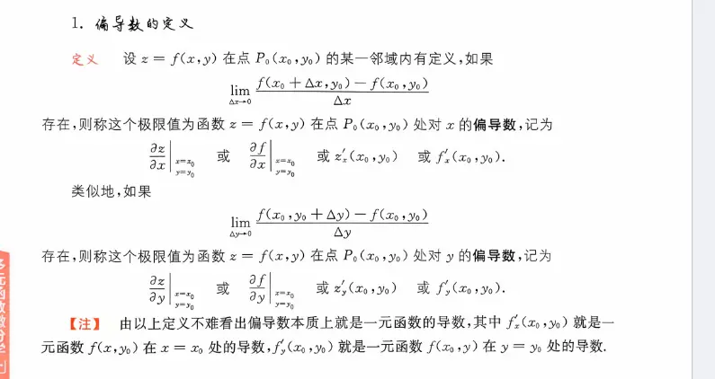

# 使用定义证明  

好，我们用一个最经典且计算代数过程非常透明的例子，来完整走一遍这个“两步走”的判定流程。

**题目：** 用定义证明函数 $f(x,y) = x^2 + y^2$ 在点 $(1, 2)$ 处是可微的。

### 第一步：找“切平面”的候选人（求该点的偏导数）  

我们需要先算出在点 $(1, 2)$ 处，函数沿 $x$ 方向和 $y$ 方向的偏导数（即定义公式里的常数 $A$ 和 $B$）。

1. **求对 $x$ 的偏导数：**
    
    $$f'_x(x,y) = 2x$$
    
    代入目标点 $(1, 2)$，得到：$A = f'_x(1,2) = 2 \times 1 = 2$。
    
2. **求对 $y$ 的偏导数：**
    
    $$f'_y(x,y) = 2y$$
    
    代入目标点 $(1, 2)$，得到：$B = f'_y(1,2) = 2 \times 2 = 4$。
    

**阶段结论：** 偏导数都存在。我们找到了切平面的候选斜率 $A=2$ 和 $B=4$。接下来带着这两个数进入第二步。

### 第二步：验证“误差”是否为高阶无穷小（算极限）

按照刚才图片里的公式，我们需要计算【真实增量】与【线性增量】之差，除以距离 $\rho$ 的极限是否为 0。

我们要验证的极限公式是：

$$\lim_{\Delta x \to 0, \Delta y \to 0} \frac{[f(x_0+\Delta x, y_0+\Delta y) - f(x_0, y_0)] - [A\Delta x + B\Delta y]}{\sqrt{(\Delta x)^2 + (\Delta y)^2}} = 0$$

为了思路清晰，我们先单独把**分子**（也就是纯误差部分）算出来：

**1. 算分子的左半边（真实总增量 $\Delta z$）：**

$$f(1+\Delta x, 2+\Delta y) - f(1, 2)$$

$$= [(1+\Delta x)^2 + (2+\Delta y)^2] - [1^2 + 2^2]$$

把括号展开：

$$= (1 + 2\Delta x + (\Delta x)^2 + 4 + 4\Delta y + (\Delta y)^2) - 5$$

合并同类项后得到：

$$= 2\Delta x + 4\Delta y + (\Delta x)^2 + (\Delta y)^2$$

**2. 算分子的右半边（切平面带来的线性增量）：**

代入刚才算出的 $A=2, B=4$：

$$A\Delta x + B\Delta y = 2\Delta x + 4\Delta y$$

**3. 两者相减得出最终的分子：**

$$\text{分子} = (2\Delta x + 4\Delta y + (\Delta x)^2 + (\Delta y)^2) - (2\Delta x + 4\Delta y)$$

$$\text{分子} = (\Delta x)^2 + (\Delta y)^2$$

_(你看，代表一次项的线性部分被完美抵消了，剩下来的纯纯就是无法被切平面覆盖的“误差”)_

**4. 代入原极限进行计算：**

现在把化简好的分子放回极限公式中：

$$\lim_{\Delta x \to 0, \Delta y \to 0} \frac{(\Delta x)^2 + (\Delta y)^2}{\sqrt{(\Delta x)^2 + (\Delta y)^2}}$$

这个极限非常好算，分子实际上就是分母的平方。上下约分一下，原式变为：

$$= \lim_{\Delta x \to 0, \Delta y \to 0} \sqrt{(\Delta x)^2 + (\Delta y)^2}$$

当 $\Delta x$ 和 $\Delta y$ 都趋近于 0 时，根号里面的值显然趋近于 0。

因此，该极限的值为 **0**。

### 最终结论

因为该极限等于 0，这说明我们找到的那个误差项 $(\Delta x)^2 + (\Delta y)^2$，确实是关于移动距离 $\rho$ 的**高阶无穷小**。

这一套流程完美符合了可微的严谨定义。

**证明完毕：函数 $f(x,y) = x^2 + y^2$ 在点 $(1, 2)$ 处是可微的。**  

# 使用一阶偏导连续来证明  

### 路径一：我们刚才用的“定义法”（硬算误差）

- **核心思想：** 不管你函数长什么样，我直接去算“真实增量”和“切平面增量”的差值（误差），然后用极限去验证这个误差是不是高阶无穷小。
    
- **特点：** 万能、绝对正确，但计算极其繁琐（遇到复杂的函数算极限会让人崩溃）。刚才那个题目 $f(x,y) = x^2 + y^2$ 因为是个简单的多项式，所以极限算起来很轻松。
    
- **地位：** 它是法律的“宪法”，是一切的基础。
    

### 路径二：如果你用“一阶偏导数连续定理”（走捷径）

“一阶偏导数连续 $\rightarrow$ 可微”在数学上被称为可微的**充分条件**。这是一条前辈们帮我们证明好的**捷径定理**。

如果我们用这个定理来证明刚才那道题，过程会简单到令人发指：

> **用定理证明 $f(x,y) = x^2 + y^2$ 在 $(1,2)$ 处可微：**
> 
> 1. 求偏导函数：$f'_x(x,y) = 2x$，$f'_y(x,y) = 2y$。
>     
> 2. 观察这两个偏导函数：$2x$ 和 $2y$ 都是初等多项式函数。
>     
> 3. 结论：显然，它们在整个二维平面上（当然也包括点 $(1,2)$ 的邻域内）都是**连续**的。
>     
> 4. 根据“一阶偏导数连续则函数必定可微”定理，该函数在 $(1,2)$ 处可微。证明完毕。
>     

你看，**完全不需要去算那一长串带有 $\Delta x$ 和 $\Delta y$ 的极限！**

### 总结：考试和做题时怎么选？

1. **优先用定理（走捷径）：** 在实际做题中，只要你发现求出来的偏导数 $f'_x$ 和 $f'_y$ 是正常的初等函数（没有分母为零，没有根号下小于零等奇奇怪怪的断点），你就可以直接说“因为偏导数连续，所以可微”。这是最常用的方法。
    
2. **被迫用定义法（硬扛）：** 什么时候必须用我们刚才那个“两步走”算极限的方法呢？
    
    - **题目强求：** 题目明确要求“请用**定义**证明……”。（就像你发给我的那张截图，第一句话就是“用定义判定……”）
        
    - **定理失效：** 当你求出来的偏导数在目标点（通常是原点 $(0,0)$ 分段处）**不连续**时。记住，定理只是“充分条件”，偏导数不连续不代表不可微（虽然很少见）。这时候捷径断了，你只能老老实实回到定义，去算那个误差极限。