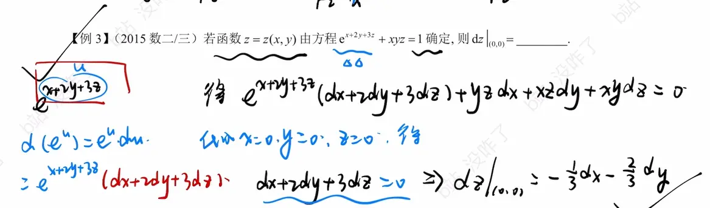

这道 2015 年的数二/数三真题非常经典。利用**一阶全微分形式的不变性**（即对方程两边同时作用微分算子 $d$，将 $x, y, z$ 的地位等同看待）来求解隐函数的全微分，往往比直接求偏导数再代入公式更高效且不易漏项。

以下是详细的求解步骤：

### 1. 确定 $(0,0)$ 点对应的 $z$ 值

首先，需要求出当 $x = 0, y = 0$ 时，$z$ 的值。

将 $x = 0, y = 0$ 代入原方程 $e^{x+2y+3z} + xyz = 1$ 中：

$$e^{0+0+3z} + 0 = 1$$

$$e^{3z} = 1$$

解得：

$$z = 0$$

因此，我们需要求的是在点 $(0,0,0)$ 处的全微分 $dz$。

### 2. 利用全微分形式的不变性对方程两边求微分

对方程 $e^{x+2y+3z} + xyz = 1$ 的两边同时求全微分 $d$：

$$d(e^{x+2y+3z} + xyz) = d(1)$$

根据微分的线性性质和乘积法则展开：

$$e^{x+2y+3z} \cdot d(x+2y+3z) + d(xyz) = 0$$

继续展开括号内的微分项：

$$e^{x+2y+3z} (dx + 2dy + 3dz) + (yz\,dx + xz\,dy + xy\,dz) = 0$$

_(注意：这里体现了全微分形式的不变性，不需要管谁是自变量谁是因变量，直接把 $x, y, z$ 都当成中间变量进行微分操作。)_

### 3. 代入坐标点并求解

将点 $(x,y,z) = (0,0,0)$ 代入上面的微分方程中。这样可以极大地简化计算，避免对复杂的代数式进行合并同类项。

代入后得到：

$$e^{0+0+0} (dx + 2dy + 3dz) + (0\cdot dx + 0\cdot dy + 0\cdot dz) = 0$$

$$1 \cdot (dx + 2dy + 3dz) + 0 = 0$$

$$dx + 2dy + 3dz = 0$$

最后，解出 $dz$：

$$3dz = -dx - 2dy$$

$$dz = -\frac{1}{3}dx - \frac{2}{3}dy$$

**最终答案：**

$$dz|_{(0,0)} = -\frac{1}{3}dx - \frac{2}{3}dy$$