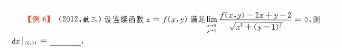

$$\Delta z = f(x_0+\Delta x, y_0+\Delta y) - f(x_0, y_0)$$
$$\lim_{\Delta x \to 0, \Delta y \to 0} \frac{f(x_0+\Delta x, y_0+\Delta y) - f(x_0, y_0) - [f'_x(x_0,y_0)\Delta x + f'_y(x_0,y_0)\Delta y]}{\sqrt{(\Delta x)^2 + (\Delta y)^2}} = 0$$

$$\mathrm{d}z = \frac{\partial z}{\partial x}\mathrm{d}x + \frac{\partial z}{\partial y}\mathrm{d}y$$

这道题没有给出具体的函数长什么样，而是直接甩给你一个极限等于 0 的式子。它的潜台词其实是：**“我已经帮你走完了可微定义的第二步（验证误差极限为 0），请你逆推回去，告诉我切平面的斜率是多少。”**

最终答案是：** $2\mathrm{d}x - \mathrm{d}y$ **。  

下面我们一步步来“扒掉它的伪装”：

### 第一步：写出标准的“可微定义”公式

已知目标点是 $(x_0, y_0) = (0, 1)$。

如果函数在该点可微，那么根据定义，必须满足：

$$\lim_{(x,y) \to (0,1)} \frac{\Delta z - (A\Delta x + B\Delta y)}{\sqrt{(\Delta x)^2 + (\Delta y)^2}} = 0$$

我们把该点的具体坐标代入，翻译一下这里面的符号：

- **横向偏移量：** $\Delta x = x - 0 = x$
    
- **纵向偏移量：** $\Delta y = y - 1$
    
- **真实总增量：** $\Delta z = f(x,y) - f(0,1)$
    
- **切面斜率：** $A = f'_x(0,1)$， $B = f'_y(0,1)$
    

把这些全塞进标准公式里，长这样：

$$\lim_{x \to 0, y \to 1} \frac{[f(x,y) - f(0,1)] - [A(x) + B(y-1)]}{\sqrt{x^2 + (y-1)^2}} = 0$$

合并一下分子的括号：

$$\lim_{x \to 0, y \to 1} \frac{f(x,y) - Ax - B(y-1) - f(0,1)}{\sqrt{x^2 + (y-1)^2}} = 0$$

### 第二步：与题目给出的式子“玩找茬”

把题目给的极限式子拿过来对比：

题目分子：$f(x,y) - 2x + y - 2$

标准分子：$f(x,y) - Ax - B(y-1) - f(0,1)$

为了能直接对比系数，我们需要把题目给的式子强行凑出 $(x)$ 和 $(y-1)$ 的结构：

题目分子 $= f(x,y) - 2x + (y - 1) - 1$

现在，我们让标准分子和凑好的题目分子一一对应：

$$f(x,y) - \underbrace{A}_{2}x - \underbrace{B}_{-1}(y-1) - \underbrace{f(0,1)}_{1}$$

- 对比 $x$ 的系数：$-A = -2 \implies \mathbf{A = 2}$ （这就是对 $x$ 的偏导数）
    
- 对比 $(y-1)$ 的系数：$-B = 1 \implies \mathbf{B = -1}$ （这就是对 $y$ 的偏导数）
    
- 对比常数项：$-f(0,1) = -1 \implies f(0,1) = 1$ （顺便求出了该点的函数值）
    

### 第三步：写出全微分

题目要求的是在该点处的全微分 $\left. \mathrm{d}z \right|_{(0,1)}$。

全微分的公式就是：

$$\mathrm{d}z = f'_x(0,1)\mathrm{d}x + f'_y(0,1)\mathrm{d}y$$

$$\mathrm{d}z = A\mathrm{d}x + B\mathrm{d}y$$

把我们刚才找出来的 $A=2$ 和 $B=-1$ 代入：

$$\mathbf{\left. \mathrm{d}z \right|_{(0,1)} = 2\mathrm{d}x - \mathrm{d}y}$$

**总结做这类题的套路（秒杀法）：**

以后遇到这种格式的极限等于 0，直接盯住分母确认目标点（本题是 $0$ 和 $1$），然后去分子里强行凑出 $(x-x_0)$ 和 $(y-y_0)$。凑完之后，它们前面的系数，就是你梦寐以求的偏导数！

