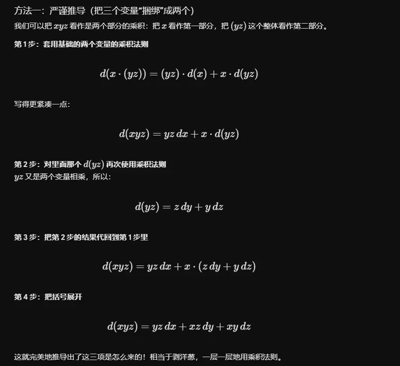
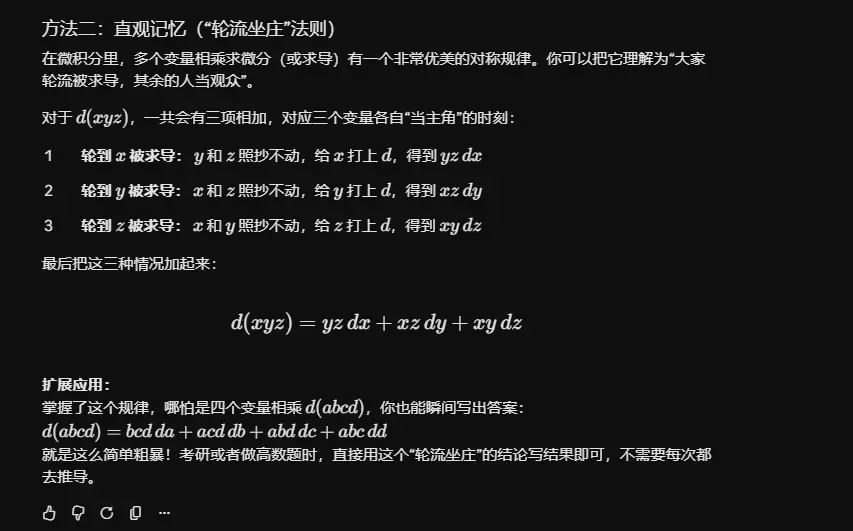

这段话讲的是微积分里一个极其优雅且实用的定理：**一阶全微分形式的不变性**（Invariance of First-Order Total Differentials）。

用大白话来翻译就是：**全微分的“公式长相（形式）”，不会因为里面的变量是“真正的主人（自变量）”还是“套皮的马甲（中间变量）”而发生任何改变。**

下面为您详细拆解它的含义和它的巨大威力。

### 1. 什么是“形式一样”？

我们先来看全微分的标准形式：

$$d(\text{目标}) = \frac{\partial (\text{目标})}{\partial (\text{变量1})} d(\text{变量1}) + \frac{\partial (\text{目标})}{\partial (\text{变量2})} d(\text{变量2})$$

定理告诉我们，这个公式结构是一个“万能模板”：

- **视角 A（直接看底层）：** 如果函数 $z$ 直接由最底层的自变量 $x$ 和 $y$ 决定。
    
    那么它的全微分长这样：
    
    $$dz = \frac{\partial z}{\partial x}dx + \frac{\partial z}{\partial y}dy$$
    
- **视角 B（看中间层）：** 如果函数 $z$ 是由中间变量 $u$ 和 $v$ 决定的（而 $u$ 和 $v$ 背后又受 $x$ 和 $y$ 控制）。
    
    按照直觉，你可能会觉得既然 $u$ 和 $v$ 不是真正的自变量，微分公式应该会变得极其复杂。但这个定理告诉你：**不需要管底层是谁，直接套模板！**
    
    它的全微分依然长这样：
    
    $$dz = \frac{\partial z}{\partial u}du + \frac{\partial z}{\partial v}dv$$
    

无论是用 $dx, dy$ 表达，还是用 $du, dv$ 表达，**结构完全一模一样**，这就是所谓的“形式不变”。

### 2. 为什么会这样？（简单推导）

这其实是**链式法则**施展的一个障眼法。我们把视角 A 拆开来看看：

1. 根据链式法则，偏导数可以展开：
    
    $$\frac{\partial z}{\partial x} = \frac{\partial z}{\partial u}\frac{\partial u}{\partial x} + \frac{\partial z}{\partial v}\frac{\partial v}{\partial x}$$
    
    $$\frac{\partial z}{\partial y} = \frac{\partial z}{\partial u}\frac{\partial u}{\partial y} + \frac{\partial z}{\partial v}\frac{\partial v}{\partial y}$$
    
2. 将它们代入视角 A 的公式 $dz = \frac{\partial z}{\partial x}dx + \frac{\partial z}{\partial y}dy$ 中：
    
    $$dz = \left( \frac{\partial z}{\partial u}\frac{\partial u}{\partial x} + \frac{\partial z}{\partial v}\frac{\partial v}{\partial x} \right) dx + \left( \frac{\partial z}{\partial u}\frac{\partial u}{\partial y} + \frac{\partial z}{\partial v}\frac{\partial v}{\partial y} \right) dy$$
    
3. **见证奇迹的时刻！** 我们把包含 $\frac{\partial z}{\partial u}$ 的项放在一起，包含 $\frac{\partial z}{\partial v}$ 的项放在一起，重新用括号打包：
    
    $$dz = \frac{\partial z}{\partial u} \left( \frac{\partial u}{\partial x}dx + \frac{\partial u}{\partial y}dy \right) + \frac{\partial z}{\partial v} \left( \frac{\partial v}{\partial x}dx + \frac{\partial v}{\partial y}dy \right)$$
    
4. 仔细观察括号里的东西，第一个括号正好就是 $du$ 的全微分公式，第二个括号正好是 $dv$ 的全微分公式！替换进去就变成了：
    
    $$dz = \frac{\partial z}{\partial u}du + \frac{\partial z}{\partial v}dv$$
    

你看，绕了一大圈，它又完美地变回了那个最简单的模样。

### 3. 这个性质有什么用？（解题利器）

这个性质在做微积分计算题时极其好用，它的核心作用是：**允许你“偷懒”，把复杂的一大坨东西直接当成一个整体来求微分。**

**举个例子：**

求 $z = \sin(x^2 + y^2)$ 的全微分。

- **没有不变性（老实人做法）：**
    
    先死磕求 $\frac{\partial z}{\partial x} = \cos(x^2+y^2) \cdot 2x$
    
    再求 $\frac{\partial z}{\partial y} = \cos(x^2+y^2) \cdot 2y$
    
    最后拼起来：$dz = 2x\cos(x^2+y^2)dx + 2y\cos(x^2+y^2)dy$
    
- **利用不变性（聪明做法）：**
    
    看到 $x^2 + y^2$ 这一坨，我懒得立刻拆，直接把它当成中间变量 $u$。
    
    那么 $z = \sin(u)$。
    
    根据全微分形式不变性，不管 $u$ 是啥，我直接写：$dz = \cos(u) du$。
    
    写完之后，我再单独算一下 $du$ 是什么：$du = d(x^2 + y^2) = 2xdx + 2ydy$。
    
    最后塞进去：$dz = \cos(x^2 + y^2)(2xdx + 2ydy)$。
    

在处理更复杂的多元复合函数（甚至是隐函数求导）时，利用全微分形式的不变性，直接在等式两边同时“打个 $d$”（求微分），可以省去大量套用链式法则展开偏导数的繁琐步骤。

这是一个非常好的问题！把 $d(xyz)$ 展开成三项，其实就是“乘积求导法则”的升级版。

我们熟悉的标准乘积法则是两个变量相乘：$d(uv) = v\,du + u\,dv$（口诀：前导后不导 + 前不导后导）。

当遇到三个变量 $x, y, z$ 相乘时，我们可以用两种方法来理解这个展开过程：一种是**严谨的数学推导**，另一种是**直观的记忆口诀**。

### 方法一：严谨推导（把三个变量“捆绑”成两个）

我们可以把 $xyz$ 看作是两个部分的乘积：把 $x$ 看作第一部分，把 $(yz)$ 这个整体看作第二部分。

**第 1 步：套用基础的两个变量的乘积法则**

$$d(x \cdot (yz)) = (yz) \cdot d(x) + x \cdot d(yz)$$

写得更紧凑一点：

$$d(xyz) = yz\,dx + x \cdot d(yz)$$

**第 2 步：对里面那个 $d(yz)$ 再次使用乘积法则**

$yz$ 又是两个变量相乘，所以：

$$d(yz) = z\,dy + y\,dz$$

**第 3 步：把第 2 步的结果代回到第 1 步里**

$$d(xyz) = yz\,dx + x \cdot (z\,dy + y\,dz)$$

**第 4 步：把括号展开**

$$d(xyz) = yz\,dx + xz\,dy + xy\,dz$$

这就完美地推导出了这三项是怎么来的！相当于剥洋葱，一层一层地用乘积法则。

### 方法二：直观记忆（“轮流坐庄”法则）

在微积分里，多个变量相乘求微分（或求导）有一个非常优美的对称规律。你可以把它理解为“大家轮流被求导，其余的人当观众”。

对于 $d(xyz)$，一共会有三项相加，对应三个变量各自“当主角”的时刻：

1. **轮到 $x$ 被求导：** $y$ 和 $z$ 照抄不动，给 $x$ 打上 $d$，得到 **$yz\,dx$**
    
2. **轮到 $y$ 被求导：** $x$ 和 $z$ 照抄不动，给 $y$ 打上 $d$，得到 **$xz\,dy$**
    
3. **轮到 $z$ 被求导：** $x$ 和 $y$ 照抄不动，给 $z$ 打上 $d$，得到 **$xy\,dz$**
    

最后把这三种情况加起来：

$$d(xyz) = yz\,dx + xz\,dy + xy\,dz$$

> **扩展应用：**
> 
> 掌握了这个规律，哪怕是四个变量相乘 $d(abcd)$，你也能瞬间写出答案：
> 
> $d(abcd) = bcd\,da + acd\,db + abd\,dc + abc\,dd$
> 
> 就是这么简单粗暴！考研或者做高数题时，直接用这个“轮流坐庄”的结论写结果即可，不需要每次都去推导。  

  

