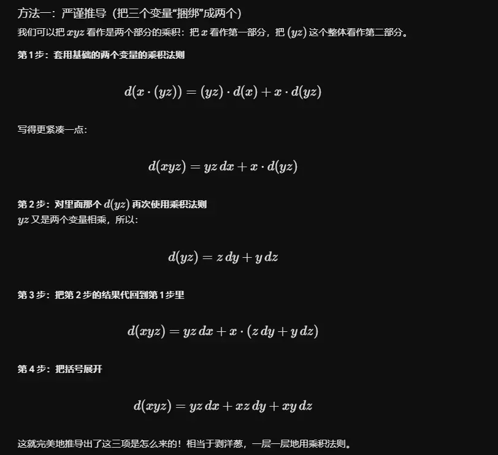
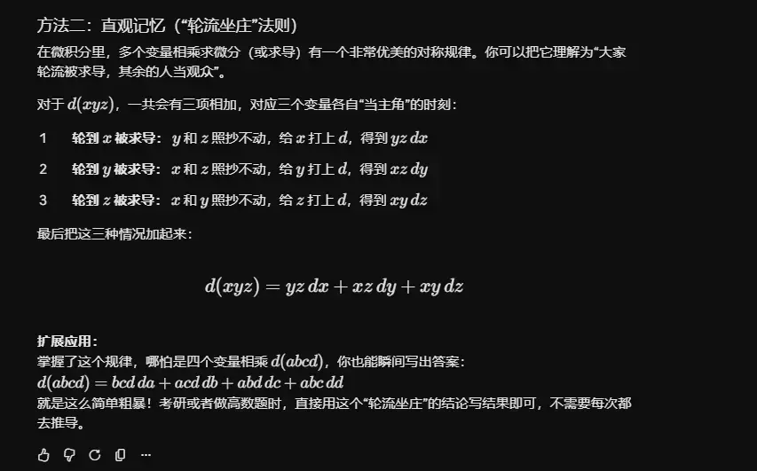

微分的**线性性质**（Linearity）和**乘积法则**（Product Rule）是微积分中最基础、也是最常用的两个运算规则。它们的作用是让我们能够像搭积木一样，把复杂的函数拆解成简单的基本函数来进行求导或求微分，而不需要每次都去使用繁琐的极限定义。

这里我们同时列出它们的“导数形式”和“微分形式”（两者在本质上是完全等价的）。

### 1. 微分的线性性质 (Linearity Property)

线性性质告诉我们两件事：**常数可以提取出来**，且**加减法可以拆开算**。

假设 $u(x)$ 和 $v(x)$ 是两个可微函数，$a$ 和 $b$ 是任意常数。

- **导数形式：**
    
    $$[a \cdot u(x) + b \cdot v(x)]' = a \cdot u'(x) + b \cdot v'(x)$$
    
- **微分形式：**
    
    $$d(a \cdot u + b \cdot v) = a \cdot du + b \cdot dv$$
    

**直白理解：**

如果你要求 $3x^2 + 5\sin(x)$ 的微分，你不需要把它们当成一个整体。你可以先不管常数 3 和 5，把加号拆开，分别去求 $x^2$ 和 $\sin(x)$ 的微分，最后再把常数乘回去并相加即可。

### 2. 微分的乘积法则 (Product Rule)

乘积法则（也叫莱布尼茨法则，Leibniz's Rule）专门用来处理**两个函数相乘**时的求导问题。

**注意：两个函数相乘的导数，绝对不等于它们各自导数的乘积！** 必须使用交叉相乘再相加的方式。

假设 $u(x)$ 和 $v(x)$ 是两个可微函数。

- **导数形式：**
    
    $$[u(x)v(x)]' = u'(x)v(x) + u(x)v'(x)$$
    
- **微分形式：**
    
    $$d(uv) = v \cdot du + u \cdot dv$$
    

**记忆口诀：**

“前导后不导，加上，前不导后导”。

也就是：第一个函数求导乘上第二个函数，加上，第一个函数乘上第二个函数的导数。

**举个例子：**

求 $y = x^2 \ln(x)$ 的导数。

这里 $u = x^2$，$v = \ln(x)$。

根据乘积法则：

$$y' = (x^2)' \cdot \ln(x) + x^2 \cdot (\ln(x))'$$

$$y' = 2x \cdot \ln(x) + x^2 \cdot \frac{1}{x}$$

$$y' = 2x\ln(x) + x$$

### 总结

这两个法则构成了高等数学中“符号演算”的基石。在面对由基本初等函数通过四则运算组合而成的复杂式子时，我们总是：

1. 先利用**线性性质**处理加减法和常数倍数。
    
2. 遇到函数相乘的地方，就套用**乘积法则**。
    
3. 如果遇到函数嵌套，再结合**链式法则**（复合函数求导）。

****