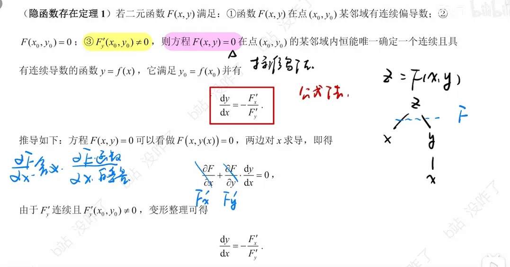
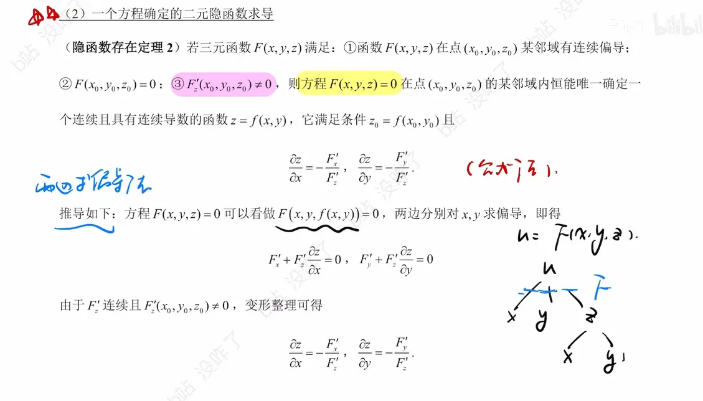

一元的
这是一个非常好的问题！只背公式容易忘，但如果你理解了它是怎么由**多元复合函数的链式求导法则**推导出来的，不仅能牢记，还能举一反三。

推导的核心思想是：**既然 $F(x, y, z) = 0$ 确定了一个隐函数 $z = z(x, y)$，那么我们把 $z(x, y)$ “塞回”到方程中，等式两边就构成了一个关于 $x$ 和 $y$ 的恒等式。**

下面是详细的推导步骤：

### 1. 设定前提

已知方程 $F(x, y, z) = 0$ 确定了隐函数 $z = z(x, y)$。

这意味着，如果我们把 $z$ 替换成它代表的函数，方程就变成了恒等式：

$$F(x, y, z(x, y)) \equiv 0$$

### 2. 对两边同时求 $x$ 的偏导

现在，我们将这个恒等式两边同时对 $x$ 求偏导数。

- 等式右边常数 $0$ 的导数还是 $0$。
    
- 等式左边是一个复合函数求导的过程。我们需要对 $F$ 的每一个“槽位”（即内部变量）使用链式法则。
    

对于外层函数 $F$，它有三个变量位置：第一个位置是 $x$，第二个位置是 $y$，第三个位置是 $z(x,y)$。根据全导数公式（多元链式法则）：

$$\frac{\partial F}{\partial x} \cdot \frac{\partial x}{\partial x} + \frac{\partial F}{\partial y} \cdot \frac{\partial y}{\partial x} + \frac{\partial F}{\partial z} \cdot \frac{\partial z}{\partial x} = 0$$

为了书写简便，我们把 $\frac{\partial F}{\partial x}$ 记作 $F_x$，$\frac{\partial F}{\partial y}$ 记作 $F_y$，$\frac{\partial F}{\partial z}$ 记作 $F_z$。代入上面的式子得到：

$$F_x \cdot \frac{\partial x}{\partial x} + F_y \cdot \frac{\partial y}{\partial x} + F_z \cdot \frac{\partial z}{\partial x} = 0$$

### 3. 分析每一项的值（最关键的一步）

我们要仔细看看上面式子中的三个内部导数：

1. ** $\frac{\partial x}{\partial x}$ 是什么？**
    
    $x$ 对自己求导，显而易见结果是 $1$。即 $\frac{\partial x}{\partial x} = 1$。
    
2. ** $\frac{\partial y}{\partial x}$ 是什么？**
    
    在多元函数 $z = z(x, y)$ 中，$x$ 和 $y$ 是**两个相互独立的自变量**。当我们在求对 $x$ 的偏导数时，根据偏导数的定义，我们会把 $y$ 视为常数。常数的导数是 $0$。因此，$\frac{\partial y}{\partial x} = 0$。
    
1. ** $\frac{\partial z}{\partial x}$ 是什么？**
    
    这正是我们想要解出来的未知目标！
    

### 4. 代入并求解

把刚才分析得到的结果（$1$ 和 $0$）代回到链式法则展开的等式中：

$$F_x \cdot 1 + F_y \cdot 0 + F_z \cdot \frac{\partial z}{\partial x} = 0$$

化简后只剩下两项：

$$F_x + F_z \cdot \frac{\partial z}{\partial x} = 0$$

现在，只需要像解一元一次方程一样，把目标 $\frac{\partial z}{\partial x}$ 孤立到等式一边。

将 $F_x$ 移到等号右边：

$$F_z \cdot \frac{\partial z}{\partial x} = -F_x$$

两边同时除以 $F_z$（前提是 $F_z \neq 0$）：

$$\frac{\partial z}{\partial x} = -\frac{F_x}{F_z}$$

**总结一下：**

这个公式前面的**负号**，其实是在解方程移项时产生的（把 $F_x$ 移到了等号右边）。而它的本质，就是死死抓住“等式两边同时对 $x$ 求导”以及“$x$ 和 $y$ 互不影响”这两个原则，利用链式法则硬生生把隐藏在里面的 $\frac{\partial z}{\partial x}$ 给“拽”出来的过程。

同理，如果你想求 $\frac{\partial z}{\partial y}$，只需要对恒等式两边同时求 $y$ 的偏导，利用 $\frac{\partial x}{\partial y} = 0$ 和 $\frac{\partial y}{\partial y} = 1$，你就能轻易推导出：

$$\frac{\partial z}{\partial y} = -\frac{F_y}{F_z}$$

