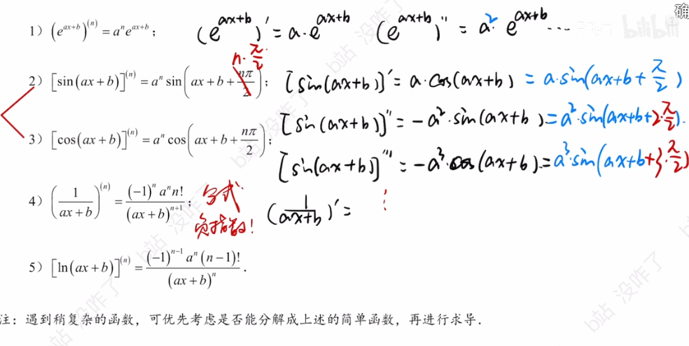

https://www.bilibili.com/video/BV1oVoNYZECx/?spm_id_from=333.337.search-card.all.click&vd_source=00e9babc4deca9e64ec25dd54e7bfe0c

# 归纳法  

遇到复杂的函数  可以优先考虑往这几个上靠 比如  
使用**分离常数法**（第一种方法）来求解 $y = \frac{x}{2x+3}$ 的 $n$ 阶导数，思路非常清晰。我们的核心目标是**把分子中的 $x$ 消掉**，将其变成常数与基本分式的组合。

以下是具体的推导步骤：

### 第一步：代数变形（分离常数）

为了在分子中凑出分母 $2x+3$ 的结构，我们需要先将分子的 $x$ 乘上 $2$，为了保持等式不变，外面再除以 $2$：

$$y = \frac{1}{2} \cdot \frac{2x}{2x+3}$$

接着，在分子里“无中生有”地加 $3$ 再减 $3$：

$$y = \frac{1}{2} \cdot \frac{(2x+3) - 3}{2x+3}$$

把分子拆开成两项：

$$y = \frac{1}{2} \left( \frac{2x+3}{2x+3} - \frac{3}{2x+3} \right)$$

$$y = \frac{1}{2} \left( 1 - \frac{3}{2x+3} \right)$$

将其展开，得到最终的变形结果：

$$y = \frac{1}{2} - \frac{3}{2(2x+3)}$$

### 第二步：套用基础公式求导

现在对等式两边同时求 $n$ 阶导数（前提是 $n \ge 1$）。

1. **第一项**：$\frac{1}{2}$ 是常数，求导一次就变成 $0$ 了，所以它的 $n$ 阶导数为 $0$。
    
2. **第二项**：提取出常数系数 $-\frac{3}{2}$，剩下部分 $\frac{1}{2x+3}$ 直接套用基础公式 $y^{(n)} = (-1)^n \frac{n! b^n}{(a+bx)^{n+1}}$ （此处 $a=3, b=2$）。
    

将它们组合起来：

$$y^{(n)} = 0 - \frac{3}{2} \cdot \left[ (-1)^n \frac{n! \cdot 2^n}{(2x+3)^{n+1}} \right]$$

### 第三步：化简结果

最后一步是整理系数。

把外面的负号合并到 $(-1)^n$ 中，变成 $(-1)^{n+1}$（或者写成 $(-1)^{n-1}$ 也可以，两者奇偶性相同）。

外面的分母 $2$ 与分子中的 $2^n$ 约分，变成 $2^{n-1}$：

$$y^{(n)} = (-1)^{n+1} \frac{3 \cdot n! \cdot 2^{n-1}}{(2x+3)^{n+1}}$$

---

