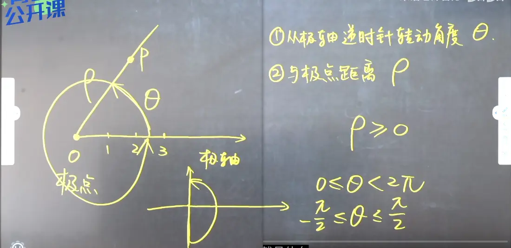
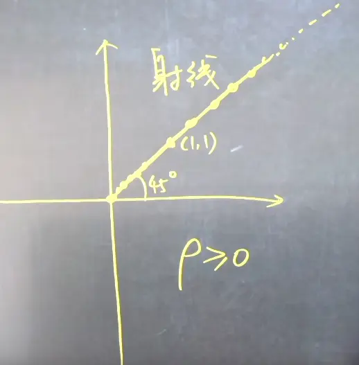
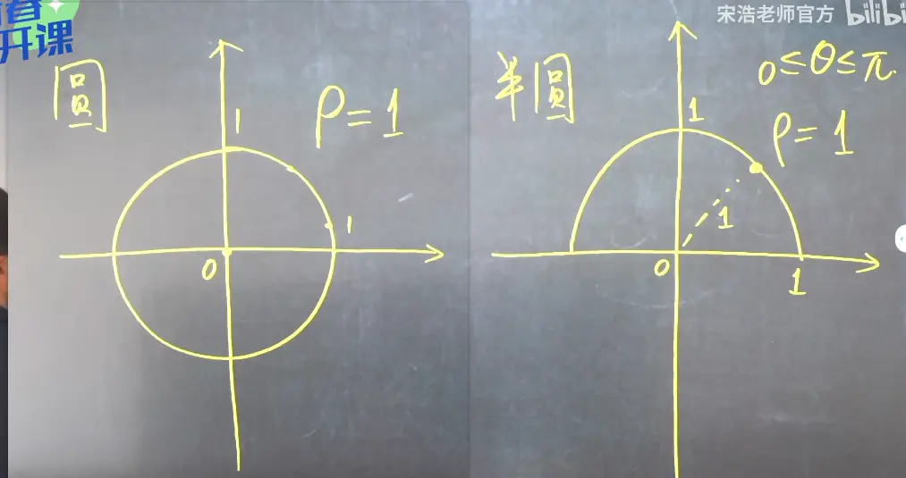
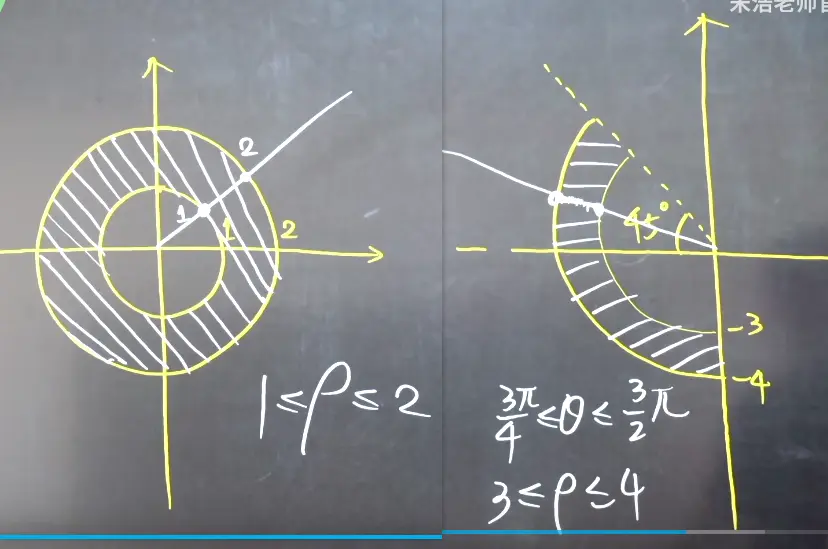
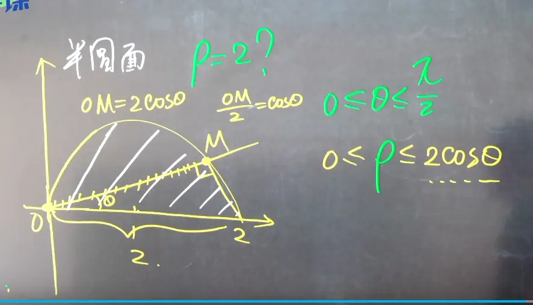
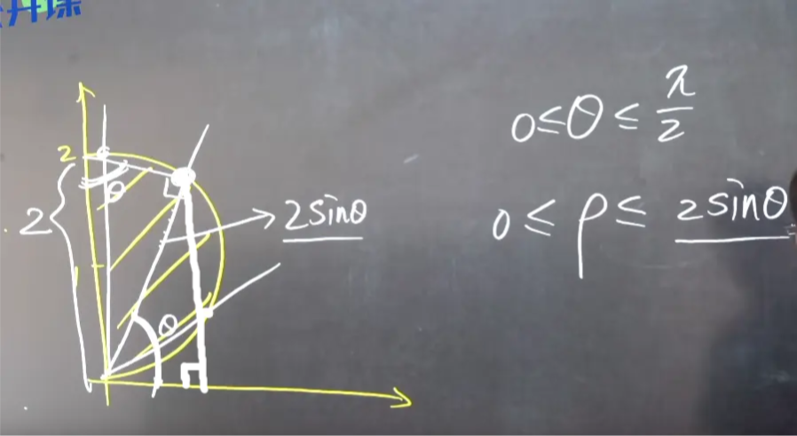
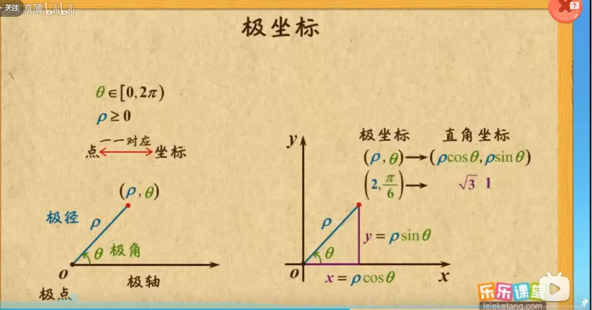
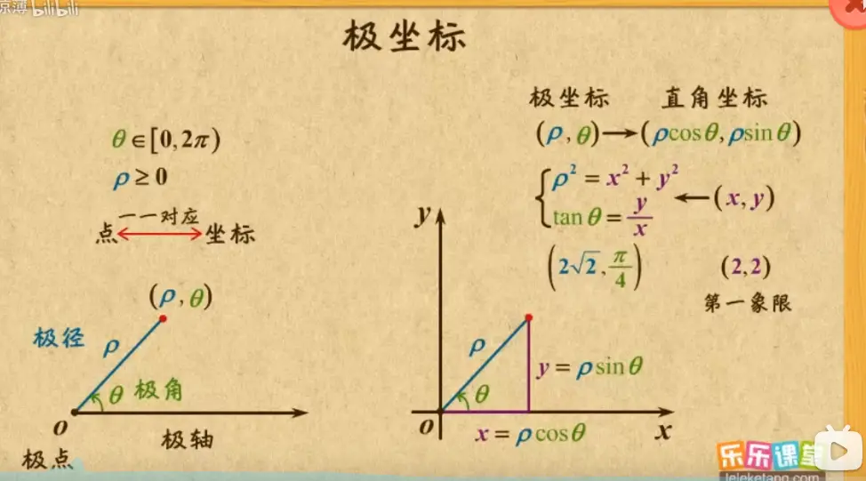

## 核心转换公式

根据极坐标与直角坐标的转换关系：

$$ x = r \cos\theta $$

$$ y = r \sin\theta $$

二重积分的转换公式为：

$$ \iint_D f(x,y) \,dx\,dy = \iint_{D'} f(r\cos\theta, r\sin\theta) \,r \,dr\,d\theta $$

## 推导方法

这是最直观的推导方式，通过观察极坐标下的微小面积块（极小矩形）来计算面积。

1. **划分区域：**
    
    在极坐标系下，我们通过同心圆（半径为 $r$）和射线（角度为 $\theta$）来划分区域。
    
    取一个极小的增量：半径增量为 $\Delta r$，角度增量为 $\Delta \theta$。
    
2. **计算微小面积块的边长：**
    
    这个微小面积块近似一个矩形（当 $\Delta r$ 和 $\Delta \theta$ 趋近于 0 时）：
    
    - **径向边长**：就是半径的增量，即 $\Delta r$。
        
    - **弧向边长**：根据圆弧长度公式（弧长 = 半径 $\times$ 圆心角），这条边的长度为 $r \Delta \theta$。
        
3. **计算面积微元 $dA$：**
    
    微小区域的面积 $\Delta A$ 近似等于长乘宽：
    
    $$ \Delta A \approx (r \Delta \theta) \cdot (\Delta r) = r \,\Delta r \,\Delta \theta $$
    
    当 $\Delta r \to 0$ 且 $\Delta \theta \to 0$ 时，取极限即得到精确的面积微元：
    
    $$ dA = r \,dr \,d\theta $$
    

因此，积分式中的 $dx\,dy$ 就被替换成了 $r \,dr \,d\theta$。

## 极坐标的表示坐标系  

  

从原点的射线 只要表示角度就行了,这里是 $\frac{pi}{4}$ row 可以是任意大  只要是在射线上的就行了
  

  

第一个圆盘 角度任意
  

  

  

# 极坐标和直角坐标系的转换  
  

