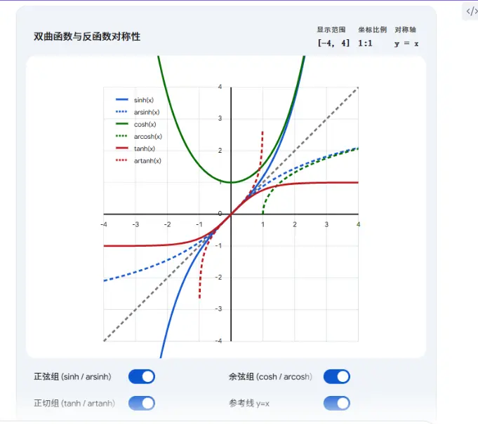

| **函数类型**  | **函数名称** | **符号**              | **定义式**                             | **奇偶性** | **导数**                   | **定义域**        |
| --------- | -------- | ------------------- | ----------------------------------- | ------- | ------------------------ | -------------- |
| **双曲函数**  | 双曲正弦     | $\sinh x$           | $\frac{e^x - e^{-x}}{2}$            | 奇函数     | $\cosh x$                | $\mathbb{R}$   |
|           | 双曲余弦     | $\cosh x$           | $\frac{e^x + e^{-x}}{2}$            | 偶函数     | $\sinh x$                | $\mathbb{R}$   |
|           | 双曲正切     | $\tanh x$           | $\frac{e^x - e^{-x}}{e^x + e^{-x}}$ | 奇函数     | $\text{sech}^2 x$        | $\mathbb{R}$   |
| **反双曲函数** | 反双曲正弦    | $\text{arsinh}\, x$ | $\ln(x + \sqrt{x^2+1})$             | 奇函数     | $\frac{1}{\sqrt{x^2+1}}$ | $\mathbb{R}$   |
|           | 反双曲余弦    | $\text{arcosh}\, x$ | $\ln(x + \sqrt{x^2-1})$             | 非奇非偶    | $\frac{1}{\sqrt{x^2-1}}$ | $[1, +\infty)$ |
|           | 反双曲正切    | $\text{artanh}\, x$ | $\frac{1}{2} \ln \frac{1+x}{1-x}$   | 奇函数     | $\frac{1}{1-x^2}$        | $(-1, 1)$      |

这里为你将图片中的双曲函数与反双曲函数的麦克劳林展开式（在 $x=0$ 处的泰勒展开）整理成表格，方便对比和记忆：

### 双曲函数与反双曲函数泰勒展开式汇总表

|**函数名称**|**符号**|**麦克劳林展开式（前几项）**|**级数展开通项 ∑n=0∞​**|**收敛域**|**记忆要点与对比**|
|---|---|---|---|---|---|
|**双曲正弦**| $\sinh x$ | $x + \frac{x^3}{3!} + \frac{x^5}{5!} + \frac{x^7}{7!} + \cdots$ | $\frac{x^{2n+1}}{(2n+1)!}$ | $(-\infty, +\infty)$ |奇函数。系数与 $\sin x$ 相同，但**项全为正号**。|
|**双曲余弦**| $\cosh x$ | $1 + \frac{x^2}{2!} + \frac{x^4}{4!} + \frac{x^6}{6!} + \cdots$ | $\frac{x^{2n}}{(2n)!}$ | $(-\infty, +\infty)$ |偶函数。系数与 $\cos x$ 相同，但**项全为正号**。|
|**双曲正切**| $\tanh x$ | $x - \frac{x^3}{3} + \frac{2x^5}{15} - \frac{17x^7}{315} + \cdots$ |_（无简单常用通项）_| $(-\frac{\pi}{2}, \frac{\pi}{2})$ |奇函数。正负交替，考研常考前两项的等价无穷小。|
|**反双曲正弦**| $\text{arsinh } x$ | $x - \frac{1}{6}x^3 + \frac{3}{40}x^5 - \frac{5}{112}x^7 + \cdots$ | $(-1)^n \frac{(2n)!}{4^n (n!)^2 (2n+1)} x^{2n+1}$ | $[-1, 1]$ |奇函数。**正负交替**（注意：普通反正弦 $\arcsin x$ 展开式全为正号）。|
|**反双曲余弦**| $\text{arcosh } x$ |**不存在麦克劳林展开式**|无|无|在 $x=0$ 处无定义（其定义域为 $[1, +\infty)$）。|
|**反双曲正切**| $\text{artanh } x$ | $x + \frac{x^3}{3} + \frac{x^5}{5} + \frac{x^7}{7} + \cdots$ | $\frac{x^{2n+1}}{2n+1}$ | $(-1, 1)$ |奇函数。**项全为正号**（注意：普通反正切 $\arctan x$ 是正负交替的）。|

为了更直观地观察这些函数的逼近过程，你可以使用下方的动态可视化工具。通过调节展开项数 $N$，可以看到泰勒多项式是如何一步步拟合原本的函数曲线的：

