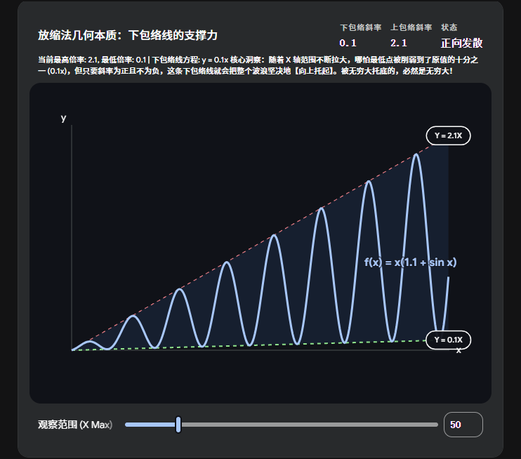
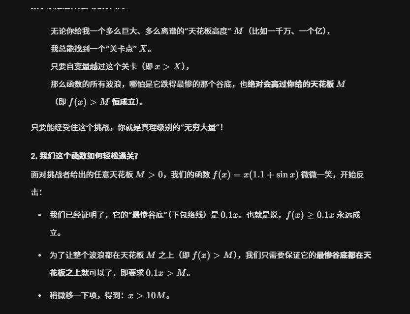

# 有界函数 × 无穷大 考研结论汇总表

表格

| **有界量 g(x) 的分类**                     | **g(x) 的极限特征**                                          | **f(x)⋅g(x) 的最终结果**                            | **核心逻辑与典型例子**                                                                                                                                                   |
| ------------------------------------ | ------------------------------------------------------- | ---------------------------------------------- | --------------------------------------------------------------------------------------------------------------------------------------------------------------- |
| **第一类：极限非零**                         | $\lim g(x) = A \neq 0$                                  | **必定是无穷大量 ($\infty$)**                         | 无穷大乘以一个稳定的非零数值，其体量依然是无穷大。      **例：** $x^2 \cdot \frac{2x+1}{x} \to \infty$                                                                         |
| **第二类：无穷小量**                         | $\lim g(x) = 0$                                         | $0 \cdot \infty$ 未定式      （一切皆有可能） | 两者发生“量级拔河”，结果可能是 $0$、非零常数、$\infty$ 或发散。      **例：** $x \cdot \frac{1}{x^2} \to 0$ （无穷小赢）      **例：** $x \cdot \frac{2}{x} \to 2$ （势均力敌） |
| 第三类：震荡无极限      （包含或跨越 0） | 震荡且取值范围包含 $0$      （如 $\sin x \in [-1, 1]$） | 必定发散，      且【绝不是】无穷大量              | 乘积会周期性地“砸回” $0$，无法满足无穷大“绝对值无限增大”的严格定义。      **例：** $x \cdot \sin x$ （极限不存在）                                                                         |
| 第四类：震荡无极限      （严格远离 0）  | 震荡但有严格非零下界      （如 $2+\sin x \in [1, 3]$）   | **必定是无穷大量 ($\infty$)**                         | 无论怎么震荡，它的倍率始终托底（例如始终 $\ge 1$ 倍），所以乘积必然也是无穷大。      **例：** $x \cdot (2+\sin x) \to \infty$                                                            |

如果是  x*(0.1+sinx)呢  

