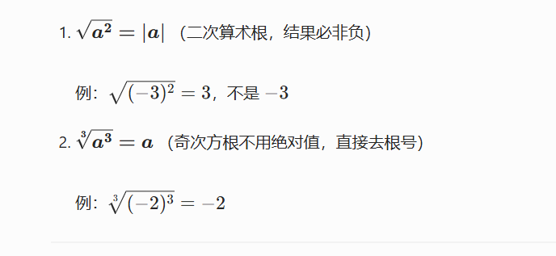
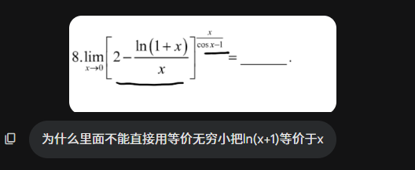
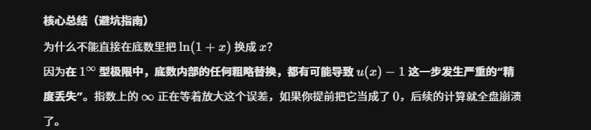

# 开根号
$x^2=a$   ->  $x=\pm \sqrt{ a }$

>   
> 求极限的时候 全是无穷加减  默认分母为 1  往分式上面靠   这样更好求
 对于偶次方根   分式形式的时候  现提出因子  在上下同除  
  对几次方根    上下可以同除  

# 等价无穷小的错误使用  
1 的无穷形式使用基本极限的方法做
  
  
在高等数学的极限计算中，底数部分包含无穷小时能否进行等价代换，**完全取决于指数是“常数”还是“变量”**。

这是一个极易踩坑的重灾区。以下是严格的分类判断和操作指南：

## 第一类：指数是“常数” —— 放心直接换

如果你的式子是 $(\text{无穷小})^C$ （其中 $C$ 是常数），这种情况本质上是乘法的延伸。

- **规则**：只要底数是一个独立的乘法因子，**可以直接对底数进行等价无穷小代换**。
    
- **原理**：比如 $(\sin x)^3$，本质上是 $\sin x \cdot \sin x \cdot \sin x$。既然乘法因子可以换，那么整体代换也是合法的。
    
- **示例**：
    
    $$ \lim_{x \to 0} \frac{(\arcsin x)^2}{x^2} = \lim_{x \to 0} \frac{(x)^2}{x^2} = 1 $$
    

## 第二类：指数是“变量” —— 绝对不能直接换！

当你的式子是 $u(x)^{v(x)}$ （即幂指函数），且指数 $v(x)$ 也是包含自变量的函数时，**严禁直接对底数 $u(x)$ 内部的无穷小进行等价代换**。

- **致命原因**：等价无穷小 $\alpha \sim \beta$ 只能保证 $\frac{\alpha}{\beta} \to 1$，**不能保证** $\alpha - \beta \to 0$。如果把带着微小误差的底数直接代换，经过变量指数的放大，极容易产生完全错误的极限。
    
- **唯一安全路径（$e$ 抬升法）**：
    
    遇到 $u(x)^{v(x)}$，不要犹豫，第一步强制变形为：
    
    $$ u(x)^{v(x)} = e^{v(x) \ln u(x)} $$
    
    把原问题转化为求指数部分 $v(x) \ln u(x)$ 的极限。到了指数上变成了乘法，你才可以重新开始考虑代换。
    

## 第三类：考场最高频 —— $1^\infty$ 型极限的“合法快捷操作”

在 $1^\infty$ 型极限 $\lim (1 + \alpha(x))^{v(x)}$ 中，底数里的 $\alpha(x)$ 是无穷小。很多人误以为在这里可以“直接换底数里的无穷小”，但实际上这是一种错觉。

- **表面操作**：比如 $\lim_{x \to 0} (1 + \sin x)^{\frac{1}{x}}$，很多人把它看成 $(1+x)^{\frac{1}{x}}$ 然后得出等于 $e$。虽然结果对了，但**逻辑是错的**（不是在底数里换的）。
    
- **真正的底层逻辑（公式法）**：
    
    对于 $\lim (1 + \alpha(x))^{v(x)}$，标准结论是它等于：
    
    $$ e^{\lim \alpha(x) \cdot v(x)} $$
    
    **关键点来了**：在这个转化公式中，原本在底数里的 $\alpha(x)$ 被“摘”了出来，放到了指数上与 $v(x)$ 相乘。**因为此时 $\alpha(x)$ 变成了乘法因子，所以你才可以对它进行等价无穷小代换！**
    
- **正确操作示范**：
    
    求 $\lim_{x \to 0} (1 + 1 - \cos x)^{\frac{1}{x^2}}$
    
    1. 识别为 $1^\infty$ 型，套用转化公式，极限转化为求 $e^{\lim (1 - \cos x) \cdot \frac{1}{x^2}}$。
        
    2. 在指数部分，$(1 - \cos x)$ 是**乘法因子**，直接替换为 $\frac{1}{2}x^2$。
        
    3. 指数极限为 $\lim \frac{1}{2}x^2 \cdot \frac{1}{x^2} = \frac{1}{2}$。
        
    4. 最终结果为 $e^{\frac{1}{2}}$。
        

> **总结口诀：**
> 
> **指数常数底随便换，指数变量底千万别碰。**
> 
> 遇到变量指数直接 $e^{\ln(\dots)}$ 抬上去，遇到 $1^\infty$ 记住 $e^{\alpha \cdot v}$ 在乘法里换。

# 定积分的运算  
定积分可以进行有理式运算和分开来算  
加上负号  交换上下限  

# 导数极限形式也要分左极限和右极限  

# 左加右减  

