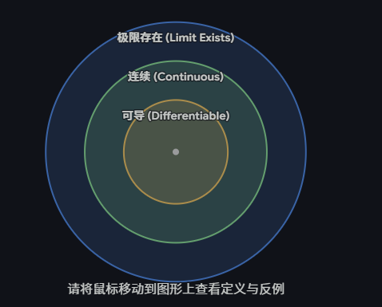

### 一、 极限 $\lim_{x \to x_0} f(x)$ 不存在的情况

| **情况分类**    | **几何表现 / 特征**                           | **数学表现形式**                                                                           | **典型反例 (在 x=0 处)**                                                            |
| ----------- | --------------------------------------- | ------------------------------------------------------------------------------------ | ----------------------------------------------------------------------------- |
| **左右极限不相等** | 函数图像在 $x_0$ 处发生“断崖式”跳跃（跳跃间断点）。          | $\lim_{x \to x_0^-} f(x) \neq \lim_{x \to x_0^+} f(x)$      （左右极限均存在但不等） | $f(x) = \frac{\vert x \vert}{x}$      左极限为 $-1$，右极限为 $1$。         |
| **极限趋于无穷大** | 函数图像在 $x_0$ 处有一条垂直渐近线（无穷间断点）。           | $\lim_{x \to x_0} f(x) = \infty$      （作为实数，极限不存在）                       | $f(x) = \frac{1}{x}$      当 $x \to 0$ 时，函数值趋于 $\infty$。           |
| **函数值剧烈震荡** | 函数在 $x_0$ 附近在两个常数之间无限次震荡，无法稳定逼近（震荡间断点）。 | $\lim_{x \to x_0} f(x)$ 的值不唯一或无法确定。                                                  | $f(x) = \sin(\frac{1}{x})$      当 $x \to 0$ 时，值在 $[-1, 1]$ 间无限震荡。 |

---

### 二、 导数 $f'(x_0)$ 不存在的情况

|**情况分类**|**几何表现 / 特征**|**数学表现形式**|**典型反例 (在 x=0 处)**|
|---|---|---|---|
|**函数在该点不连续**|图像在该点断开（包含跳跃、无穷、可去或震荡间断点）。|$\lim_{x \to x_0} f(x) \neq f(x_0)$ 或极限不存在。      **（不连续必不可导）**|$f(x) = \begin{cases} 1, & x \geq 0 \\ 0, & x < 0 \end{cases}$      在 $x=0$ 处断开，无切线。|
|**连续，但左右导数不等**|图像连续，但在该点出现**尖点**或**折点**，不够平滑。|$f'_-(x_0) \neq f'_+(x_0)$      （左右导数均存在但不等）|$f(x) = \vert x \vert$      左导数为 $-1$，右导数为 $1$，无唯一切线。|
|**导数趋于无穷大**|图像在该点连续且平滑，但**切线垂直于 x 轴**（斜率为无穷大）。|$\lim_{\Delta x \to 0} \frac{f(x_0+\Delta x)-f(x_0)}{\Delta x} = \infty$|$f(x) = x^{\frac{1}{3}}$      在 $x=0$ 处有一条垂直切线 $x=0$。|
