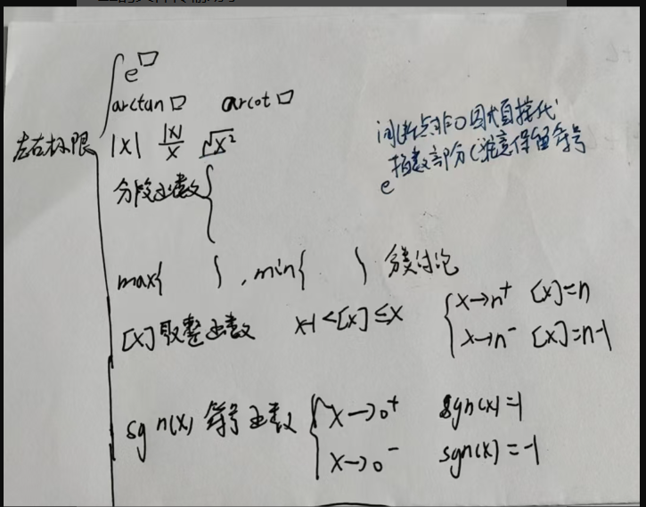
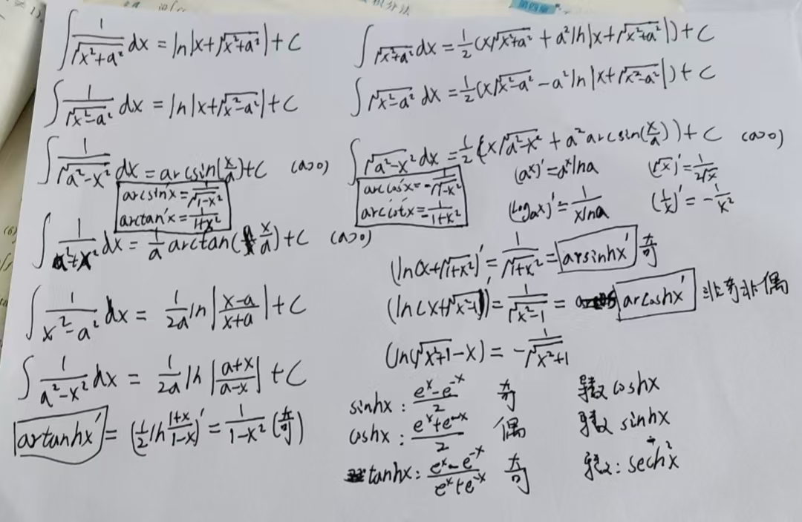
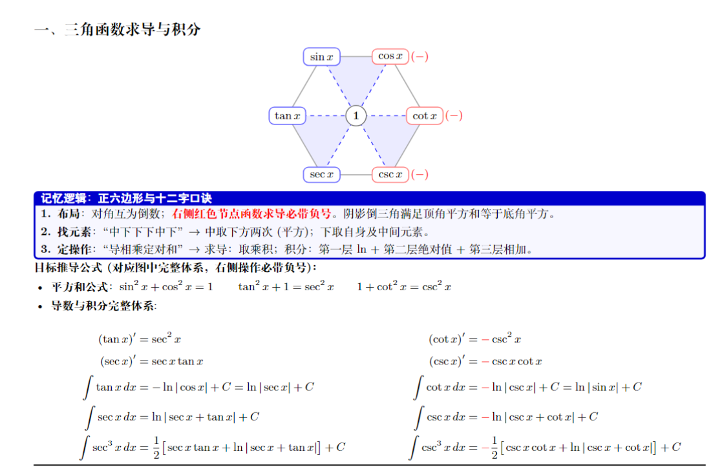
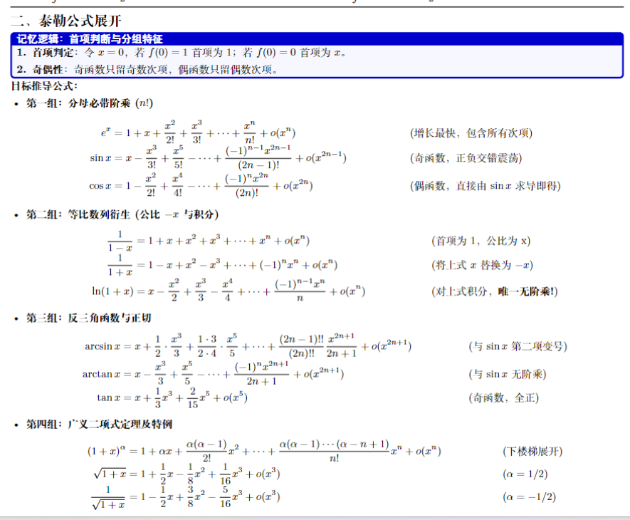
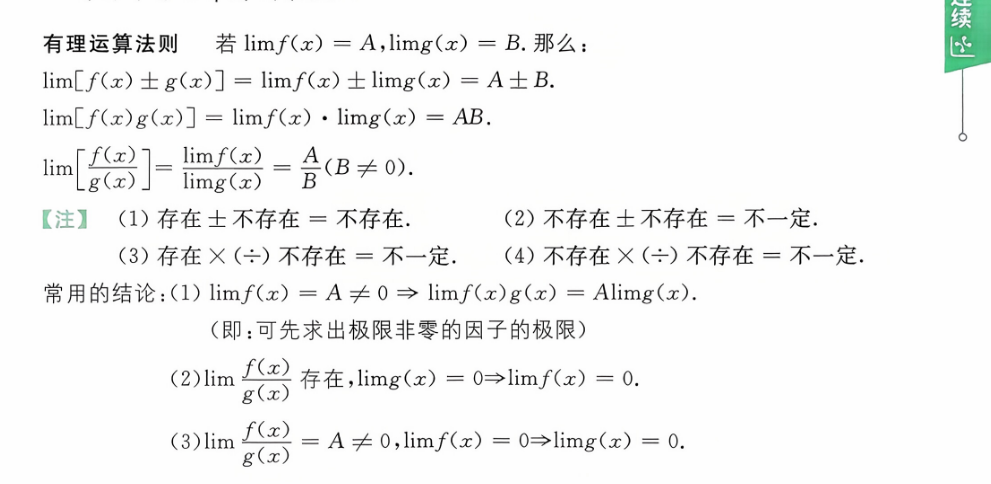
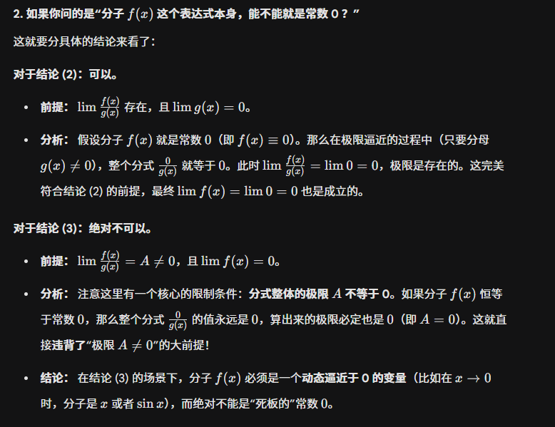

# 中断点
  

# 补充不定积分  

  
[三角双曲函数](三角双曲函数.md)  

# 三角函数

# 泰勒展开总结  

使用注意事项  

# 洛必达法则  
这张图完美总结了计算极限时，如何将各种未定式（Indeterminate Forms）转化为最基础的 $\frac{0}{0}$ 或 $\frac{\infty}{\infty}$ 型的过程。在考研数学二的复习中，这是应用洛必达法则（L'Hôpital's Rule）和泰勒公式（Taylor's Formula）的核心前提。

我们可以顺着图中的箭头，把这个推导过程分为三大类来梳理：

### 1. 幂指型未定式转化：$1^\infty, \infty^0, 0^0 \implies 0 \cdot \infty$

这三种形式都属于函数 $f(x)^{g(x)}$ 的极限。处理它们的标准动作是**利用指数对数恒等式进行转化**（即“取指对数法”）。

根据恒等式 $A = e^{\ln A}$，我们可以将原极限改写为：

$$ \lim f(x)^{g(x)} = \lim e^{\ln(f(x)^{g(x)})} = \lim e^{g(x) \ln f(x)} $$

因为指数函数 $e^x$ 是连续函数，我们可以将极限符号移到指数上：

$$ e^{\lim [g(x) \ln f(x)]} $$

此时，只需要关注指数部分 $\lim [g(x) \ln f(x)]$ 的极限：

- **对于 $1^\infty$ 型：** $g(x) \to \infty$，$f(x) \to 1 \implies \ln f(x) \to 0$。指数部分变成了 $\infty \cdot 0$。
    
- **对于 $\infty^0$ 型：** $g(x) \to 0$，$f(x) \to \infty \implies \ln f(x) \to \infty$。指数部分变成了 $0 \cdot \infty$。
    
- **对于 $0^0$ 型：** $g(x) \to 0$，$f(x) \to 0 \implies \ln f(x) \to -\infty$。指数部分同样变成了 $0 \cdot \infty$。
    

这样，所有复杂的幂指型都被统一降维成了 $0 \cdot \infty$ 的乘积型。

### 2. 乘积型未定式转化：$0 \cdot \infty \implies \frac{0}{0}$ 或 $\frac{\infty}{\infty}$

当你面对 $u(x) \cdot v(x)$，且其中一个趋于 $0$，另一个趋于 $\infty$ 时，核心策略是“下放因子”（把其中一个乘式放到分母的分母去）。

代数原理非常简单，就是 $a \cdot b = \frac{a}{1/b} = \frac{b}{1/a}$。

- **转化为 $\frac{0}{0}$ 型：** 保留趋于 $0$ 的项在分子，把趋于 $\infty$ 的项下放到分母：
    
    $$ \lim (u \cdot v) = \lim \frac{u}{1/v} \quad \text{（此时分子分母都趋于 0）} $$
    
- **转化为 $\frac{\infty}{\infty}$ 型：** 保留趋于 $\infty$ 的项在分子，把趋于 $0$ 的项下放到分母：
    
    $$ \lim (u \cdot v) = \lim \frac{v}{1/u} \quad \text{（此时分子分母都趋于 }\infty\text{）} $$
    

**实战技巧：** 下放哪一个？原则是“谁求导简单就留下谁，谁求导复杂（或倒数好求导）就下放谁”。通常对数函数 $\ln x$ 极难下放（变成 $\frac{1}{\ln x}$ 后求导极繁琐），所以一般把它留在分子上；而多项式 $x^n$ 或指数函数下放后求导依然相对规整。

### 3. 差值型未定式转化：$\infty - \infty \implies \frac{0}{0}$ 或 $\frac{\infty}{\infty}$

这种形式通常出现在两个分式相减，或者带有根号的表达式相减中。转化策略取决于表达式的具体形态： 往分式上面靠

- **如果是分式相减（通分法）：** 这是最常见的，直接通分即可转化为分数形式。
    
    例如 $\lim_{x \to 0} \left( \frac{1}{x} - \frac{1}{\sin x} \right)$
    
    通分后得到：$\lim_{x \to 0} \frac{\sin x - x}{x \sin x}$，这就直接变成了标准的 $\frac{0}{0}$ 型，后续可以用泰勒展开或洛必达法则秒杀。
    
- **如果是根式相减（有理化法）：** 通过乘以共轭表达式（分子有理化）来破局。
    
    例如 $\lim_{x \to \infty} (\sqrt{x^2+x} - x)$，分子分母同乘 $(\sqrt{x^2+x} + x)$，即可转化为 $\frac{\infty}{\infty}$ 型。
    
- **提公因式法：** 提出增长最快的项，利用等价无穷小或泰勒公式处理剩下的部分。
> 对于偶次方根 分式情况下 先提出来在消  
> 对于几次方根  分式情况下 可以直接上下同除(除大的)
---

# 有理运算法则  

  
对于 $f(x)$ 等于 0 的探讨
  
